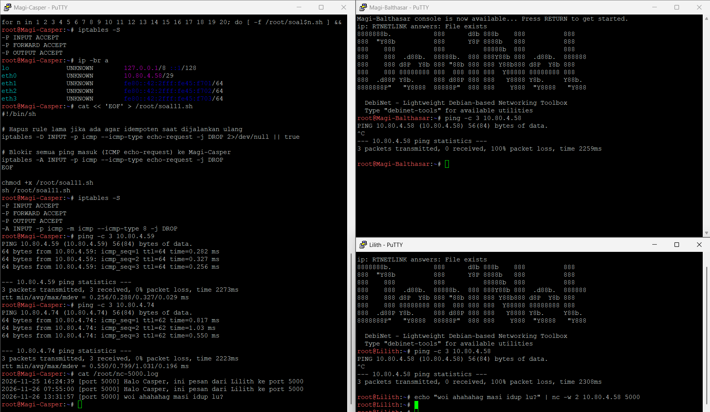
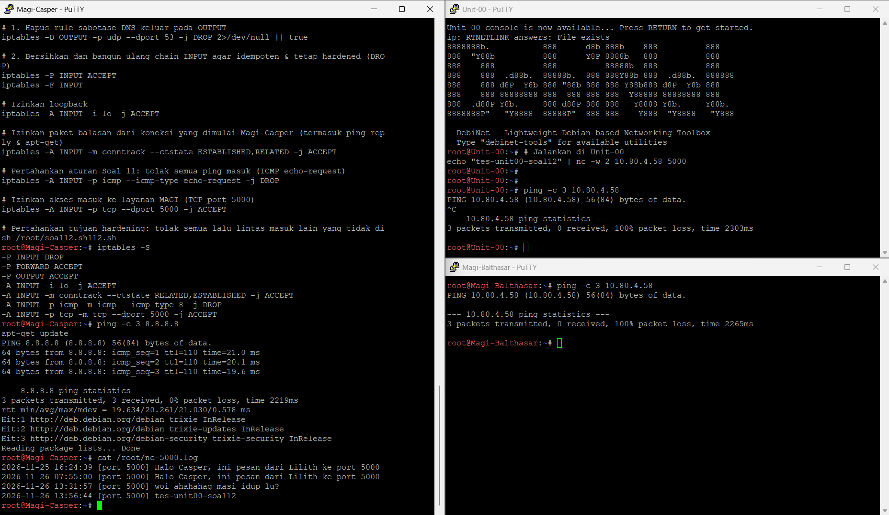
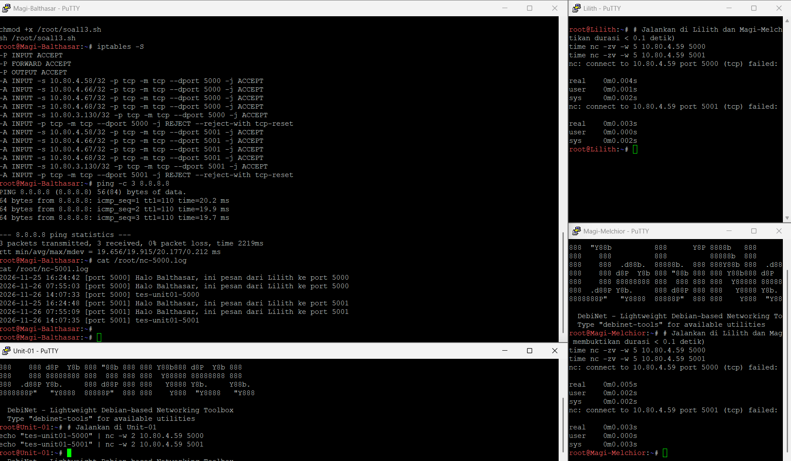
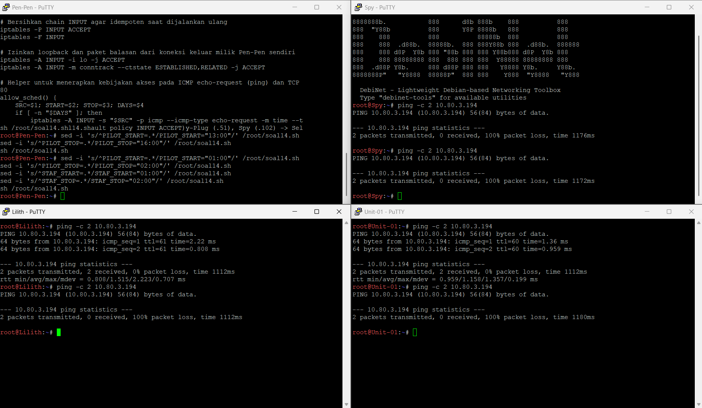
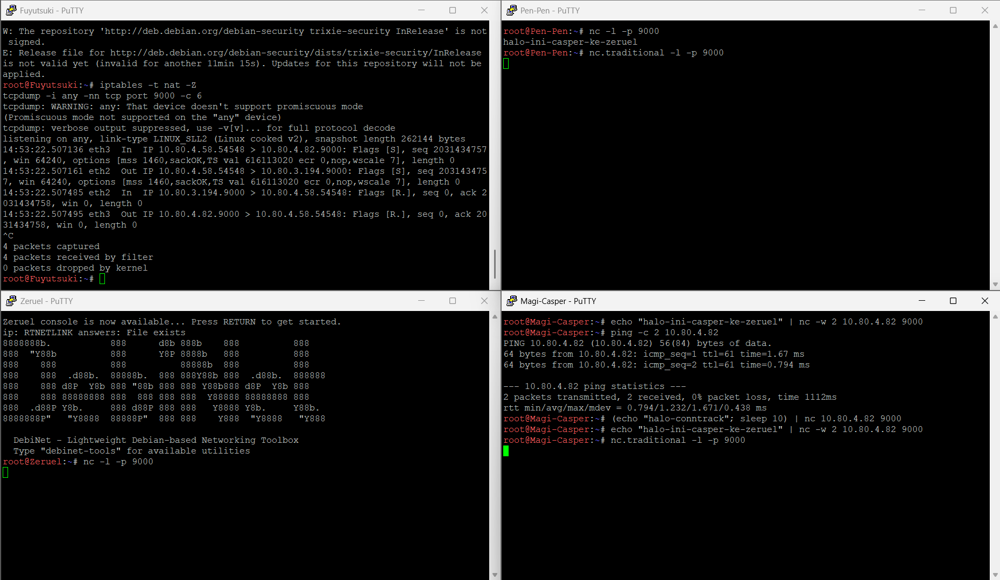
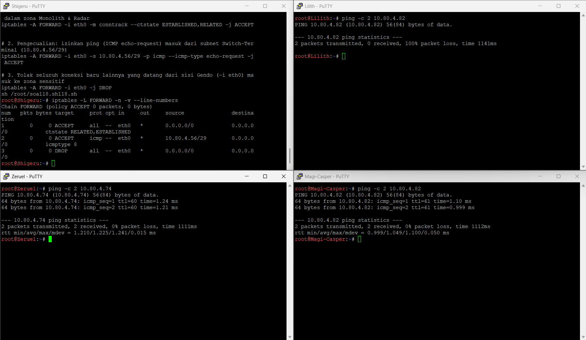
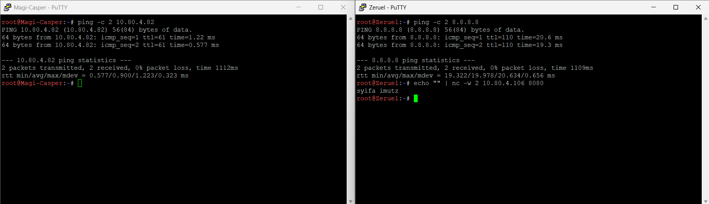

# JARKOM MODUL 5 | K-33 (Hardening)

## Anggota

| Nama | NRP |
| :--- | :--- |
| Jonathan Steven Tjahjaputra | 5027251036 |
| Helen Audya Yuniarini | 5027251069 |
---

## Soal 11

### A. Penjelasan

Mengonfigurasi aturan firewall berbasis `iptables` pada container **Magi-Casper**
(`10.80.4.58/29`) agar tidak dapat di-ping oleh perangkat lain dari segmen mana pun.
Hal ini mencakup perangkat dalam switch yang sama, seperti **Magi-Balthasar**
(`10.80.4.59`) dan **Magi-Melchior** (`10.80.4.60`), serta host lintas subnet,
seperti **Lilith** (`10.80.4.74`).

Magi-Casper tetap dapat:

- Mengirim `ping` keluar ke node lain.
- Menerima balasan dari `ping` yang dikirimnya.
- Menjalankan listener `nc` pada port TCP `5000`.

### B. Konfigurasi

Simpan konfigurasi berikut sebagai `/root/soal11.sh` pada node `Magi-Casper`:

```sh
# Konfigurasi node Magi-Casper (/root/soal11.sh)
cat << 'EOF' > /root/soal11.sh
#!/bin/sh

# Hapus rule lama jika ada agar idempoten saat dijalankan ulang
iptables -D INPUT -p icmp --icmp-type echo-request -j DROP 2>/dev/null || true

# Blokir semua ping masuk (ICMP echo-request) ke Magi-Casper
iptables -A INPUT -p icmp --icmp-type echo-request -j DROP
EOF

chmod +x /root/soal11.sh
sh /root/soal11.sh
```

Skrip `/root/soal11.sh` dijalankan saat kontainer diinisialisasi. Pada rantai
`INPUT`, aturan tersebut membuang (`DROP`) seluruh paket ICMP bertipe
`echo-request` (type `8`).

Karena penyaringan hanya berlaku pada `echo-request` masuk dan tidak memblokir
`echo-reply` (type `0`) maupun rantai `OUTPUT`, Magi-Casper tetap dapat melakukan
`ping` keluar serta menerima balasannya. Lalu lintas TCP pada port `5000` juga
tidak terdampak.

### C. Pengujian

#### 1. Verifikasi aturan iptables pada Magi-Casper

```sh
iptables -S
```

**Output yang diharapkan:**

```text
-P INPUT ACCEPT
-P FORWARD ACCEPT
-P OUTPUT ACCEPT
-A INPUT -p icmp -m icmp --icmp-type 8 -j DROP
```

Output tersebut membuktikan bahwa pemblokiran `ICMP Echo Request` telah terpasang
pada chain `INPUT`.

#### 2. Uji penolakan ping ke Magi-Casper

Jalankan perintah berikut dari **Magi-Balthasar** atau **Lilith**:

```sh
ping -c 3 10.80.4.58
```

**Output yang diharapkan:**

```text
--- 10.80.4.58 ping statistics ---
3 packets transmitted, 0 received, 100% packet loss
```

Permintaan `ping` menuju Magi-Casper gagal baik dari perangkat satu switch maupun
dari subnet lain.

#### 3. Uji ping keluar dari Magi-Casper

Jalankan dari Magi-Casper:

```sh
ping -c 3 10.80.4.59
ping -c 3 10.80.4.74
```

**Output yang diharapkan:**

```text
3 packets transmitted, 3 received, 0% packet loss
```

Hasil ini membuktikan bahwa Magi-Casper tetap dapat mengirim `ICMP Echo Request`
dan menerima `ICMP Echo Reply` dari perangkat satu switch maupun lintas subnet.

#### 4. Verifikasi layanan TCP port `5000`

Jalankan pengujian berikut dari Lilith:

```sh
echo "woi ahahahag masih idup lu?" | nc -w 2 10.80.4.58 5000
```

Kemudian cek log pada Magi-Casper:

```sh
cat /root/nc-5000.log
```

**Output yang diharapkan:**

Menampilkan baris baru berisi pesan yang dikirim dari Lilith pada
`/root/nc-5000.log`.

Dengan demikian, layanan listener TCP port `5000` tetap aktif meskipun akses
`ping` masuk telah ditutup.

### Hasil Pengujian



## Soal 12

### A. Penjelasan

Memulihkan konfigurasi firewall pada node **Magi-Casper** (`10.80.4.58/29`)
setelah eksekusi skrip sabotase `break_fw.sh`, tanpa membatalkan kebijakan
hardening yang sudah ditetapkan.

Hasil pemeriksaan rule `iptables` pasca-sabotase menunjukkan empat gangguan:

1. Policy `INPUT DROP` aktif, tetapi tidak mengizinkan paket balasan
   `ESTABLISHED,RELATED`.
2. Seluruh protokol ICMP diblokir pada chain `INPUT`, termasuk `echo-reply`.
3. DNS UDP port `53` diblokir pada chain `OUTPUT`.
4. Tidak ada aturan `ACCEPT` untuk layanan TCP port `5000`.

Pemulihan harus memastikan aturan Soal 11 tetap aktif: Magi-Casper tidak dapat
di-ping dari luar, tetapi tetap dapat menggunakan koneksi keluar dan melayani
port `5000`.

### B. Konfigurasi

Simpan konfigurasi berikut sebagai `/root/soal12.sh` pada node `Magi-Casper`:

```sh
# Konfigurasi pemulihan node Magi-Casper (/root/soal12.sh)
cat << 'EOF' > /root/soal12.sh
#!/bin/sh

# 1. Hapus rule sabotase DNS keluar pada OUTPUT
iptables -D OUTPUT -p udp --dport 53 -j DROP 2>/dev/null || true

# 2. Bersihkan dan bangun ulang chain INPUT secara idempoten
iptables -P INPUT ACCEPT
iptables -F INPUT

# Izinkan loopback
iptables -A INPUT -i lo -j ACCEPT

# Izinkan paket balasan dari koneksi yang dimulai Magi-Casper
iptables -A INPUT -m conntrack --ctstate ESTABLISHED,RELATED -j ACCEPT

# Pertahankan aturan Soal 11: tolak semua ping masuk (ICMP echo-request)
iptables -A INPUT -p icmp --icmp-type echo-request -j DROP

# Izinkan akses masuk ke layanan MAGI (TCP port 5000)
iptables -A INPUT -p tcp --dport 5000 -j ACCEPT

# Pertahankan hardening: tolak lalu lintas masuk lain
iptables -P INPUT DROP
EOF

chmod +x /root/soal12.sh
sh /root/soal12.sh
```

Skrip tersebut menghapus pemblokiran DNS pada rantai `OUTPUT`, lalu membangun
ulang rantai `INPUT` dengan policy default `DROP`.

Rantai `INPUT` diberikan izin untuk:

- Antarmuka loopback (`lo`).
- Paket balasan berstatus `ESTABLISHED,RELATED`.
- Koneksi masuk ke layanan MAGI pada port TCP `5000`.
- Penolakan `ICMP Echo Request` dari luar.

### C. Pengujian

#### 1. Verifikasi kebijakan hardening dan aturan iptables

Jalankan pada Magi-Casper:

```sh
iptables -S
```

**Output yang diharapkan:**

```text
-P INPUT DROP
-P FORWARD ACCEPT
-P OUTPUT ACCEPT
-A INPUT -i lo -j ACCEPT
-A INPUT -m conntrack --ctstate ESTABLISHED,RELATED -j ACCEPT
-A INPUT -p icmp -m icmp --icmp-type 8 -j DROP
-A INPUT -p tcp -m tcp --dport 5000 -j ACCEPT
```

Policy default `INPUT` tetap `DROP`, tetapi paket balasan, layanan TCP `5000`,
dan penolakan `ping` masuk sudah terkonfigurasi dengan tepat.

#### 2. Uji konektivitas internet dan pembaruan repositori

Jalankan pada Magi-Casper:

```sh
ping -c 3 8.8.8.8
apt-get update
```

**Output yang diharapkan:**

- `ping` menghasilkan `3 packets transmitted, 3 received, 0% packet loss`.
- `apt-get update` berhasil membaca daftar paket Debian.

Hasil ini membuktikan bahwa pembatasan DNS keluar telah teratasi dan paket
balasan `ESTABLISHED,RELATED` dapat diterima oleh chain `INPUT`.

#### 3. Uji akses layanan TCP port `5000`

Jalankan dari Unit-00 (`10.80.4.68`):

```sh
echo "tes-unit00-soal12" | nc -w 2 10.80.4.58 5000
```

Kemudian cek log pada Magi-Casper:

```sh
cat /root/nc-5000.log
```

**Output yang diharapkan:**

Pesan `tes-unit00-soal12` tercatat pada `/root/nc-5000.log`.

Layanan listener TCP `5000` kembali dapat diakses oleh host internal meskipun
policy `INPUT` berstatus `DROP`.

#### 4. Verifikasi aturan ping masuk dari Soal 11

Jalankan dari Unit-00 atau Magi-Balthasar:

```sh
ping -c 3 10.80.4.58
```

**Output yang diharapkan:**

```text
--- 10.80.4.58 ping statistics ---
3 packets transmitted, 0 received, 100% packet loss
```

Pemulihan jaringan tidak membatalkan aturan isolasi ICMP: Magi-Casper tetap
menolak seluruh permintaan `ping` masuk.



## Soal 13

### A. Penjelasan

Mengonfigurasi aturan pembatasan akses berbasis `iptables` pada container
**Magi-Balthasar** (`10.80.4.59/29`) untuk melindungi layanan sensitif pada port
TCP `5000` dan `5001`.

Kebijakan akses menggunakan whitelist. Hanya sumber berikut yang diizinkan:

- Magi-Casper: `10.80.4.58`
- Unit-01: `10.80.4.66`
- Unit-02: `10.80.4.67`
- Unit-00: `10.80.4.68`
- Sachiel: `10.80.3.130`

Seluruh koneksi lain ke port `5000` dan `5001` ditolak menggunakan
`REJECT --reject-with tcp-reset`. Mekanisme ini mengirim balasan TCP Reset
sehingga klien langsung mengetahui bahwa koneksinya ditolak, tanpa menunggu
batas waktu timeout.

Lalu lintas jaringan lain, seperti `ping` ke internet, tetap berjalan normal.

### B. Konfigurasi

Simpan konfigurasi berikut sebagai `/root/soal13.sh` pada node
`Magi-Balthasar`:

```sh
# Konfigurasi node Magi-Balthasar (/root/soal13.sh)
cat << 'EOF' > /root/soal13.sh
#!/bin/sh

# Hapus rule lama agar skrip idempoten
for PORT in 5000 5001; do
    for SRC in 10.80.4.58 10.80.4.66 10.80.4.67 10.80.4.68 10.80.3.130; do
        iptables -D INPUT -p tcp -s "$SRC" --dport "$PORT" -j ACCEPT 2>/dev/null || true
    done
    iptables -D INPUT -p tcp --dport "$PORT" -j REJECT --reject-with tcp-reset 2>/dev/null || true
done

# Izinkan akses ke TCP port 5000 dan 5001 hanya dari Magi-Casper dan seluruh Pilot
for PORT in 5000 5001; do
    # Magi-Casper (10.80.4.58)
    iptables -A INPUT -p tcp -s 10.80.4.58 --dport "$PORT" -j ACCEPT
    # Pilot: Unit-01 (10.80.4.66), Unit-02 (10.80.4.67), Unit-00 (10.80.4.68), Sachiel (10.80.3.130)
    iptables -A INPUT -p tcp -s 10.80.4.66 --dport "$PORT" -j ACCEPT
    iptables -A INPUT -p tcp -s 10.80.4.67 --dport "$PORT" -j ACCEPT
    iptables -A INPUT -p tcp -s 10.80.4.68 --dport "$PORT" -j ACCEPT
    iptables -A INPUT -p tcp -s 10.80.3.130 --dport "$PORT" -j ACCEPT

    # Tolak seketika seluruh koneksi lain ke port 5000 dan 5001 dengan TCP Reset
    iptables -A INPUT -p tcp --dport "$PORT" -j REJECT --reject-with tcp-reset
done
EOF

chmod +x /root/soal13.sh
sh /root/soal13.sh
```

Skrip dibersihkan terlebih dahulu sebelum rule baru ditambahkan pada chain
`INPUT`. Untuk masing-masing port, lima alamat whitelist ditambahkan sebagai
rule `ACCEPT`, lalu sebuah rule `REJECT --reject-with tcp-reset` menangani semua
sumber lain.

Policy default tetap `ACCEPT`; pemblokiran hanya diterapkan pada akses port
`5000` dan `5001`.

### C. Pengujian

#### 1. Verifikasi aturan iptables dan konektivitas internet

Jalankan pada Magi-Balthasar:

```sh
iptables -S
ping -c 3 8.8.8.8
```

**Output yang diharapkan:**

```text
-P INPUT ACCEPT
-P FORWARD ACCEPT
-P OUTPUT ACCEPT
-A INPUT -s 10.80.4.58/32 -p tcp -m tcp --dport 5000 -j ACCEPT
-A INPUT -s 10.80.4.66/32 -p tcp -m tcp --dport 5000 -j ACCEPT
-A INPUT -s 10.80.4.67/32 -p tcp -m tcp --dport 5000 -j ACCEPT
-A INPUT -s 10.80.4.68/32 -p tcp -m tcp --dport 5000 -j ACCEPT
-A INPUT -s 10.80.3.130/32 -p tcp -m tcp --dport 5000 -j ACCEPT
-A INPUT -p tcp -m tcp --dport 5000 -j REJECT --reject-with tcp-reset
-A INPUT -s 10.80.4.58/32 -p tcp -m tcp --dport 5001 -j ACCEPT
-A INPUT -s 10.80.4.66/32 -p tcp -m tcp --dport 5001 -j ACCEPT
-A INPUT -s 10.80.4.67/32 -p tcp -m tcp --dport 5001 -j ACCEPT
-A INPUT -s 10.80.4.68/32 -p tcp -m tcp --dport 5001 -j ACCEPT
-A INPUT -s 10.80.3.130/32 -p tcp -m tcp --dport 5001 -j ACCEPT
-A INPUT -p tcp -m tcp --dport 5001 -j REJECT --reject-with tcp-reset
```

Perintah `ping -c 3 8.8.8.8` menghasilkan
`3 packets transmitted, 3 received, 0% packet loss`.

Hasil ini membuktikan bahwa seluruh aturan whitelist dan penolakan TCP Reset
terpasang tanpa mengganggu konektivitas internet.

#### 2. Uji akses port `5000` dan `5001` dari node whitelist

Jalankan dari Unit-01 (`10.80.4.66`):

```sh
echo "tes-unit01-5000" | nc -w 2 10.80.4.59 5000
echo "tes-unit01-5001" | nc -w 2 10.80.4.59 5001
```

Kemudian cek log pada Magi-Balthasar:

```sh
cat /root/nc-5000.log
cat /root/nc-5001.log
```

**Output yang diharapkan:**

- Pesan `tes-unit01-5000` tercatat pada `/root/nc-5000.log`.
- Pesan `tes-unit01-5001` tercatat pada `/root/nc-5001.log`.

Host pada whitelist dapat terhubung dan mengirim pesan ke kedua layanan port
Magi-Balthasar.

#### 3. Uji penolakan seketika dari node di luar whitelist

Jalankan dari Lilith (`10.80.4.74`) atau Magi-Melchior (`10.80.4.60`):

```sh
time nc -zv -w 5 10.80.4.59 5000
time nc -zv -w 5 10.80.4.59 5001
```

**Output yang diharapkan:**

```text
nc: connect to 10.80.4.59 port 5000 (tcp) failed: Connection refused
real    0m0.004s
nc: connect to 10.80.4.59 port 5001 (tcp) failed: Connection refused
real    0m0.003s
```

Percobaan koneksi dari node di luar whitelist ditolak dalam hitungan milidetik,
tanpa menunggu seluruh batas timeout.

### Hasil Pengujian



## Soal 14

### A. Penjelasan

Mengonfigurasi kontrol akses berbasis waktu (*time-based firewall*) menggunakan
modul `-m time` pada `iptables` di node **Pen-Pen** (`10.80.3.194/27`). Pembatasan
mencakup paket `ICMP Echo Request` (`ping`) dan layanan TCP port `80`.

`iptables` membaca waktu sistem dalam zona UTC, tujuh jam lebih lambat dari WIB.
Aturan akses dibagi menjadi empat kategori:

1. **Pilot**, terdiri atas Unit-01 (`10.80.4.66`), Unit-02 (`10.80.4.67`),
   Unit-00 (`10.80.4.68`), dan Sachiel (`10.80.3.130`).
   - Jadwal: `01:00-09:00 UTC`
   - Setara: `08:00-16:00 WIB`
   - Hari: Senin sampai Jumat

2. **Staf Geofront**, terdiri atas Lilith (`10.80.4.74`) dan Adam
   (`10.80.4.75`).
   - Jadwal: `10:00-16:00 UTC`
   - Setara: `17:00-23:00 WIB`

3. **Terduga Dummy System**, terdiri atas Entry-Plug (`10.80.4.50`),
   Dummy-Plug (`10.80.4.51`), dan Spy (`10.80.4.102`).
   - Akses selalu diblokir.

4. **Lainnya**
   - Tidak dibatasi jadwal dan tetap diizinkan.

### B. Konfigurasi

Simpan konfigurasi berikut sebagai `/root/soal14.sh` pada node `Pen-Pen`:

```sh
# Konfigurasi node Pen-Pen (/root/soal14.sh)
cat << 'EOF' > /root/soal14.sh
#!/bin/sh

# Variabel jadwal dalam UTC (WIB - 7 jam)
PILOT_START="01:00"
PILOT_STOP="09:00"
PILOT_DAYS="Mon,Tue,Wed,Thu,Fri"
STAF_START="10:00"
STAF_STOP="16:00"

# Bersihkan chain INPUT agar idempoten saat dijalankan ulang
iptables -P INPUT ACCEPT
iptables -F INPUT

# Izinkan loopback dan paket balasan dari koneksi keluar milik Pen-Pen sendiri
iptables -A INPUT -i lo -j ACCEPT
iptables -A INPUT -m conntrack --ctstate ESTABLISHED,RELATED -j ACCEPT

# Helper untuk menerapkan kebijakan akses pada ICMP echo-request (ping) dan TCP 80
allow_sched() {
    SRC=$1; START=$2; STOP=$3; DAYS=$4
    if [ -n "$DAYS" ]; then
        iptables -A INPUT -s "$SRC" -p icmp --icmp-type echo-request -m time --timestart "$START" --timestop "$STOP" --weekdays "$DAYS" -j ACCEPT
        iptables -A INPUT -s "$SRC" -p tcp --dport 80 -m time --timestart "$START" --timestop "$STOP" --weekdays "$DAYS" -j ACCEPT
    else
        iptables -A INPUT -s "$SRC" -p icmp --icmp-type echo-request -m time --timestart "$START" --timestop "$STOP" -j ACCEPT
        iptables -A INPUT -s "$SRC" -p tcp --dport 80 -m time --timestart "$START" --timestop "$STOP" -j ACCEPT
    fi
}

drop_target() {
    SRC=$1
    iptables -A INPUT -s "$SRC" -p icmp --icmp-type echo-request -j DROP
    iptables -A INPUT -s "$SRC" -p tcp --dport 80 -j DROP
}

# 1. Pilot: Unit-01 (.66), Unit-02 (.67), Unit-00 (.68), Sachiel (10.80.3.130)
for IP in 10.80.4.66 10.80.4.67 10.80.4.68 10.80.3.130; do
    allow_sched "$IP" "$PILOT_START" "$PILOT_STOP" "$PILOT_DAYS"
    drop_target "$IP"
done

# 2. Staf Geofront: Lilith (.74), Adam (.75)
for IP in 10.80.4.74 10.80.4.75; do
    allow_sched "$IP" "$STAF_START" "$STAF_STOP" ""
    drop_target "$IP"
done

# 3. Terduga Dummy System: Entry-Plug (.50), Dummy-Plug (.51), Spy (.102) -> Selalu ditolak
for IP in 10.80.4.50 10.80.4.51 10.80.4.102; do
    drop_target "$IP"
done

# 4. Lainnya: bebas (default policy INPUT ACCEPT)
EOF

chmod +x /root/soal14.sh
sh /root/soal14.sh
```

Variabel jadwal didefinisikan di bagian awal skrip agar mudah disesuaikan tanpa
mengubah jam sistem. Untuk kelompok Pilot dan Staf Geofront, rule `ACCEPT`
dengan pencocokan waktu ditempatkan sebelum rule `DROP`.

Urutan tersebut memastikan:

- Paket yang datang sesuai jadwal diterima.
- Paket di luar jadwal dibuang.
- Dummy System selalu diblokir.
- Node lain tetap dilayani oleh policy default `INPUT ACCEPT`.

### C. Pengujian

#### 1. Jadwal disesuaikan dengan waktu pengujian

Sesuaikan variabel jadwal agar mencakup jam sistem saat pengujian,
misalnya sekitar `14:15 UTC`:

```sh
sed -i 's/^PILOT_START=.*/PILOT_START="13:00"/' /root/soal14.sh
sed -i 's/^PILOT_STOP=.*/PILOT_STOP="16:00"/' /root/soal14.sh
sh /root/soal14.sh
```

Uji dari Unit-01, Lilith, dan Spy:

```sh
ping -c 2 10.80.3.194
```

**Output yang diharapkan:**

- Unit-01 (`10.80.4.66`): `2 packets transmitted, 2 received, 0% packet loss`.
- Lilith (`10.80.4.74`): `2 packets transmitted, 2 received, 0% packet loss`.
- Spy (`10.80.4.102`): `2 packets transmitted, 0 received, 100% packet loss`.

Saat waktu akses berada dalam jadwal, kategori Pilot dan Staf Geofront diizinkan
menghubungi Pen-Pen, sedangkan Terduga Dummy System tetap diblokir.

#### 2. Jadwal diubah di luar waktu pengujian

Ubah jadwal Pilot dan Staf ke rentang `01:00-02:00 UTC`:

```sh
sed -i 's/^PILOT_START=.*/PILOT_START="01:00"/' /root/soal14.sh
sed -i 's/^PILOT_STOP=.*/PILOT_STOP="02:00"/' /root/soal14.sh
sed -i 's/^STAF_START=.*/STAF_START="01:00"/' /root/soal14.sh
sed -i 's/^STAF_STOP=.*/STAF_STOP="02:00"/' /root/soal14.sh
sh /root/soal14.sh
```

Ulangi pengujian:

```sh
ping -c 2 10.80.3.194
```

**Output yang diharapkan:**

- Unit-01 (`10.80.4.66`): `2 packets transmitted, 0 received, 100% packet loss`.
- Lilith (`10.80.4.74`): `2 packets transmitted, 0 received, 100% packet loss`.
- Spy (`10.80.4.102`): `2 packets transmitted, 0 received, 100% packet loss`.

Seluruh paket dari kategori Pilot dan Staf Geofront diblokir ketika waktu
pengujian berada di luar jadwal.

Setelah pengujian selesai, kembalikan konfigurasi resmi:

- Pilot: `01:00-09:00 UTC`
- Staf Geofront: `10:00-16:00 UTC`

### Hasil Pengujian



## Soal 15

### A. Penjelasan

Mengonfigurasi pembatasan laju (*rate limiting*) menggunakan modul `-m limit`
pada `iptables` di node **Tokyo3-Core** (`10.80.4.106/30`).

Aturan diterapkan pada chain `INPUT` untuk paket `ICMP Echo Request`
(type `8`) dengan:

- Batas rata-rata: `5` paket per detik.
- Burst awal: `5` paket.
- Paket yang melampaui batas dibuang (`DROP`).

Pembatasan hanya berlaku pada permintaan `ping` yang masuk. Permintaan `ping`
keluar dari Tokyo3-Core dan paket `echo-reply` tetap tidak terbatasi.

### B. Konfigurasi

Simpan konfigurasi berikut sebagai `/root/soal15.sh` pada node `Tokyo3-Core`:

```sh
# Konfigurasi node Tokyo3-Core (/root/soal15.sh)
cat << 'EOF' > /root/soal15.sh
#!/bin/sh

# Hapus rule lama agar skrip idempoten
iptables -D INPUT -p icmp --icmp-type echo-request -m limit --limit 5/sec --limit-burst 5 -j ACCEPT 2>/dev/null || true
iptables -D INPUT -p icmp --icmp-type echo-request -j DROP 2>/dev/null || true

# Izinkan paket ICMP echo-request masuk maksimal 5 ping per detik
iptables -A INPUT -p icmp --icmp-type echo-request -m limit --limit 5/sec --limit-burst 5 -j ACCEPT

# Buang seluruh kelebihan ICMP echo-request
iptables -A INPUT -p icmp --icmp-type echo-request -j DROP
EOF

chmod +x /root/soal15.sh
sh /root/soal15.sh
```

Aturan pertama menggunakan mekanisme *token bucket* untuk menerima paket dalam
batas yang diizinkan. Setelah token habis, paket kelebihan dilanjutkan ke
aturan kedua dan dibuang.

Karena hanya mencocokkan `echo-request` pada chain `INPUT`, paket
`echo-reply` dan lalu lintas `ping` keluar tidak terkena pembatasan.

### C. Pengujian

#### 1. Verifikasi urutan aturan dan counter

Reset counter lalu tampilkan aturan pada Tokyo3-Core:

```sh
iptables -Z INPUT
iptables -L INPUT -n -v --line-numbers
```

**Output yang diharapkan:**

```text
Chain INPUT (policy ACCEPT 0 packets, 0 bytes)
num   pkts bytes target     prot opt in     out     source               destination
1        0     0 ACCEPT     icmp --  *      *       0.0.0.0/0            0.0.0.0/0            icmptype 8 limit: avg 5/sec burst 5
2        0     0 DROP       icmp --  *      *       0.0.0.0/0            0.0.0.0/0            icmptype 8
```

Aturan `rate limiting` berada tepat di atas aturan `DROP`, dan counter awal
masing-masing rule bernilai nol.

#### 2. Uji ping flood dari Lilith

Jalankan dari Lilith (`10.80.4.74`):

```sh
ping -i 0.1 -c 50 10.80.4.106
```

Kemudian cek counter pada Tokyo3-Core:

```sh
iptables -L INPUT -n -v --line-numbers
```

**Output yang diharapkan:**

- Lilith menerima sekitar `30` balasan dari `50` paket.
- Statistik menunjukkan sekitar `40% packet loss`.
- Counter baris `2` pada Tokyo3-Core bertambah hingga sekitar `20` paket.

Paket ping di atas batas `5/sec` dibuang sehingga serangan ping flood tidak
melumpuhkan Tokyo3-Core.

#### 3. Uji ping normal dan ping keluar

Ping normal dari Lilith dengan jeda tiga detik:

```sh
ping -i 3 -c 4 10.80.4.106
```

Ping keluar dengan interval cepat dari Tokyo3-Core ke Lilith:

```sh
ping -i 0.1 -c 15 10.80.4.74
```

**Output yang diharapkan:**

- Ping dari Lilith: `4 packets transmitted, 4 received, 0% packet loss`.
- Ping dari Tokyo3-Core: `15 packets transmitted, 15 received, 0% packet loss`.

Pembatasan laju tidak mengganggu lalu lintas ping normal maupun ping yang
diinisiasi oleh Tokyo3-Core.

### Hasil Pengujian


## Soal 16

### A. Penjelasan

Mengonfigurasi deteksi pemindaian port (*port scan logging*) dan penolakan aktif
berbasis `iptables` pada container **Tokyo3-Core** (`10.80.4.106/30`) terhadap
akses dari **Dummy-Plug** (`10.80.4.51/29`) ke port sensitif:

- TCP `22`: SSH
- TCP `23`: Telnet
- TCP `3306`: MySQL/MariaDB

Setiap paket dicatat ke log kernel dengan prefix `SCAN-NERV:` menggunakan target
`LOG`, kemudian ditolak dengan `REJECT --reject-with tcp-reset`.

Layanan pada port TCP `80` dan `8080` serta lalu lintas klien lain tetap
diizinkan berjalan normal.

### B. Konfigurasi

Simpan konfigurasi berikut sebagai `/root/soal16.sh` pada node `Tokyo3-Core`:

```sh
# Konfigurasi node Tokyo3-Core (/root/soal16.sh)
cat << 'EOF' > /root/soal16.sh
#!/bin/sh

# Hapus rule lama agar skrip idempoten
iptables -D INPUT -s 10.80.4.51 -p tcp -m multiport --dports 22,23,3306 -j LOG --log-prefix "SCAN-NERV:" 2>/dev/null || true
iptables -D INPUT -s 10.80.4.51 -p tcp -m multiport --dports 22,23,3306 -j REJECT --reject-with tcp-reset 2>/dev/null || true

# Catat percobaan koneksi TCP ke port 22, 23, dan 3306
iptables -A INPUT -s 10.80.4.51 -p tcp -m multiport --dports 22,23,3306 -j LOG --log-prefix "SCAN-NERV:"

# Tolak koneksi menggunakan TCP Reset
iptables -A INPUT -s 10.80.4.51 -p tcp -m multiport --dports 22,23,3306 -j REJECT --reject-with tcp-reset
EOF

chmod +x /root/soal16.sh
sh /root/soal16.sh
```

Aturan pertama menggunakan modul `multiport` untuk mencocokkan paket TCP dari
`10.80.4.51` menuju port `22`, `23`, atau `3306`, lalu mencatatnya.

Target `LOG` bersifat non-terminating. Paket kemudian diteruskan ke aturan
`REJECT`, yang membalas paket `SYN` dengan `TCP RST`.

Aturan ini tidak mengganggu koneksi ke port `80` dan `8080` maupun client lain.

### C. Pengujian

#### 1. Reset counter dan verifikasi urutan aturan

Jalankan pada Tokyo3-Core:

```sh
iptables -Z INPUT
iptables -L INPUT -n -v --line-numbers
```

**Output yang diharapkan:**

```text
num   pkts bytes target     prot opt in     out     source               destination
1        0     0 ACCEPT     icmp --  *      *       0.0.0.0/0            0.0.0.0/0            icmptype 8 limit: avg 5/sec burst 5
2        0     0 DROP       icmp --  *      *       0.0.0.0/0            0.0.0.0/0            icmptype 8
3        0     0 LOG        tcp  --  *      *       10.80.4.51           0.0.0.0/0            multiport dports 22,23,3306 LOG flags 0 level 4 prefix "SCAN-NERV:"
4        0     0 REJECT     tcp  --  *      *       10.80.4.51           0.0.0.0/0            multiport dports 22,23,3306 reject-with tcp-reset
```

Aturan pencatatan `SCAN-NERV:` dan penolakan `tcp-reset` terpasang berurutan
setelah aturan pembatasan ping dengan counter awal nol.

#### 2. Uji penolakan port sensitif

Jalankan dari Dummy-Plug (`10.80.4.51`):

```sh
time nc -zv -w 5 10.80.4.106 22
time nc -zv -w 5 10.80.4.106 23
time nc -zv -w 5 10.80.4.106 3306
```

**Output yang diharapkan:**

```text
nc: connect to 10.80.4.106 port 22 (tcp) failed: Connection refused
real    0m0.005s
nc: connect to 10.80.4.106 port 23 (tcp) failed: Connection refused
real    0m0.004s
nc: connect to 10.80.4.106 port 3306 (tcp) failed: Connection refused
real    0m0.004s
```

Koneksi ke ketiga port ditolak dalam hitungan milidetik, tanpa menunggu batas
timeout lima detik.

#### 3. Uji counter log dan layanan publik

Uji port `80` dan `8080` dari Dummy-Plug atau klien lain:

```sh
nc -w 2 10.80.4.106 80
nc -w 2 10.80.4.106 8080
```

Kemudian cek counter pada Tokyo3-Core:

```sh
iptables -L INPUT -n -v --line-numbers
```

**Output yang diharapkan:**

- Port `80` membalas `Welcome to Tokyo3-Core`.
- Port `8080` membalas `syifa imutz`.
- Counter baris `LOG` dan `REJECT` bertambah menjadi sekitar `3` paket
  atau `180` byte setelah tiga percobaan pemindaian.

Setiap percobaan port sensitif tercatat sekaligus ditolak tanpa mengganggu
layanan web pada port `80` dan `8080`.

### Hasil Pengujian


## Soal 17

### A. Penjelasan

Mengonfigurasi pengalihan lalu lintas berbasis *Destination Network Address
Translation* (`DNAT`) pada router **Fuyutsuki**. Tujuannya membelokkan seluruh
koneksi TCP dari **Magi-Casper** (`10.80.4.58`) menuju **Zeruel**
(`10.80.4.82`) agar diterima oleh **Pen-Pen** (`10.80.3.194`).

Aturan hanya mencocokkan paket TCP pada rantai `PREROUTING` tabel `nat`.
Karena itu:

- Koneksi TCP dialihkan ke Pen-Pen.
- Paket ICMP atau `ping` tetap menuju Zeruel.
- Paket balasan dikembalikan ke Magi-Casper seolah-olah berasal dari Zeruel.

Pengembalian alamat tersebut dilakukan otomatis oleh `conntrack`.

### B. Konfigurasi

Simpan konfigurasi berikut sebagai `/root/soal17.sh` pada router `Fuyutsuki`:

```sh
# Konfigurasi router Fuyutsuki (/root/soal17.sh)
cat << 'EOF' > /root/soal17.sh
#!/bin/sh

# Hapus rule lama agar skrip idempoten
iptables -t nat -D PREROUTING -s 10.80.4.58 -d 10.80.4.82 -p tcp -j DNAT --to-destination 10.80.3.194 2>/dev/null || true

# Alihkan TCP Magi-Casper -> Zeruel ke Pen-Pen
iptables -t nat -A PREROUTING -s 10.80.4.58 -d 10.80.4.82 -p tcp -j DNAT --to-destination 10.80.3.194
EOF

chmod +x /root/soal17.sh
sh /root/soal17.sh
```

Aturan dipasang pada rantai `PREROUTING` tabel `nat`. Paket dicocokkan
berdasarkan:

- Sumber: `10.80.4.58`
- Tujuan: `10.80.4.82`
- Protokol: TCP

Alamat tujuan kemudian diubah menjadi `10.80.3.194`.

Dengan `conntrack`, paket balasan otomatis dikembalikan seolah-olah berasal
dari Zeruel. Tidak diperlukan aturan `SNAT` tambahan.

### C. Pengujian

#### 1. Verifikasi aturan NAT

Jalankan pada Fuyutsuki:

```sh
iptables -t nat -S
```

**Output yang diharapkan:**

```text
-A PREROUTING -s 10.80.4.58/32 -d 10.80.4.82/32 -p tcp -j DNAT --to-destination 10.80.3.194
```

#### 2. Uji pengalihan koneksi TCP

Jalankan listener pada Pen-Pen dan Zeruel:

```sh
nc -l -p 9000
```

Kirim pesan dari Magi-Casper ke alamat Zeruel:

```sh
echo "halo-ini-casper-ke-zeruel" | nc -w 2 10.80.4.82 9000
```

**Output yang diharapkan:**

- Pesan muncul pada listener Pen-Pen.
- Zeruel tidak menerima pesan.

Hasil ini membuktikan bahwa router Fuyutsuki berhasil mengalihkan koneksi TCP
menuju Pen-Pen.

#### 3. Uji pengecualian ICMP

Jalankan ping dari Magi-Casper:

```sh
ping -c 2 10.80.4.82
```

**Output yang diharapkan:**

```text
--- 10.80.4.82 ping statistics ---
2 packets transmitted, 2 received, 0% packet loss
```

Pengalihan hanya berlaku untuk TCP. Paket ICMP tetap mencapai Zeruel.

#### 4. Verifikasi translasi paket dengan tcpdump

Jalankan pada Fuyutsuki saat koneksi berlangsung:

```sh
tcpdump -i any -nn tcp port 9000 -c 6
```

**Output yang diharapkan:**

```text
eth3 In  IP 10.80.4.58.54548 > 10.80.4.82.9000: Flags [S] ...
eth2 Out IP 10.80.4.58.54548 > 10.80.3.194.9000: Flags [S] ...
eth2 In  IP 10.80.3.194.9000 > 10.80.4.58.54548: Flags [R.] ...
eth3 Out IP 10.80.4.82.9000 > 10.80.4.58.54548: Flags [R.] ...
```

Magi-Casper melihat respons seolah-olah berasal dari Zeruel, sedangkan paket
SYN sebenarnya diteruskan ke Pen-Pen.

### Hasil Pengujian



## Soal 18

### A. Penjelasan

Mengonfigurasi pengamanan perimeter zona sensitif **Switch-Monolith** dan
**Switch-Radar** pada router **Shigeru** menggunakan penyaringan berbasis
antarmuka masuk pada rantai `FORWARD`.

Seluruh lalu lintas baru yang masuk melalui `eth0`, yaitu sisi yang menghadap
Gendo, diblokir. Perlakuannya dibagi menjadi:

1. Paket balasan `RELATED,ESTABLISHED` dari koneksi yang dimulai dalam zona
   tetap diizinkan.
2. Paket `ICMP Echo Request` dari subnet Switch-Terminal
   (`10.80.4.56/29`) mendapat pengecualian.
3. Koneksi baru lain dari luar zona dibuang.

Metode ini tidak memerlukan daftar satu per satu untuk seluruh subnet luar.

### B. Konfigurasi

Simpan konfigurasi berikut sebagai `/root/soal18.sh` pada router `Shigeru`:

```sh
# Konfigurasi router Shigeru (/root/soal18.sh)
cat << 'EOF' > /root/soal18.sh
#!/bin/sh

# Hapus rule lama agar skrip idempoten
iptables -D FORWARD -i eth0 -m conntrack --ctstate ESTABLISHED,RELATED -j ACCEPT 2>/dev/null || true
iptables -D FORWARD -i eth0 -s 10.80.4.56/29 -p icmp --icmp-type echo-request -j ACCEPT 2>/dev/null || true
iptables -D FORWARD -i eth0 -j DROP 2>/dev/null || true

# Izinkan paket balasan dari koneksi dalam zona
iptables -A FORWARD -i eth0 -m conntrack --ctstate ESTABLISHED,RELATED -j ACCEPT

# Izinkan ping dari subnet Switch-Terminal
iptables -A FORWARD -i eth0 -s 10.80.4.56/29 -p icmp --icmp-type echo-request -j ACCEPT

# Tolak koneksi baru lain dari sisi Gendo
iptables -A FORWARD -i eth0 -j DROP
EOF

chmod +x /root/soal18.sh
sh /root/soal18.sh
```

Aturan dipasang pada rantai `FORWARD` dan seluruhnya menggunakan antarmuka
masuk `eth0`. Urutan rule adalah:

1. Izinkan paket balasan.
2. Izinkan ping dari Switch-Terminal.
3. Blokir koneksi baru lain.

### C. Pengujian

#### 1. Verifikasi urutan aturan firewall

Jalankan pada Shigeru:

```sh
iptables -L FORWARD -n -v --line-numbers
```

**Output yang diharapkan:**

```text
Chain FORWARD (policy ACCEPT 0 packets, 0 bytes)
num   pkts bytes target     prot opt in     out     source               destination
1        0     0 ACCEPT     all  --  eth0   *       0.0.0.0/0            0.0.0.0/0            ctstate RELATED,ESTABLISHED
2        0     0 ACCEPT     icmp --  eth0   *       10.80.4.56/29        0.0.0.0/0            icmptype 8
3        0     0 DROP       all  --  eth0   *       0.0.0.0/0            0.0.0.0/0
```

Urutan ini membuktikan bahwa paket balasan dan ping Terminal diterima sebelum
blokir koneksi baru diterapkan.

#### 2. Uji ping dari Terminal dan node luar

Jalankan dari Magi-Casper (`10.80.4.58`):

```sh
ping -c 2 10.80.4.82
```

**Output yang diharapkan:**

```text
2 packets transmitted, 2 received, 0% packet loss
```

Kemudian jalankan dari Lilith (`10.80.4.74`):

```sh
ping -c 2 10.80.4.82
```

**Output yang diharapkan:**

```text
2 packets transmitted, 0 received, 100% packet loss
```

Shigeru meloloskan ping dari subnet Switch-Terminal tetapi memblokir akses baru
dari node luar seperti Lilith.

#### 3. Uji koneksi keluar dari zona sensitif

Jalankan ping dari Zeruel (`10.80.4.82`) ke Lilith:

```sh
ping -c 2 10.80.4.74
```

**Output yang diharapkan:**

```text
--- 10.80.4.74 ping statistics ---
2 packets transmitted, 2 received, 0% packet loss
```

Node dalam zona sensitif tetap dapat memulai koneksi keluar dan menerima
paket balasan melalui aturan `RELATED,ESTABLISHED`.

### Hasil Pengujian



## Soal 19

### A. Penjelasan
Mengisolasi node pengkhianat **Armisael** (`10.80.4.83/29`) secara menyeluruh
tanpa mengubah konfigurasi di dalam container Armisael.

Isolasi dilakukan pada dua lapisan:

1. **Layer 3:** router Shigeru memblokir seluruh paket dengan alamat sumber atau
   tujuan `10.80.4.83` pada rantai `INPUT`, `OUTPUT`, dan `FORWARD`.
2. **Layer 2:** tautan Armisael pada Switch-Monolith disuspend agar Armisael
   tidak dapat berkomunikasi langsung melalui domain broadcast Ethernet.

Zeruel tetap dapat berkomunikasi dengan jaringan luar dan node lain.

### B. Konfigurasi

Simpan konfigurasi berikut sebagai `/root/soal19.sh` pada router `Shigeru`:

```sh
# Konfigurasi router Shigeru (/root/soal19.sh)
cat << 'EOF' > /root/soal19.sh
#!/bin/sh

# Bersihkan rule lama agar skrip idempoten
for CHAIN in INPUT OUTPUT FORWARD; do
    iptables -D "$CHAIN" -s 10.80.4.83 -j DROP 2>/dev/null || true
    iptables -D "$CHAIN" -d 10.80.4.83 -j DROP 2>/dev/null || true
done

# Isolasi Armisael pada setiap rantai
for CHAIN in INPUT OUTPUT FORWARD; do
    iptables -I "$CHAIN" 1 -s 10.80.4.83 -j DROP
    iptables -I "$CHAIN" 2 -d 10.80.4.83 -j DROP
done
EOF

chmod +x /root/soal19.sh
sh /root/soal19.sh
```

Aturan disisipkan pada urutan pertama dan kedua setiap rantai sehingga paket
dari atau menuju `10.80.4.83` dibuang sebelum aturan firewall lain diproses.

Tambahan isolasi Layer 2 dilakukan dengan menyuspend tautan Armisael pada
Switch-Monolith di GNS3.

### C. Pengujian

#### 1. Verifikasi aturan isolasi

Jalankan pada Shigeru:

```sh
iptables -S
```

**Output yang diharapkan:**

```text
-P INPUT ACCEPT
-P FORWARD ACCEPT
-P OUTPUT ACCEPT
-A INPUT -s 10.80.4.83/32 -j DROP
-A INPUT -d 10.80.4.83/32 -j DROP
-A FORWARD -s 10.80.4.83/32 -j DROP
-A FORWARD -d 10.80.4.83/32 -j DROP
-A FORWARD -i eth0 -m conntrack --ctstate RELATED,ESTABLISHED -j ACCEPT
-A FORWARD -s 10.80.4.56/29 -i eth0 -p icmp -m icmp --icmp-type 8 -j ACCEPT
-A FORWARD -i eth0 -j DROP
-A OUTPUT -s 10.80.4.83/32 -j DROP
-A OUTPUT -d 10.80.4.83/32 -j DROP
```

Aturan pemblokiran Armisael berada di posisi paling atas pada ketiga rantai
tanpa menghapus aturan perimeter sebelumnya.

#### 2. Uji isolasi dari Armisael

Jalankan pengujian berikut dari Armisael:

```sh
ping -c 2 -W 1 10.80.4.81
ping -c 2 -W 1 8.8.8.8
ping -c 2 -W 1 10.80.4.82
ping -c 2 -W 1 10.80.4.74

nc -zv -w 2 8.8.8.8 53
nc -zv -w 2 10.80.4.82 9000
nc -zv -w 2 10.80.4.74 9000
```

**Output yang diharapkan:**

- Semua `ping` menghasilkan `100% packet loss`.
- Semua `nc` gagal atau menghasilkan status keluar `1`.

Armisael terisolasi dari gateway, internet, Zeruel, dan Lilith.

#### 3. Pastikan Zeruel tetap normal

Jalankan dari Zeruel:

```sh
ping -c 2 8.8.8.8
ping -c 2 10.80.4.74

nc -zv -w 3 8.8.8.8 53
echo "halo-dari-zeruel" | nc -w 2 10.80.4.74 9000
```

**Output yang diharapkan:**

- Semua ping berhasil dengan `0% packet loss`.
- Akses TCP ke internet dan Lilith berhasil.

Zeruel tetap dapat berkomunikasi normal meskipun Armisael telah diisolasi.

### Hasil Pengujian


## Soal 20

### A. Penjelasan

Menguji ketahanan dan sifat idempotensi (*idempotency*) mekanisme pencadangan
serta pemulihan konfigurasi pada tiga node:

- Router Shigeru
- Router Fuyutsuki
- Host layanan Tokyo3-Core

Konfigurasi awal disimpan menggunakan `iptables-save` ke berkas
`/root/<nama>.rules`. Setelah itu, dilakukan dua siklus pemulihan:

1. Hapus seluruh rule dan rute statis.
2. Pulihkan rule menggunakan `iptables-restore`.
3. Jalankan ulang skrip konfigurasi node.

Konfigurasi harus menghasilkan jumlah rule dan rute yang sama setelah setiap
siklus, tanpa duplikasi.

### B. Konfigurasi

```sh
# 1. Pencadangan dan pemulihan dua siklus di Shigeru
iptables-save > /root/shigeru.rules

for i in 1 2; do
    iptables -F; iptables -X; iptables -t nat -F; iptables -t nat -X; iptables -t mangle -F; iptables -t mangle -X
    iptables -P INPUT ACCEPT; iptables -P FORWARD ACCEPT; iptables -P OUTPUT ACCEPT
    ip route del default 2>/dev/null || true
    ip route del 10.80.4.88/29 2>/dev/null || true

    iptables-restore < /root/shigeru.rules
    sh /root/shigeru.sh
done

# 2. Pencadangan dan pemulihan dua siklus di Fuyutsuki
iptables-save > /root/fuyutsuki.rules

for i in 1 2; do
    iptables -F; iptables -X; iptables -t nat -F; iptables -t nat -X; iptables -t mangle -F; iptables -t mangle -X
    iptables -P INPUT ACCEPT; iptables -P FORWARD ACCEPT; iptables -P OUTPUT ACCEPT
    ip route del default 2>/dev/null || true
    ip route del 10.80.3.192/27 2>/dev/null || true
    ip route del 10.80.4.72/29 2>/dev/null || true

    iptables-restore < /root/fuyutsuki.rules
    sh /root/fuyutsuki.sh
done

# 3. Pencadangan dan pemulihan dua siklus di Tokyo3-Core
iptables-save > /root/tokyo3-core.rules

for i in 1 2; do
    iptables -F; iptables -X; iptables -t nat -F; iptables -t nat -X; iptables -t mangle -F; iptables -t mangle -X
    iptables -P INPUT ACCEPT; iptables -P FORWARD ACCEPT; iptables -P OUTPUT ACCEPT
    ip route del default 2>/dev/null || true

    iptables-restore < /root/tokyo3-core.rules
    sh /root/tokyo3-core.sh
done
```

Setelah tabel `iptables` dikosongkan, `iptables-restore` mengembalikan snapshot
tanpa menggandakan rule. Eksekusi ulang skrip node menulis ulang routing dan
menjaga konfigurasi tetap idempoten.

### C. Pengujian

#### 1. Verifikasi konsistensi jumlah rule

Jalankan setelah pemulihan pertama dan kedua pada ketiga node:

```sh
echo "Shigeru:"
iptables -S | wc -l
iptables -t nat -S | wc -l

echo "Fuyutsuki:"
iptables -S | wc -l
iptables -t nat -S | wc -l

echo "Tokyo3-Core:"
iptables -S | wc -l
iptables -t nat -S | wc -l
```

**Output yang diharapkan:**

```text
Shigeru -> Run1: filter=12 nat=4 | Run2: filter=12 nat=4
Fuyutsuki -> Run1: filter=3 nat=5 | Run2: filter=3 nat=5
Tokyo3-Core -> Run1: filter=7 nat=4 | Run2: filter=7 nat=4
```

Tidak terjadi duplikasi rule firewall, NAT, maupun entri routing setelah dua
siklus penghapusan dan pemulihan.

#### 2. Uji fungsional pasca-pemulihan

Jalankan dari Magi-Casper:

```sh
ping -c 2 10.80.4.82
```

Jalankan dari Zeruel:

```sh
ping -c 2 8.8.8.8
echo "" | nc -w 2 10.80.4.106 8080
```

**Output yang diharapkan:**

- Ping Magi-Casper ke Zeruel:
  `2 packets transmitted, 2 received, 0% packet loss`.
- Ping Zeruel ke internet:
  `2 packets transmitted, 2 received, 0% packet loss`.
- Respons port `8080` Tokyo3-Core: `syifa imutz`.

Shigeru, Fuyutsuki, dan Tokyo3-Core kembali berfungsi normal setelah dua siklus
pemulihan.


> Ini nampilin ketika ngeconfig di Shigeru, Fuyutsuki, dan Tokyo3-Core


> Ini nampilin pengujian pasca "kebakaran"