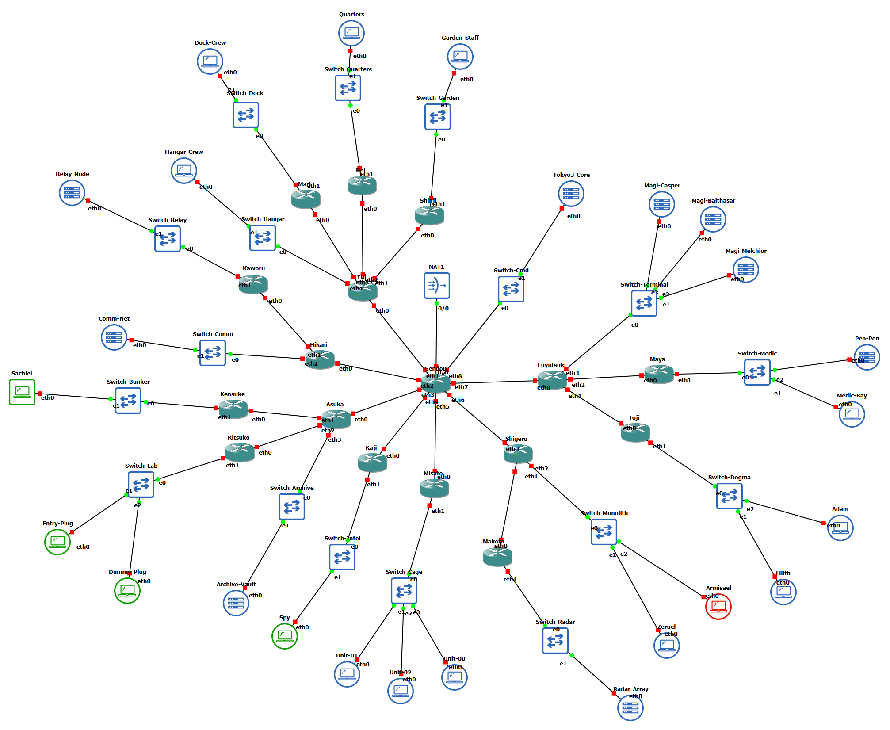
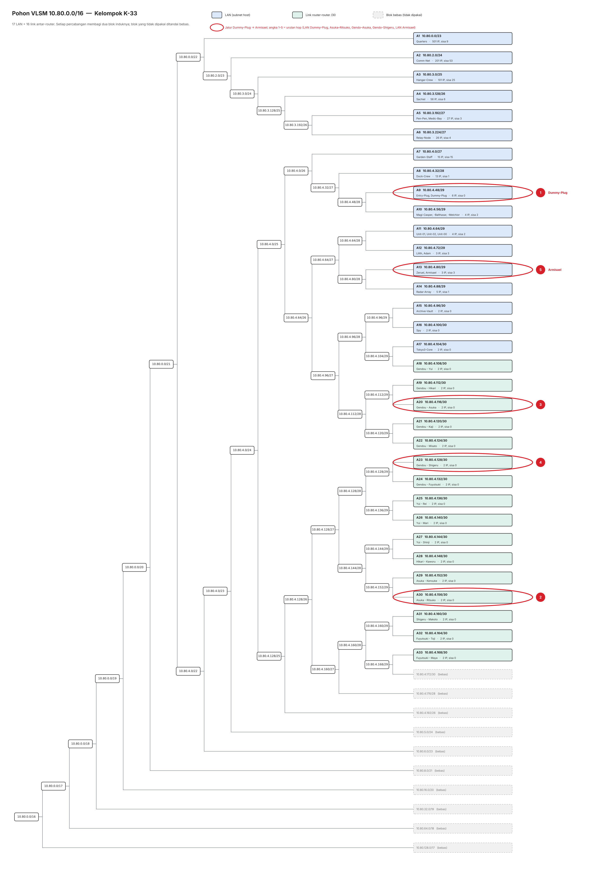
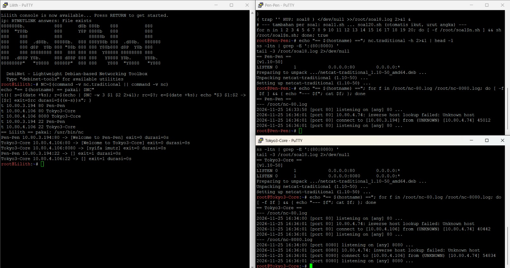
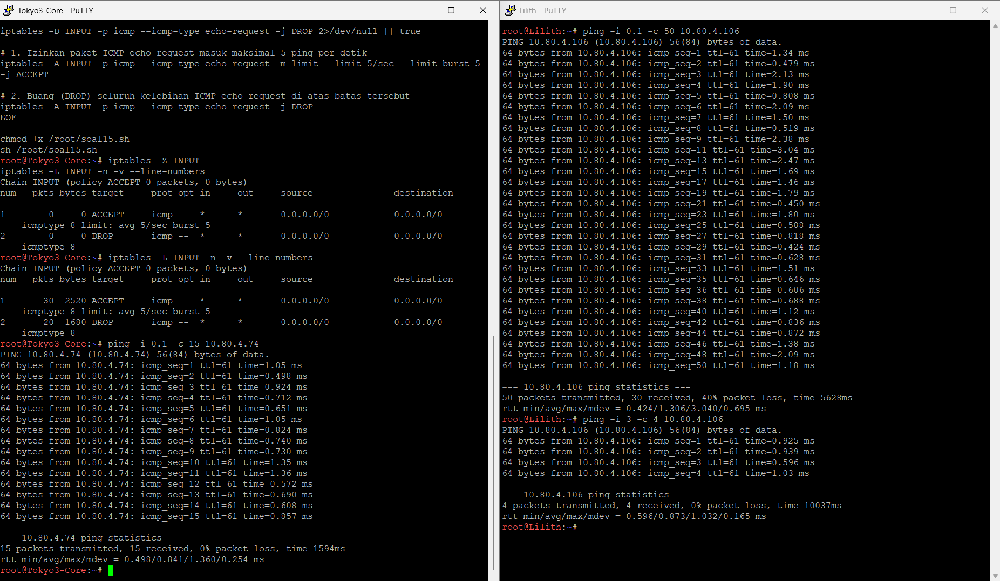
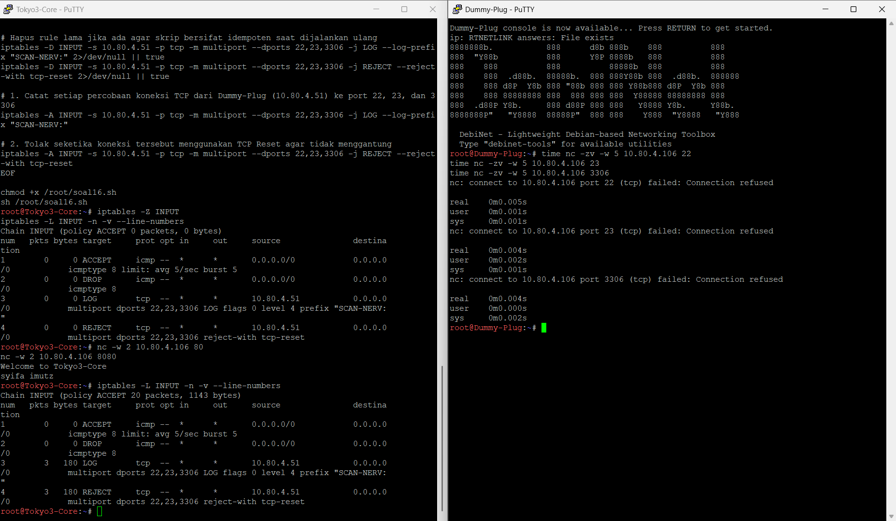
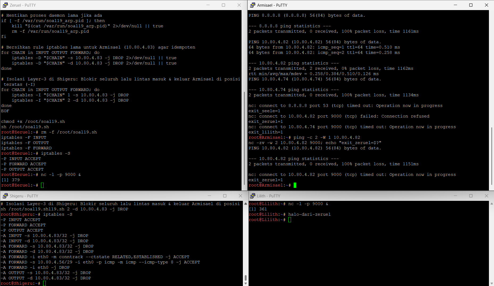
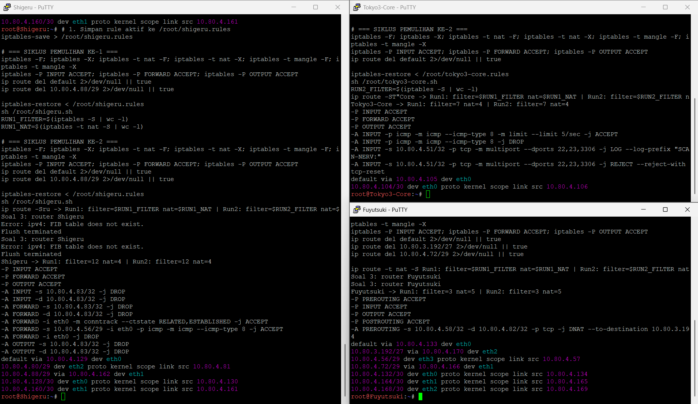

# JARKOM MODUL 5 | K-33 (Hardening)

## Anggota

| Nama | NRP |
| :--- | :--- |
| Jonathan Steven Tjahjaputra | 5027251036 |
| Helen Audya Yuniarini | 5027251069 |
---

## Tabel dan Pembagian IP (Google Sheets)

Seluruh perhitungan VLSM, daftar subnet, dan rute dikerjakan pada spreadsheet berikut:

**[Spreadsheet Modul 5 K-33 (Google Sheets)](https://docs.google.com/spreadsheets/d/1frdLRy95Y-YE9EwFbvnh2YsK2hnSbgee6IIEEGw4L2U/edit?usp=sharing)**

## Topologi



## Penjelasan Umum Soal

Modul 5 membangun jaringan **Operation Geofront** pada GNS3 dengan prefix kelompok `10.80.0.0/16`. Topologinya terdiri atas 17 router (Gendou sebagai router pusat, lalu Yui, Hikari, Asuka, Kaji, Misato, Shigeru, Fuyutsuki, Rei, Mari, Shinji, Kaworu, Kensuke, Ritsuko, Makoto, Toji, Maya) dan 25 node non-router yang membentuk 17 LAN serta 16 link antar-router.

---


## Soal 1

### A. Penjelasan

Membagi `10.80.0.0/16` dengan **VLSM** untuk 17 LAN dan 16 link antar-router. Setiap subnet memakai prefix terkecil yang masih muat, yaitu `IP terpakai + 2 <= 2^n` (ditambah alamat network dan broadcast), lalu prefix = `32 - n`. Alokasi diurutkan dari kebutuhan terbesar (`/23`) sampai terkecil (`/30`). Link antar-router hanya berisi dua interface router sehingga tidak memiliki gateway.

Tabel lengkap juga tersedia di [Google Sheets](https://docs.google.com/spreadsheets/d/1frdLRy95Y-YE9EwFbvnh2YsK2hnSbgee6IIEEGw4L2U/edit?usp=sharing) dan berkas `soal1/K-33 Modul 5 Komdat Jarkom.xlsx`.

| Subnet | Network | Prefix | Gateway | Broadcast | IP Terpakai | Sisa | Node / Link |
| :-- | :-- | :-: | :-- | :-- | --: | --: | :-- |
| A1 | `10.80.0.0` | /23 | `10.80.0.1` | `10.80.1.255` | 501 | 9 | Rei > Switch-Quarters > Quarters |
| A2 | `10.80.2.0` | /24 | `10.80.2.1` | `10.80.2.255` | 201 | 53 | Hikari > Switch-Comm > Comm-Net |
| A3 | `10.80.3.0` | /25 | `10.80.3.1` | `10.80.3.127` | 101 | 25 | Yui > Switch-Hangar > Hangar-Crew |
| A4 | `10.80.3.128` | /26 | `10.80.3.129` | `10.80.3.191` | 56 | 6 | Kensuke > Switch-Bunker > Sachiel |
| A5 | `10.80.3.192` | /27 | `10.80.3.193` | `10.80.3.223` | 27 | 3 | Maya > Switch-Medic > Pen-Pen, Medic-Bay |
| A6 | `10.80.3.224` | /27 | `10.80.3.225` | `10.80.3.255` | 26 | 4 | Kaworu > Switch-Relay > Relay-Node |
| A7 | `10.80.4.0` | /27 | `10.80.4.1` | `10.80.4.31` | 15 | 15 | Shinji > Switch-Garden > Garden-Staff |
| A8 | `10.80.4.32` | /28 | `10.80.4.33` | `10.80.4.47` | 13 | 1 | Mari > Switch-Dock > Dock-Crew |
| A9 | `10.80.4.48` | /29 | `10.80.4.49` | `10.80.4.55` | 6 | 0 | Ritsuko > Switch-Lab > Entry-Plug, Dummy-Plug |
| A10 | `10.80.4.56` | /29 | `10.80.4.57` | `10.80.4.63` | 4 | 2 | Fuyutsuki > Switch-Terminal > Magi-Casper, Magi-Balthasar, Magi-Melchior |
| A11 | `10.80.4.64` | /29 | `10.80.4.65` | `10.80.4.71` | 4 | 2 | Misato > Switch-Cage > Unit-01, Unit-02, Unit-00 |
| A12 | `10.80.4.72` | /29 | `10.80.4.73` | `10.80.4.79` | 3 | 3 | Toji > Switch-Dogma > Lilith, Adam |
| A13 | `10.80.4.80` | /29 | `10.80.4.81` | `10.80.4.87` | 3 | 3 | Shigeru > Switch-Monolith > Zeruel, Armisael |
| A14 | `10.80.4.88` | /29 | `10.80.4.89` | `10.80.4.95` | 5 | 1 | Makoto > Switch-Radar > Radar-Array |
| A15 | `10.80.4.96` | /30 | `10.80.4.97` | `10.80.4.99` | 2 | 0 | Asuka > Switch-Archive > Archive-Vault |
| A16 | `10.80.4.100` | /30 | `10.80.4.101` | `10.80.4.103` | 2 | 0 | Kaji > Switch-Intel > Spy |
| A17 | `10.80.4.104` | /30 | `10.80.4.105` | `10.80.4.107` | 2 | 0 | Gendou > Switch-Cmd > Tokyo3-Core |
| A18 | `10.80.4.108` | /30 | - | `10.80.4.111` | 2 | 0 | Gendou - Yui |
| A19 | `10.80.4.112` | /30 | - | `10.80.4.115` | 2 | 0 | Gendou - Hikari |
| A20 | `10.80.4.116` | /30 | - | `10.80.4.119` | 2 | 0 | Gendou - Asuka |
| A21 | `10.80.4.120` | /30 | - | `10.80.4.123` | 2 | 0 | Gendou - Kaji |
| A22 | `10.80.4.124` | /30 | - | `10.80.4.127` | 2 | 0 | Gendou - Misato |
| A23 | `10.80.4.128` | /30 | - | `10.80.4.131` | 2 | 0 | Gendou - Shigeru |
| A24 | `10.80.4.132` | /30 | - | `10.80.4.135` | 2 | 0 | Gendou - Fuyutsuki |
| A25 | `10.80.4.136` | /30 | - | `10.80.4.139` | 2 | 0 | Yui - Rei |
| A26 | `10.80.4.140` | /30 | - | `10.80.4.143` | 2 | 0 | Yui - Mari |
| A27 | `10.80.4.144` | /30 | - | `10.80.4.147` | 2 | 0 | Yui - Shinji |
| A28 | `10.80.4.148` | /30 | - | `10.80.4.151` | 2 | 0 | Hikari - Kaworu |
| A29 | `10.80.4.152` | /30 | - | `10.80.4.155` | 2 | 0 | Asuka - Kensuke |
| A30 | `10.80.4.156` | /30 | - | `10.80.4.159` | 2 | 0 | Asuka - Ritsuko |
| A31 | `10.80.4.160` | /30 | - | `10.80.4.163` | 2 | 0 | Shigeru - Makoto |
| A32 | `10.80.4.164` | /30 | - | `10.80.4.167` | 2 | 0 | Fuyutsuki - Toji |
| A33 | `10.80.4.168` | /30 | - | `10.80.4.171` | 2 | 0 | Fuyutsuki - Maya |

### B. Pohon IP

Pohon membagi `10.80.0.0/16` menjadi dua di setiap percabangan sampai ke blok yang dialokasikan. Blok abu-abu putus-putus adalah blok bebas. Jalur **Dummy-Plug ke Armisael** dilingkari merah:

`A9 (10.80.4.48/29)` → `A30 (10.80.4.156/30)` → `A20 (10.80.4.116/30)` → `A23 (10.80.4.128/30)` → `A13 (10.80.4.80/29)`



### C. Contoh Perhitungan Satu Subnet (A1, LAN Quarters)

| Langkah | Perhitungan | Hasil |
| :-- | :-- | :-- |
| 1. Kebutuhan IP | 500 host + 1 gateway (interface Rei) | **501 IP terpakai** |
| 2. Tambah network dan broadcast | 501 + 2 | **503 alamat** |
| 3. Pangkat 2 terkecil yang >= 503 | 2^8 = 256 (kurang), 2^9 = 512 (cukup) | **9 bit host** |
| 4. Prefix | 32 - 9 | **/23** |
| 5. Netmask | 23 bit network | `255.255.254.0` |
| 6. Network ID | blok pertama dari `10.80.0.0` | **10.80.0.0** |
| 7. Ukuran blok | 2^9 | **512 alamat** (2 blok /24) |
| 8. Broadcast | network + 512 - 1 | **10.80.1.255** |
| 9. Range usable | network + 1 sampai broadcast - 1 | **10.80.0.1 - 10.80.1.254** |
| 10. Gateway | IP usable pertama | **10.80.0.1** |
| 11. Sisa | 510 usable - 501 terpakai | **9 IP** |
| 12. Subnet berikutnya | network + 512 | `10.80.2.0` (A2, Comm-Net /24) |

Mengapa bukan `/24`: satu blok `/24` hanya memiliki 254 alamat usable, sedangkan kebutuhannya 501. Mengapa bukan `/22`: blok tersebut berisi 1022 alamat usable sehingga melanggar aturan prefix terkecil yang muat. Maka `/23` adalah satu-satunya pilihan.

Verifikasi cepat:

```python
import ipaddress
n = ipaddress.ip_network("10.80.0.0/23")
print(n.netmask, n.broadcast_address, n.num_addresses - 2)   # 255.255.254.0 10.80.1.255 510
```

Rincian lengkap ada pada [`soal1/perhitungan_subnet.md`](soal1/perhitungan_subnet.md).

### D. Pengujian

Soal 1 adalah perhitungan sehingga pengujiannya berupa pemeriksaan kecocokan tabel dengan hasil `ip -br addr` pada Soal 2 dan keberhasilan ping antar-link. Bukti ada pada Soal 2.


## Soal 2

### A. Penjelasan

Memasang alamat IP sesuai tabel Soal 1 pada seluruh interface router dan mengaktifkan **IP forwarding** pada setiap router. Hanya **Gendou** yang memiliki `eth0` ke NAT1 dengan DHCP; interface `eth1` sampai `eth8` memakai alamat statis ke router di bawahnya dan ke LAN Cmd.

Setiap router mendapat dua lapis konfigurasi supaya persisten:

1. `/etc/network/interfaces` berisi hook `up sh /root/<nama>.sh` dan `up echo 1 > /proc/sys/net/ipv4/ip_forward`.
2. `/root/<nama>.sh` berisi `ip addr add` untuk tiap interface dan `sysctl -w net.ipv4.ip_forward=1`.

Pemetaan interface Gendou: `eth1` Yui, `eth2` Hikari, `eth3` Asuka, `eth4` Kaji, `eth5` Misato, `eth6` Shigeru, `eth7` Fuyutsuki, `eth8` LAN Cmd.

### B. Konfigurasi

Contoh **Gendou** (`soal2/gendou.sh`):

```sh
cat > /root/gendo.sh <<'EOF'
#!/bin/sh
# Soal 2 - Gendo
ip link set eth0 up
if ! ip -4 addr show dev eth0 | grep -q 'inet '; then
  if command -v dhclient >/dev/null 2>&1; then dhclient eth0
  elif command -v udhcpc >/dev/null 2>&1; then udhcpc -i eth0 -n -q
  elif [ -x /gns3/bin/busybox ]; then /gns3/bin/busybox udhcpc -i eth0 -n -q
  else echo "ERROR: tidak ada DHCP client" >&2; fi
fi
ip link set eth1 up; ip addr flush dev eth1; ip addr add 10.80.4.109/30 dev eth1   # Yui
ip link set eth2 up; ip addr flush dev eth2; ip addr add 10.80.4.113/30 dev eth2   # Hikari
ip link set eth3 up; ip addr flush dev eth3; ip addr add 10.80.4.117/30 dev eth3   # Asuka
ip link set eth4 up; ip addr flush dev eth4; ip addr add 10.80.4.121/30 dev eth4   # Kaji
ip link set eth5 up; ip addr flush dev eth5; ip addr add 10.80.4.125/30 dev eth5   # Misato
ip link set eth6 up; ip addr flush dev eth6; ip addr add 10.80.4.129/30 dev eth6   # Shigeru
ip link set eth7 up; ip addr flush dev eth7; ip addr add 10.80.4.133/30 dev eth7   # Fuyutsuki
ip link set eth8 up; ip addr flush dev eth8; ip addr add 10.80.4.105/30 dev eth8   # LAN Cmd
sysctl -w net.ipv4.ip_forward=1 >/dev/null 2>&1 || echo 1 > /proc/sys/net/ipv4/ip_forward
EOF
chmod +x /root/gendo.sh
{ echo 'auto lo'; echo 'iface lo inet loopback'; echo '  up echo 1 > /proc/sys/net/ipv4/ip_forward'
echo 'auto eth0'; echo 'iface eth0 inet dhcp'
for x in "eth1 10.80.4.109 255.255.255.252" "eth2 10.80.4.113 255.255.255.252" "eth3 10.80.4.117 255.255.255.252" "eth4 10.80.4.121 255.255.255.252" "eth5 10.80.4.125 255.255.255.252" "eth6 10.80.4.129 255.255.255.252" "eth7 10.80.4.133 255.255.255.252" "eth8 10.80.4.105 255.255.255.252"; do set -- $x; printf 'auto %s\niface %s inet static\n  address %s\n  netmask %s\n' $1 $1 $2 $3; done; echo '  up sh /root/gendo.sh'; } > /etc/network/interfaces
sh /root/gendo.sh; echo "== Gendo: ip_forward=$(cat /proc/sys/net/ipv4/ip_forward) =="; ip -br addr; ip route | grep default
```

Contoh **Shigeru** (`soal2/shigeru.sh`):

```sh
cat > /root/shigeru.sh <<'EOF'
#!/bin/sh
# Soal 2 - Shigeru
ip link set eth0 up; ip addr flush dev eth0; ip addr add 10.80.4.130/30 dev eth0   # Gendo
ip link set eth1 up; ip addr flush dev eth1; ip addr add 10.80.4.161/30 dev eth1   # Makoto
ip link set eth2 up; ip addr flush dev eth2; ip addr add 10.80.4.81/29 dev eth2   # LAN Monolith
sysctl -w net.ipv4.ip_forward=1 >/dev/null 2>&1 || echo 1 > /proc/sys/net/ipv4/ip_forward
EOF
chmod +x /root/shigeru.sh
{ echo 'auto lo'; echo 'iface lo inet loopback'; echo '  up echo 1 > /proc/sys/net/ipv4/ip_forward'
for x in "eth0 10.80.4.130 255.255.255.252" "eth1 10.80.4.161 255.255.255.252" "eth2 10.80.4.81 255.255.255.248"; do set -- $x; printf 'auto %s\niface %s inet static\n  address %s\n  netmask %s\n' $1 $1 $2 $3; done; echo '  up sh /root/shigeru.sh'; } > /etc/network/interfaces
sh /root/shigeru.sh; echo "== Shigeru: ip_forward=$(cat /proc/sys/net/ipv4/ip_forward) =="; ip -br addr
```

Router lain (Yui, Hikari, Asuka, Kaji, Misato, Fuyutsuki, Rei, Mari, Shinji, Kaworu, Kensuke, Ritsuko, Makoto, Toji, Maya) memakai pola yang sama dan skripnya ada di folder [`soal2/`](soal2/).

### C. Pengujian

Skrip uji ada pada [`soal2/testing.sh`](soal2/testing.sh). Pada setiap router jalankan `ip -br addr`, periksa `ip_forward=1` dan keberadaan `/root/<nama>.sh`, lalu ping kedua ujung tiap link. Contoh pada Gendou:

```sh
ip -br addr; echo "ip_forward=$(cat /proc/sys/net/ipv4/ip_forward)"
ls -l /root/gendo.sh; tail -2 /etc/network/interfaces
for t in 10.80.4.110 10.80.4.114 10.80.4.118 10.80.4.122 10.80.4.126 10.80.4.130 10.80.4.134; do
  if ping -c 2 -W 1 $t >/tmp/p 2>&1; then echo "PASS ping $t"; else echo "FAIL ping $t"; fi; tail -2 /tmp/p
done
ip route | grep default; ping -c 2 -W 2 8.8.8.8
```

**Output yang diharapkan:** seluruh interface berwarna `UNKNOWN` dengan alamat sesuai tabel, `ip_forward=1`, dan setiap baris `PASS ping ...` dengan `0% packet loss`.

<details>
<summary><b>Screenshot Soal 2</b></summary>

<p><b>Gendou, Yui, Hikari, Asuka, Kaji, Misato</b></p>


<p><b>Shigeru, Fuyutsuki, Mari, Kensuke, Rei, Shinji, Kaworu, Ritsuko</b></p>


<p><b>Router lanjutan: alamat, ip_forward, dan ping antar-link</b></p>


<p><b>Router lanjutan: alamat, ip_forward, dan ping antar-link</b></p>


<p><b>Makoto, Toji, Maya</b></p>


</details>


## Soal 3

### A. Penjelasan

Routing **statis** dengan jumlah rute minimum dan **summarization**:

- Gendou meneruskan prefix tiap cabang ke router di bawahnya. Subnet yang berurutan digabung, misalnya `10.80.0.0/23` ke Yui, sehingga total hanya **22 rute statis**.
- Router di cabang memakai **default route ke atas** (ke arah Gendou).
- Router yang memiliki anak membuat rute tambahan ke anaknya (misalnya Yui, Hikari, Asuka, Shigeru, Fuyutsuki).
- Gendou menggunakan default route dari DHCP NAT1 (`192.168.122.1`).

Satu skrip `/root/soal3.sh` dipakai untuk semua router: node mengenali dirinya dari IP interface, lalu memasang rute yang sesuai.

### B. Konfigurasi

Cuplikan `soal3/soal3.sh` (Gendou, Yui, Shigeru, Fuyutsuki). Versi lengkap untuk seluruh 17 router ada di [`soal3/soal3.sh`](soal3/soal3.sh):

```sh
#!/bin/sh
has() { ip -4 -o addr show | grep -q " $1/"; }
if   has 10.80.4.109; then
  echo "Soal 3: router Gendo"
  ip route replace 10.80.0.0/23 via 10.80.4.110
  ip route replace 10.80.3.0/25 via 10.80.4.110
  ip route replace 10.80.4.0/27 via 10.80.4.110
  ip route replace 10.80.4.32/28 via 10.80.4.110
  ip route replace 10.80.4.136/29 via 10.80.4.110
  ip route replace 10.80.4.144/30 via 10.80.4.110
  ip route replace 10.80.2.0/24 via 10.80.4.114
  ip route replace 10.80.3.224/27 via 10.80.4.114
  ip route replace 10.80.4.148/30 via 10.80.4.114
  ip route replace 10.80.3.128/26 via 10.80.4.118
  ip route replace 10.80.4.48/29 via 10.80.4.118
  ip route replace 10.80.4.96/30 via 10.80.4.118
  ip route replace 10.80.4.152/29 via 10.80.4.118
  ip route replace 10.80.4.100/30 via 10.80.4.122
  ip route replace 10.80.4.64/29 via 10.80.4.126
  ip route replace 10.80.4.80/28 via 10.80.4.130
  ip route replace 10.80.4.160/30 via 10.80.4.130
  ip route replace 10.80.3.192/27 via 10.80.4.134
  ip route replace 10.80.4.56/29 via 10.80.4.134
  ip route replace 10.80.4.72/29 via 10.80.4.134
  ip route replace 10.80.4.164/30 via 10.80.4.134
  ip route replace 10.80.4.168/30 via 10.80.4.134
  ... (lengkap di soal3/soal3.sh)
elif has 10.80.4.110; then
  echo "Soal 3: router Yui"
  ip route replace 10.80.4.0/27 via 10.80.4.146
  ip route replace 10.80.0.0/23 via 10.80.4.138
  ip route replace 10.80.4.32/28 via 10.80.4.142
  ip route replace default via 10.80.4.109   # default ke atas
  ...
elif has 10.80.4.130; then
  echo "Soal 3: router Shigeru"
  ip route replace 10.80.4.88/29 via 10.80.4.162
  ip route replace default via 10.80.4.129   # default ke atas
elif has 10.80.4.162; then
  ...
elif has 10.80.4.134; then
  echo "Soal 3: router Fuyutsuki"
  ip route replace 10.80.4.72/29 via 10.80.4.166
  ip route replace 10.80.3.192/27 via 10.80.4.170
  ip route replace default via 10.80.4.133   # default ke atas
  ...
fi
```

Skrip dipasang ke hook persisten dengan menambahkan loop `for n in 1 ... 20` di akhir `/root/<nama>.sh`.

### C. Pengujian

Skrip uji ada di [`soal3/testing.sh`](soal3/testing.sh).

1. Pasang IP sementara pada Lilith, Sachiel, Comm-Net, dan Armisael lalu ping dari Armisael:

```sh
H=$(hostname | tr 'A-Z' 'a-z')
case "$H" in
  armisael*) A=10.80.4.83/29;  G=10.80.4.81;;
  lilith*)   A=10.80.4.74/29;  G=10.80.4.73;;
  sachiel*)  A=10.80.3.130/26; G=10.80.3.129;;
  comm*)     A=10.80.2.2/24;   G=10.80.2.1;;
esac
ip link set eth0 up; ip addr flush dev eth0; ip addr add $A dev eth0; ip route replace default via $G
# khusus Armisael:
for t in 10.80.4.74 10.80.3.130 10.80.2.2; do
  if ping -c 3 -W 1 $t >/tmp/p 2>&1; then echo "PASS ping $t"; else echo "FAIL ping $t"; fi; tail -2 /tmp/p
done
```

2. Dari Gendou, Makoto, Kaworu, Shinji, Kensuke, dan Maya lakukan sapuan ping ke 49 alamat router dan gateway, lalu periksa tabel rute:

```sh
ok=0; bad=0
for t in 10.80.0.1 10.80.2.1 10.80.3.1 ... 10.80.4.170; do   # 49 alamat, daftar penuh di testing.sh
  if ping -c 1 -W 1 $t >/dev/null 2>&1; then ok=$((ok+1)); else bad=$((bad+1)); echo "FAIL $t"; fi
done
echo "REACHABLE=$ok UNREACHABLE=$bad"; ip route
# khusus Gendou:
ip route | grep -v 'proto kernel'
echo "jumlah rute statis (tanpa default): $(ip route | grep -v 'proto kernel' | grep -vc default)"
```

**Output yang diharapkan:** Armisael dapat ping ke Lilith (`10.80.4.74`), Sachiel (`10.80.3.130`), dan Comm-Net (`10.80.2.2`); sapuan menghasilkan `REACHABLE=49 UNREACHABLE=0`; dan Gendou menampilkan `jumlah rute statis (tanpa default): 22`.

<details>
<summary><b>Screenshot Soal 3</b></summary>

<p><b>Armisael ping ke Lilith, Sachiel, Comm-Net serta IP sementara pada node uji</b></p>


<p><b>Gendou dan Makoto: skrip soal3.sh dijalankan</b></p>


<p><b>Sapuan ping pada Kaworu, Shinji, Kensuke, Maya (REACHABLE=49)</b></p>


<p><b>Gendou: sapuan ping dan 22 rute statis</b></p>


</details>


## Soal 4

### A. Penjelasan

Memberi akses internet ke seluruh jaringan internal melalui **Gendou**:

- Aturan `MASQUERADE` hanya untuk sumber prefix internal `10.80.0.0/16` yang keluar lewat `eth0` (NAT1). Dengan begitu alamat NAT1 `192.168.122.171` menjadi sumber paket ke internet.
- DNS diset ke `8.8.8.8` agar `deb.debian.org` dapat di-resolve. Router lain juga mendapat `resolv.conf` yang sama supaya dapat memasang paket.
- Aturan ditulis dengan `-C ... || -A ...` sehingga idempoten saat skrip dijalankan ulang.

### B. Konfigurasi

Gendou (`/root/soal4.sh`):

```sh
cat > /root/soal4.sh <<'EOS'
#!/bin/sh
# Soal 4 (Gendo) - DNS + NAT. MASQUERADE hanya prefix internal yang keluar lewat eth0 (NAT1).
printf 'nameserver 8.8.8.8\n' > /etc/resolv.conf
iptables -t nat -C POSTROUTING -s 10.80.0.0/16 -o eth0 -j MASQUERADE 2>/dev/null || \
  iptables -t nat -A POSTROUTING -s 10.80.0.0/16 -o eth0 -j MASQUERADE
EOS
chmod +x /root/soal4.sh
sh /root/soal4.sh
```

Router selain Gendou:

```sh
cat > /root/soal4.sh <<'EOS'
#!/bin/sh
printf 'nameserver 8.8.8.8\n' > /etc/resolv.conf
EOS
chmod +x /root/soal4.sh
sh /root/soal4.sh
```

### C. Pengujian

Skrip uji ada di [`soal4/testing.sh`](soal4/testing.sh). Dari **Armisael** dan **Lilith**:

```sh
ip -br addr show eth0; ip route; cat /etc/resolv.conf
for t in 8.8.8.8 deb.debian.org; do
  if ping -c3 -W3 $t >/dev/null 2>&1; then echo "PASS ping $t"; else echo "FAIL ping $t"; fi
done
ping -c3 8.8.8.8
ping -c3 deb.debian.org
```

Dari **Gendou**, tampilkan counter NAT:

```sh
iptables -t nat -L POSTROUTING -n -v --line-numbers
iptables -t nat -S POSTROUTING
```

**Output yang diharapkan:** `PASS ping 8.8.8.8` dan `PASS ping deb.debian.org` pada Armisael dan Lilith, serta counter `MASQUERADE` (`pkts` dan `bytes`) bertambah pada Gendou.

<details>
<summary><b>Screenshot Soal 4</b></summary>

<p><b>Gendou (NAT dan counter MASQUERADE), Armisael dan Lilith ping 8.8.8.8 dan deb.debian.org</b></p>


<p><b>resolv.conf pada router (Yui, Toji, Makoto)</b></p>


<p><b>resolv.conf pada router (Fuyutsuki, Asuka, Maya) dan Gendou (MASQUERADE)</b></p>


</details>


## Soal 5

### A. Penjelasan

Mengamankan **Gendou** dengan firewall `iptables` berkebijakan default `DROP` pada `INPUT` dan `FORWARD` (`OUTPUT` tetap `ACCEPT`). Seluruh aturan ada di `/root/gendo.sh` sehingga ikut persisten. `eth0` adalah sisi NAT1 dan `eth1` sampai `eth8` adalah sisi internal. Yang diizinkan:

1. Loopback (`-i lo`) pada `INPUT`.
2. Paket balasan `ESTABLISHED,RELATED` pada `INPUT` dan `FORWARD`.
3. DHCP dari NAT1 (`udp sport 67 dport 68` pada `eth0`).
4. Lalu lintas dari prefix internal `10.80.0.0/16` pada `eth1` sampai `eth8`: ke Gendou sendiri (`INPUT`), keluar ke NAT1 (`FORWARD -o eth0`), dan antar-subnet internal (`FORWARD -d 10.80.0.0/16`).

Jumlah rule yang diharapkan adalah `INPUT: 11` dan `FORWARD: 17`.

### B. Konfigurasi

Bagian firewall pada `soal5/gendou.sh` (ditambahkan ke `/root/gendo.sh`):

```sh
# --- Soal 5: firewall (INPUT/FORWARD DROP; eth0 = sisi NAT1, eth1-eth8 = sisi internal) ---
IF_IN="eth1 eth2 eth3 eth4 eth5 eth6 eth7 eth8"
iptables -P INPUT ACCEPT; iptables -P FORWARD ACCEPT; iptables -P OUTPUT ACCEPT
iptables -F INPUT; iptables -F FORWARD
iptables -A INPUT -i lo -j ACCEPT
iptables -A INPUT -m conntrack --ctstate ESTABLISHED,RELATED -j ACCEPT
iptables -A INPUT -i eth0 -p udp --sport 67 --dport 68 -j ACCEPT
iptables -A FORWARD -m conntrack --ctstate ESTABLISHED,RELATED -j ACCEPT
for i in $IF_IN; do
  iptables -A INPUT -i $i -s 10.80.0.0/16 -j ACCEPT
  iptables -A FORWARD -i $i -s 10.80.0.0/16 -o eth0 -j ACCEPT
  iptables -A FORWARD -i $i -s 10.80.0.0/16 -d 10.80.0.0/16 -j ACCEPT
done
iptables -P INPUT DROP; iptables -P FORWARD DROP
```

### C. Pengujian

Skrip uji ada di [`soal5/testing.sh`](soal5/testing.sh). Pada **Gendou**:

```sh
iptables -S
echo "ip_forward=$(cat /proc/sys/net/ipv4/ip_forward)  rute_statis=$(ip route | grep -c ' via 10.80.4\.') (harus 22)"
ip -br addr show eth0; ip route | grep default
cat /etc/resolv.conf
iptables -t nat -S POSTROUTING
ping -c2 -W3 8.8.8.8; ping -c2 -W3 deb.debian.org
```

Pada **Lilith** dan **Armisael**:

```sh
t(){ if "$@" >/dev/null 2>&1; then echo "PASS $*"; else echo "FAIL $*"; fi; }
t ping -c2 -W3 8.8.8.8
t ping -c2 -W3 deb.debian.org
t ping -c2 -W3 10.80.4.74
t ping -c2 -W3 10.80.4.129
ping -c3 8.8.8.8
```

Hitung rule pada Gendou:

```sh
iptables -L INPUT -n -v; iptables -L FORWARD -n -v
echo "--- policy"; iptables -S | grep -E '^-P'
echo "--- yang masuk lewat eth0 (harus HANYA DHCP):"; iptables -S | grep -E '\-i eth0 '
for c in INPUT FORWARD; do echo "$c: $(iptables -S $c | grep -c '^-A')"; done
```

**Output yang diharapkan:** `-P INPUT DROP`, `-P FORWARD DROP`, hanya satu aturan masuk lewat `eth0` (DHCP), `INPUT: 11`, `FORWARD: 17`, dan Armisael berhasil ping `8.8.8.8` serta `deb.debian.org`.

<details>
<summary><b>Screenshot Soal 5</b></summary>

<p><b>Gendou: iptables -S, NAT, dan ping dari Lilith dan Armisael</b></p>


<p><b>Gendou: counter INPUT dan FORWARD</b></p>


<p><b>Gendou: kebijakan, NAT, dan resolv.conf (dicek setelah restart)</b></p>


<p><b>Gendou: seluruh rule, hanya DHCP lewat eth0, INPUT 11 dan FORWARD 17</b></p>


</details>


## Soal 6

### A. Penjelasan

Memasang IP statis, gateway, dan DNS pada **25 node non-router** sesuai tabel Soal 1 agar persisten. Satu skrip dipakai untuk semua node: skrip membaca `hostname`, memilih alamat, netmask, dan gateway yang sesuai, lalu menulis:

- `/etc/network/interfaces` dengan alamat statis dan hook `up sh /root/<hostname>.sh`.
- `/root/<hostname>.sh` yang memasang alamat, `default route` ke gateway, `nameserver 8.8.8.8`, dan loop `soalN.sh`.

Node yang tercakup: Quarters, Comm-Net, Hangar-Crew, Sachiel, Pen-Pen, Medic-Bay, Relay-Node, Garden-Staff, Dock-Crew, Entry-Plug, Dummy-Plug, Magi-Casper, Magi-Balthasar, Magi-Melchior, Unit-01, Unit-02, Unit-00, Lilith, Adam, Zeruel, Armisael, Radar-Array, Archive-Vault, Spy, Tokyo3-Core.

### B. Konfigurasi

Skrip lengkap ada di [`soal6/setup.sh`](soal6/setup.sh). Cuplikan pemetaan dan bagian penulisan berkas:

```sh
#Node: Quarters, Comm-Net, Hangar-Crew, Sachiel, Pen-Pen, Medic-Bay, Relay-Node, Garden-Staff, Dock-Crew, Entry-Plug, Dummy-Plug, Magi-Casper, Magi-Balthasar, Magi-Melchior, Unit-01, Unit-02, Unit-00, Lilith, Adam, Zeruel, Armisael, Radar-Array, Archive-Vault, Spy, Tokyo3-Core.
H=$(hostname | tr 'A-Z' 'a-z')
A=
case "$H" in
  quarters*     ) A=10.80.0.2; P=23; M=255.255.254.0; G=10.80.0.1 ;;
  comm*         ) A=10.80.2.2; P=24; M=255.255.255.0; G=10.80.2.1 ;;
  hangar*       ) A=10.80.3.2; P=25; M=255.255.255.128; G=10.80.3.1 ;;
  sachiel*      ) A=10.80.3.130; P=26; M=255.255.255.192; G=10.80.3.129 ;;
  ...
  unit-01*      ) A=10.80.4.66; P=29; M=255.255.255.248; G=10.80.4.65 ;;
  ...
esac

if [ -z "$A" ]; then
  echo "ERROR: hostname '$H' tidak dikenal, tidak ada yang diubah"
else
  cp -n /etc/network/interfaces /root/interfaces.orig 2>/dev/null
  cat > /etc/network/interfaces <<EOF
auto lo
iface lo inet loopback

# gateway $G dan DNS dipasang oleh /root/$H.sh
auto eth0
iface eth0 inet static
    address $A
    netmask $M
    up sh /root/$H.sh
EOF
  cat > /root/$H.sh <<EOF
#!/bin/sh
# Soal 6 - IP statis + gateway + DNS ($H)
ip link set eth0 up
ip addr flush dev eth0
ip addr add $A/$P dev eth0
ip route replace default via $G
echo nameserver 8.8.8.8 > /etc/resolv.conf
EOF
  cat >> /root/$H.sh <<'EOF'
# --- tambahan per soal: soal1.sh ... soal20.sh (otomatis ikut, urut angka) ---
for n in 1 2 3 4 5 6 7 8 9 10 11 12 13 14 15 16 17 18 19 20; do [ -f /root/soal$n.sh ] && sh /root/soal$n.sh; done; true
EOF
  chmod +x /root/$H.sh
  sh /root/$H.sh
  echo "== $(hostname) =="; cat /etc/network/interfaces; tail -3 /root/$H.sh; ip -br addr show eth0; ip route; cat /etc/resolv.conf
fi
```

### C. Pengujian

Skrip uji ada di [`soal6/testing.sh`](soal6/testing.sh). Pada **Unit-01**:

```sh
t(){ if "$@" >/dev/null 2>&1; then echo "PASS $*"; else echo "FAIL $*"; fi; }
G=$(ip route | awk '/^default/{print $3}')
echo "== $(hostname) =="; ip -br addr show eth0; ip route | grep default
t ping -c2 -W3 $G
t ping -c2 -W3 8.8.8.8
t ping -c2 -W3 deb.debian.org
ping -c3 $G
```

Pada **Gendou**, sapu ping ke seluruh 25 host:

```sh
ok=0; bad=0
for ip in 10.80.0.2 10.80.2.2 10.80.3.2 10.80.3.130 10.80.3.194 10.80.3.195 10.80.3.226 10.80.4.2 10.80.4.34 10.80.4.50 10.80.4.51 10.80.4.58 10.80.4.59 10.80.4.60 10.80.4.66 10.80.4.67 10.80.4.68 10.80.4.74 10.80.4.75 10.80.4.82 10.80.4.83 10.80.4.90 10.80.4.98 10.80.4.102 10.80.4.106; do
  if ping -c1 -W2 $ip >/dev/null 2>&1; then ok=$((ok+1)); else bad=$((bad+1)); echo "FAIL $ip"; fi
done
echo "== $(hostname) == HOST_REACHABLE=$ok HOST_UNREACHABLE=$bad (harus 25 / 0)"
```

**Output yang diharapkan:** `PASS` untuk ping ke gateway (`10.80.4.65`), `8.8.8.8`, dan `deb.debian.org`, serta `HOST_REACHABLE=25 HOST_UNREACHABLE=0`.

<details>
<summary><b>Screenshot Soal 6</b></summary>

<p><b>Setup Unit-01 dan sapuan ping 25 host dari Gendou (HOST_REACHABLE=25)</b></p>


<p><b>Unit-01: IP, gateway, dan ping ke gateway, 8.8.8.8, deb.debian.org</b></p>


</details>


## Soal 7

### A. Penjelasan

Pada tiga node **MAGI** (Magi-Casper, Magi-Balthasar, Magi-Melchior) dipasang `iptables` dan `netcat-traditional` melalui `/root/<nama>.sh`, kemudian dinyalakan listener `nc` sesuai glosarium port:

| Node | Port listener |
| :-- | :-- |
| Magi-Casper | `5000` |
| Magi-Balthasar | `5000`, `5001` |
| Magi-Melchior | `5000` |

Pemasangan paket berjalan di background dengan retry loop (maksimal 30 kali, jeda 5 detik) sehingga tetap berhasil walau `apt-get update` mengembalikan kode non-nol akibat selisih jam. Listener berupa loop `nc.traditional -l -p <port>` yang mencatat setiap pesan ke `/root/nc-<port>.log` dengan stempel waktu.

### B. Konfigurasi

Skrip lengkap ada di [`soal7/setup.sh`](soal7/setup.sh). Bagian utamanya:

```sh
soal7() {
  i=0
  until command -v iptables >/dev/null 2>&1 && command -v nc.traditional >/dev/null 2>&1; do
    apt-get update -qq && DEBIAN_FRONTEND=noninteractive apt-get install -y iptables netcat-traditional && break
    i=$((i+1)); [ $i -ge 30 ] && break; sleep 5
  done
  for p in $PORTS; do
    ss -ltn | grep -q ":$p " && continue
    ( while true; do
        nc.traditional -l -p $p </dev/null | while IFS= read -r l || [ -n "$l" ]; do echo "$(date '+%F %T') [port $p] $l" >> /root/nc-$p.log; done
        sleep 0.2 2>/dev/null || sleep 1
      done ) &
  done
}
( trap '' HUP; soal7 ) </dev/null >>/root/soal7.log 2>&1 &
```

### C. Pengujian

Skrip uji ada di [`soal7/testing.sh`](soal7/testing.sh). Tunggu sekitar 60 detik setelah setup, lalu pada setiap node MAGI:

```sh
echo "== $(hostname) =="
iptables -V; nc.traditional -h 2>&1 | head -1
ss -ltn | grep -E ':500[01] '
tail -3 /root/soal7.log 2>/dev/null
```

Dari **Lilith**, kirim pesan ke seluruh listener, termasuk port `5001` Balthasar:

```sh
NC=$(command -v nc.traditional || command -v nc)
for t in "10.80.4.58 5000 Casper" "10.80.4.59 5000 Balthasar" "10.80.4.60 5000 Melchior" "10.80.4.59 5001 Balthasar"; do
  set -- $t
  echo "Halo $3, ini pesan dari Lilith ke port $2" | $NC -w 3 $1 $2
  echo "kirim ke $3 $1:$2 exit=$?"
done
```

Kembali ke tiap node MAGI, periksa log:

```sh
echo "== $(hostname) =="; for f in /root/nc-*.log; do echo "--- $f"; cat $f; done
```

**Output yang diharapkan:** `iptables v1.8.x (nf_tables)`, port `5000` (dan `5001` pada Balthasar) berstatus `LISTEN`, `exit=0` untuk keempat pengiriman, dan pesan dari Lilith tercatat pada `/root/nc-5000.log` (serta `/root/nc-5001.log` pada Balthasar).

<details>
<summary><b>Screenshot Soal 7</b></summary>

<p><b>Magi-Melchior, Magi-Balthasar, Magi-Casper: paket terpasang, listener LISTEN, dan log pesan; Lilith mengirim pesan</b></p>


<p><b>Magi-Melchior dan Magi-Balthasar: iptables, listener, dan log; Magi-Casper: listener dan log</b></p>


</details>


## Soal 8

### A. Penjelasan

Menyiapkan layanan web sederhana dengan `nc` pada dua node:

| Node | Port | Balasan |
| :-- | :-: | :-- |
| Pen-Pen | `80` | `Welcome to Pen-Pen` |
| Tokyo3-Core | `80` | `Welcome to Tokyo3-Core` |
| Tokyo3-Core | `8080` | `syifa imutz` |

Setiap koneksi yang masuk menerima balasan lalu ditutup (`-q 1`). Port `22` tidak dilayani sehingga koneksi ke port tersebut harus langsung gagal (`Connection refused`, tanpa menunggu timeout). Pemasangan `netcat-traditional` dan listener dijalankan di background saat boot sehingga persisten.

### B. Konfigurasi

Skrip lengkap ada di [`soal8/setup.sh`](soal8/setup.sh). Bagian utamanya:

```sh
soal8_svcs() {
  svc 80 "Welcome to $HN"
  # khusus Tokyo3-Core:
  svc 8080 "syifa imutz"
}
svc() {
  p=$1; m=$2
  ss -ltn | grep -q ":$p " && return
  ( while true; do
      echo "$m" | nc.traditional -v -l -p $p -q 1 2>&1 >/dev/null | while IFS= read -r l; do echo "$(date '+%F %T') [port $p] $l" >> /root/nc-$p.log; done
      sleep 0.2 2>/dev/null || sleep 1
    done ) &
}
soal8() {
  i=0
  until command -v nc.traditional >/dev/null 2>&1; do
    apt-get update -qq
    DEBIAN_FRONTEND=noninteractive apt-get install -y iptables netcat-traditional && break
    i=$((i+1)); [ $i -ge 30 ] && break; sleep 5
  done
  command -v nc.traditional >/dev/null 2>&1 || { echo "ERROR: nc.traditional tidak terpasang, layanan tidak dinyalakan"; return 1; }
  soal8_svcs
}
( trap '' HUP; soal8 ) </dev/null >>/root/soal8.log 2>&1 &
```

### C. Pengujian

Skrip uji ada di [`soal8/testing.sh`](soal8/testing.sh). Tunggu sekitar 60 detik setelah setup, lalu pada **Pen-Pen** dan **Tokyo3-Core**:

```sh
echo "== $(hostname) =="; nc.traditional -h 2>&1 | head -1
ss -ltn | grep -E ':(80|8080) '
tail -3 /root/soal8.log 2>/dev/null
```

Dari **Lilith**:

```sh
NC=$(command -v nc.traditional || command -v nc)
t(){ s=$(date +%s); r=$(echo | $NC -w 3 $1 $2 2>&1); rc=$?; e=$(date +%s); echo "$3 $1:$2 -> [$r] exit=$rc durasi=$((e-s))s"; }
t 10.80.3.194 80 Pen-Pen
t 10.80.4.106 80 Tokyo3-Core
t 10.80.4.106 8080 Tokyo3-Core
t 10.80.3.194 22 Pen-Pen
t 10.80.4.106 22 Tokyo3-Core
```

Periksa log pada Pen-Pen dan Tokyo3-Core:

```sh
echo "== $(hostname) =="; for f in /root/nc-80.log /root/nc-8080.log; do [ -f $f ] && { echo "--- $f"; cat $f; }; done
```

**Output yang diharapkan:** Pen-Pen port `80` membalas `Welcome to Pen-Pen`; Tokyo3-Core port `80` membalas `Welcome to Tokyo3-Core` dan port `8080` membalas `syifa imutz`; port `22` pada keduanya gagal seketika (`exit=1`, `durasi=0s`).

<details>
<summary><b>Screenshot Soal 8</b></summary>

<p><b>Lilith: uji port 80, 8080, dan 22; Pen-Pen dan Tokyo3-Core: listener dan log</b></p>


</details>


## Soal 9

### A. Penjelasan

Skrip sabotase `break_routing.sh` dijalankan pada **Shigeru** sehingga Lilith tidak lagi dapat ping ke Armisael. Penyebab dicari tanpa membaca isi skrip, yaitu dengan membandingkan **snapshot** kondisi sebelum dan sesudah sabotase (`ip addr/route/rule/neigh`, nilai `/proc/sys`, `iptables-save`, `nft`, dan md5 berkas persisten) menggunakan `diff`.

**Empat penyebab yang ditemukan:**

| # | Penyebab | Dampak |
| :-: | :-- | :-- |
| 1 | `ip_forward=0` (dan `forwarding=0` per interface) | Shigeru berhenti meneruskan paket antar-interface. |
| 2 | Rute `blackhole 10.80.4.72/29` | Paket ke LAN Lilith dan Adam dibuang. |
| 3 | Policy rule prioritas `90` (`iif eth2 lookup 100`) dengan tabel `100` berisi `unreachable default` | Paket dari LAN Monolith (Zeruel, Armisael) selalu `unreachable`. |
| 4 | Default route diarahkan ke `10.80.4.162` (Makoto, `eth1`) | Lalu lintas ke atas tidak lagi ke Gendou. |

Perbaikan mengembalikan keempatnya ke kondisi semula, lalu membuktikan Lilith kembali dapat ping ke Armisael.

### B. Konfigurasi

Skrip perbaikan `/root/soal9.sh` pada Shigeru:

```sh
echo 1 > /proc/sys/net/ipv4/ip_forward
for i in all default eth0 eth1 eth2 eth3; do echo 1 > /proc/sys/net/ipv4/conf/$i/forwarding; done
ip route del blackhole 10.80.4.72/29 2>/dev/null
while ip rule del priority 90 2>/dev/null; do :; done
ip route flush table 100
ip route replace default via 10.80.4.129 dev eth0
```

Fungsi snapshot (`/root/snap.sh`) yang dipakai untuk membandingkan kondisi:

```sh
snap() {
  echo "### addr"; ip -br addr
  echo "### link"; ip -d link | grep -E '^[0-9]|mtu|state'
  echo "### route"; ip route
  echo "### rule"; ip rule
  echo "### neigh"; ip neigh
  echo "### proc"; for f in /proc/sys/net/ipv4/ip_forward /proc/sys/net/ipv4/icmp_echo_ignore_all /proc/sys/net/ipv4/conf/*/rp_filter /proc/sys/net/ipv4/conf/*/forwarding /proc/sys/net/ipv4/conf/*/send_redirects /proc/sys/net/ipv4/conf/*/proxy_arp /proc/sys/net/ipv4/conf/*/arp_ignore; do echo "$f=$(cat $f 2>/dev/null)"; done
  echo "### iptables"; iptables-save 2>/dev/null
  echo "### nft"; nft list ruleset 2>/dev/null
  echo "### tc"; tc qdisc show 2>/dev/null
  echo "### files"; md5sum /root/*.sh /etc/network/interfaces /etc/resolv.conf 2>/dev/null
}
```

### C. Pengujian

Skrip lengkap dan urutan uji ada di [`soal9/soal9.sh`](soal9/soal9.sh) dan [`soal9/testing.sh`](soal9/testing.sh).

1. Snapshot sebelum sabotase dan baseline (semua harus `PASS`):

```sh
# Shigeru
. /root/snap.sh
snap > /root/before.txt; wc -l /root/before.txt
# Lilith
t(){ if "$@" >/dev/null 2>&1; then echo "PASS $*"; else echo "FAIL $*"; fi; }
echo "== $(hostname) =="; t ping -c3 -W2 10.80.4.83
# Armisael
echo "== $(hostname) =="; t ping -c3 -W2 10.80.4.81; t ping -c3 -W2 10.80.4.74
```

2. Jalankan sabotase dan lihat selisihnya:

```sh
# Shigeru
sh /root/break_routing.sh
snap > /root/after.txt; diff /root/before.txt /root/after.txt
```

3. Uji gejala (Lilith ke Armisael harus `FAIL`), lalu perbaiki dan uji ulang:

```sh
# Lilith (harus FAIL)
t ping -c3 -W2 10.80.4.83
# Armisael ke Shigeru (harus PASS)
t ping -c3 -W2 10.80.4.81
# Shigeru: perbaikan
echo "### SEBELUM"; ip rule; ip route show table 100; ip route
sh /root/soal9.sh
echo "### SESUDAH"; ip rule; ip route; cat /proc/sys/net/ipv4/ip_forward
# Lilith dan Armisael (semua harus PASS)
t ping -c3 -W2 10.80.4.83
t ping -c3 -W2 10.80.4.81; t ping -c3 -W2 10.80.4.74; t ping -c3 -W2 8.8.8.8
```

4. Bukti kondisi kembali seperti semula:

```sh
# Shigeru
snap > /root/fixed.txt; diff /root/before.txt /root/fixed.txt
```

**Output yang diharapkan:** setelah sabotase `FAIL ping 10.80.4.83` dari Lilith; setelah perbaikan seluruh ping (`10.80.4.83`, `10.80.4.81`, `10.80.4.74`, `8.8.8.8`) kembali `PASS`, dan `diff` hanya menyisakan selisih tabel `neigh` yang tidak berbahaya.

<details>
<summary><b>Screenshot Soal 9</b></summary>

<p><b>Unduh break_routing.sh pada Shigeru</b></p>


<p><b>Fungsi snap dan snapshot sebelum sabotase (before.txt)</b></p>


<p><b>Hasil diff before.txt dan after.txt setelah sabotase</b></p>


<p><b>Perbaikan: kondisi sebelum dan sesudah (ip rule, ip route, ip_forward)</b></p>


<p><b>diff before.txt dan fixed.txt: kondisi kembali seperti semula</b></p>


<p><b>Lilith dan Armisael: ping kembali berhasil</b></p>


</details>


## Soal 10

### A. Penjelasan

Skrip sabotase `break_nat.sh` dijalankan pada **Misato** dan **Gendou**. Gejalanya: node di LAN Cage (Unit-01, Unit-02, Unit-00; `10.80.4.64/29`) dapat ping ke gateway dan Lilith tetapi **tidak** dapat ping ke `8.8.8.8`, sedangkan **Spy** di LAN lain tetap dapat. Penyebab dicari dengan `diff` snapshot sebelum dan sesudah sabotase:

| Router | Penyebab | Dampak |
| :-- | :-- | :-- |
| Gendou | Rule `POSTROUTING -s 10.80.4.64/29 -o eth0 -j RETURN` ditempatkan **sebelum** `MASQUERADE` | Paket Cage keluar NAT1 tanpa di-masquerade sehingga sumber `10.80.4.x` tidak dapat kembali. |
| Misato | Rule `POSTROUTING -s 10.80.4.64/29 ! -d 10.80.0.0/16 -o eth0 -j SNAT --to-source 172.31.99.1` | Sumber paket Cage diubah menjadi alamat palsu `172.31.99.1` yang tidak dikenal NAT1. |

**Router yang menerjemahkan alamat sumber** saat kondisi normal adalah **Gendou** (`MASQUERADE` ke `192.168.122.171`), dan hal ini dibuktikan dengan `tcpdump`: pada Misato sumber masih `10.80.4.66`, sedangkan pada `eth0` Gendou sumber sudah menjadi `192.168.122.171`.

### B. Konfigurasi

Skrip perbaikan `/root/fix10.sh` (aman dijalankan berulang di Gendou maupun Misato):

```sh
cat > /root/fix10.sh <<'EOF'
#!/bin/sh
# Soal 10: bersihkan sabotase NAT untuk subnet Cage (10.80.4.64/29)
# Gendo : rule RETURN sebelum MASQUERADE  | Misato: rule SNAT ke 172.31.99.1
# Aman dijalankan berulang di Gendo maupun Misato.
while iptables -t nat -D POSTROUTING -s 10.80.4.64/29 -o eth0 -j RETURN 2>/dev/null; do :; done
while iptables -t nat -D POSTROUTING -s 10.80.4.64/29 ! -d 10.80.0.0/16 -o eth0 -j SNAT --to-source 172.31.99.1 2>/dev/null; do :; done
# Hanya Gendo (punya alamat NAT1 192.168.122.x): pastikan MASQUERADE ada dan DNS benar
if ip -o addr show 2>/dev/null | grep -q ' 192\.168\.122\.'; then
  iptables -t nat -C POSTROUTING -s 10.80.0.0/16 -o eth0 -j MASQUERADE 2>/dev/null || iptables -t nat -A POSTROUTING -s 10.80.0.0/16 -o eth0 -j MASQUERADE
  printf 'nameserver 8.8.8.8\n' > /etc/resolv.conf
fi
command -v conntrack >/dev/null 2>&1 && conntrack -F >/dev/null 2>&1
echo "fix10 selesai"
EOF
sh -n /root/fix10.sh && echo SYNTAX_OK
```

### C. Pengujian

Skrip lengkap dan urutan uji ada di [`soal10/soal10.sh`](soal10/soal10.sh) dan [`soal10/testing.sh`](soal10/testing.sh).

1. Persiapan (Gendou dan Misato): buat `fix10.sh`, unduh `break_nat.sh`, pasang `tcpdump`, pastikan kondisi sehat, lalu ambil snapshot `before10.txt`:

```sh
command -v wget >/dev/null || apt-get install -y wget ca-certificates
[ -s /root/break_nat.sh ] || wget -O /root/break_nat.sh "<URL break_nat.sh>"
command -v tcpdump >/dev/null || apt-get install -y tcpdump
sh /root/fix10.sh
. /root/snap.sh
snap > /root/before10.txt; wc -l /root/before10.txt
```

2. Baseline: dari **Unit-01/02/00** dan **Spy** (semua `PASS`):

```sh
t(){ if "$@" >/dev/null 2>&1; then echo "PASS $*"; else echo "FAIL $*"; fi; }
# Unit-01, Unit-02, Unit-00
echo "== $(hostname) =="; t ping -c3 -W2 10.80.4.65; t ping -c3 -W2 10.80.4.74; t ping -c3 -W2 8.8.8.8
# Spy
echo "== $(hostname) =="; t ping -c3 -W2 10.80.4.101; t ping -c3 -W2 8.8.8.8
```

3. Jalankan sabotase di Misato dan Gendou lalu lihat selisihnya:

```sh
# Misato lalu Gendou
sh /root/break_nat.sh
. /root/snap.sh; snap > /root/after10.txt; diff /root/before10.txt /root/after10.txt
```

4. Uji gejala: Unit-01/02/00 `FAIL` ke `8.8.8.8` tetapi `PASS` ke gateway dan Lilith; Spy `PASS` ke `8.8.8.8`.

5. Perbaikan (Misato dan Gendou) lalu uji ulang (semua `PASS`):

```sh
# Misato dan Gendou
sh /root/fix10.sh
iptables -t nat -S POSTROUTING
# Unit-01, Unit-02, Unit-00
t ping -c3 -W2 10.80.4.65; t ping -c3 -W2 10.80.4.74; t ping -c3 -W2 8.8.8.8
# Spy
t ping -c3 -W2 10.80.4.101; t ping -c3 -W2 8.8.8.8
```

6. Bukti letak penerjemahan alamat sumber dan counter NAT:

```sh
# Misato (sumber masih 10.80.4.x)
tcpdump -ni eth0 -c 6 icmp
# Gendou (sumber menjadi 192.168.122.171 pada eth0)
tcpdump -ni any -c 12 'icmp and host 8.8.8.8'
# Unit-01
ping -c3 8.8.8.8
# Gendou: counter NAT
iptables -t nat -L POSTROUTING -n -v
```

7. Bukti kondisi kembali seperti semula (Misato dan Gendou):

```sh
. /root/snap.sh; snap > /root/fixed10.txt
cl(){ awk -v s="### $2" '$0==s{f=1;next} /^### /{f=0} f' "$1" | grep -v '^#' | sed 's/ \[[0-9]*:[0-9]*\]//'; }
for s in route rule proc iptables; do
  cl /root/before10.txt $s > /tmp/a.$s; cl /root/fixed10.txt $s > /tmp/b.$s
  if diff /tmp/a.$s /tmp/b.$s >/dev/null; then echo "SAMA  $s"; else echo "BEDA  $s"; diff /tmp/a.$s /tmp/b.$s; fi
done
# Gendou: cek DNS setelah resolv.conf dipulihkan
cat /etc/resolv.conf; ping -c2 -W2 deb.debian.org
```

**Output yang diharapkan:** setelah perbaikan `iptables -t nat -S POSTROUTING` pada Gendou hanya berisi `-A POSTROUTING -s 10.80.0.0/16 -o eth0 -j MASQUERADE`; Unit-01 dapat ping `8.8.8.8`; counter `MASQUERADE` bertambah; dan hasil banding menampilkan `SAMA route`, `SAMA rule`, `SAMA proc`, `SAMA iptables`.

<details>
<summary><b>Screenshot Soal 10</b></summary>

<p><b>Gendou dan Misato: unduh break_nat.sh dan snapshot sebelum (before10.txt)</b></p>


<p><b>Gendou dan Misato: pembuatan fix10.sh (SYNTAX_OK)</b></p>


<p><b>Gendou dan Misato: tcpdump letak penerjemahan sumber, Unit-01 ping 8.8.8.8, dan counter MASQUERADE</b></p>


<p><b>Spy, Unit-00, Unit-01, Unit-02: hasil ping setelah perbaikan</b></p>


<p><b>Gendou dan Misato: SAMA route, rule, proc, iptables (kondisi kembali seperti semula)</b></p>


</details>

---

## Soal 11

### A. Penjelasan

Mengonfigurasi aturan firewall berbasis `iptables` pada container **Magi-Casper**
(`10.80.4.58/29`) agar tidak dapat di-ping oleh perangkat lain dari segmen mana pun.
Hal ini mencakup perangkat dalam switch yang sama, seperti **Magi-Balthasar**
(`10.80.4.59`) dan **Magi-Melchior** (`10.80.4.60`), serta host lintas subnet,
seperti **Lilith** (`10.80.4.74`).

Magi-Casper tetap dapat:

- Mengirim `ping` keluar ke node lain.
- Menerima balasan dari `ping` yang dikirimnya.
- Menjalankan listener `nc` pada port TCP `5000`.

### B. Konfigurasi

Simpan konfigurasi berikut sebagai `/root/soal11.sh` pada node `Magi-Casper`:

```sh
# Konfigurasi node Magi-Casper (/root/soal11.sh)
cat << 'EOF' > /root/soal11.sh
#!/bin/sh

# Hapus rule lama jika ada agar idempoten saat dijalankan ulang
iptables -D INPUT -p icmp --icmp-type echo-request -j DROP 2>/dev/null || true

# Blokir semua ping masuk (ICMP echo-request) ke Magi-Casper
iptables -A INPUT -p icmp --icmp-type echo-request -j DROP
EOF

chmod +x /root/soal11.sh
sh /root/soal11.sh
```

Skrip `/root/soal11.sh` dijalankan saat kontainer diinisialisasi. Pada rantai
`INPUT`, aturan tersebut membuang (`DROP`) seluruh paket ICMP bertipe
`echo-request` (type `8`).

Karena penyaringan hanya berlaku pada `echo-request` masuk dan tidak memblokir
`echo-reply` (type `0`) maupun rantai `OUTPUT`, Magi-Casper tetap dapat melakukan
`ping` keluar serta menerima balasannya. Lalu lintas TCP pada port `5000` juga
tidak terdampak.

### C. Pengujian

#### 1. Verifikasi aturan iptables pada Magi-Casper

```sh
iptables -S
```

**Output yang diharapkan:**

```text
-P INPUT ACCEPT
-P FORWARD ACCEPT
-P OUTPUT ACCEPT
-A INPUT -p icmp -m icmp --icmp-type 8 -j DROP
```

Output tersebut membuktikan bahwa pemblokiran `ICMP Echo Request` telah terpasang
pada chain `INPUT`.

#### 2. Uji penolakan ping ke Magi-Casper

Jalankan perintah berikut dari **Magi-Balthasar** atau **Lilith**:

```sh
ping -c 3 10.80.4.58
```

**Output yang diharapkan:**

```text
--- 10.80.4.58 ping statistics ---
3 packets transmitted, 0 received, 100% packet loss
```

Permintaan `ping` menuju Magi-Casper gagal baik dari perangkat satu switch maupun
dari subnet lain.

#### 3. Uji ping keluar dari Magi-Casper

Jalankan dari Magi-Casper:

```sh
ping -c 3 10.80.4.59
ping -c 3 10.80.4.74
```

**Output yang diharapkan:**

```text
3 packets transmitted, 3 received, 0% packet loss
```

Hasil ini membuktikan bahwa Magi-Casper tetap dapat mengirim `ICMP Echo Request`
dan menerima `ICMP Echo Reply` dari perangkat satu switch maupun lintas subnet.

#### 4. Verifikasi layanan TCP port `5000`

Jalankan pengujian berikut dari Lilith:

```sh
echo "woi ahahahag masih idup lu?" | nc -w 2 10.80.4.58 5000
```

Kemudian cek log pada Magi-Casper:

```sh
cat /root/nc-5000.log
```

**Output yang diharapkan:**

Menampilkan baris baru berisi pesan yang dikirim dari Lilith pada
`/root/nc-5000.log`.

Dengan demikian, layanan listener TCP port `5000` tetap aktif meskipun akses
`ping` masuk telah ditutup.

### Hasil Pengujian


## Soal 12

### A. Penjelasan

Memulihkan konfigurasi firewall pada node **Magi-Casper** (`10.80.4.58/29`)
setelah eksekusi skrip sabotase `break_fw.sh`, tanpa membatalkan kebijakan
hardening yang sudah ditetapkan.

Hasil pemeriksaan rule `iptables` pasca-sabotase menunjukkan empat gangguan:

1. Policy `INPUT DROP` aktif, tetapi tidak mengizinkan paket balasan
   `ESTABLISHED,RELATED`.
2. Seluruh protokol ICMP diblokir pada chain `INPUT`, termasuk `echo-reply`.
3. DNS UDP port `53` diblokir pada chain `OUTPUT`.
4. Tidak ada aturan `ACCEPT` untuk layanan TCP port `5000`.

Pemulihan harus memastikan aturan Soal 11 tetap aktif: Magi-Casper tidak dapat
di-ping dari luar, tetapi tetap dapat menggunakan koneksi keluar dan melayani
port `5000`.

### B. Konfigurasi

Simpan konfigurasi berikut sebagai `/root/soal12.sh` pada node `Magi-Casper`:

```sh
# Konfigurasi pemulihan node Magi-Casper (/root/soal12.sh)
cat << 'EOF' > /root/soal12.sh
#!/bin/sh

# 1. Hapus rule sabotase DNS keluar pada OUTPUT
iptables -D OUTPUT -p udp --dport 53 -j DROP 2>/dev/null || true

# 2. Bersihkan dan bangun ulang chain INPUT secara idempoten
iptables -P INPUT ACCEPT
iptables -F INPUT

# Izinkan loopback
iptables -A INPUT -i lo -j ACCEPT

# Izinkan paket balasan dari koneksi yang dimulai Magi-Casper
iptables -A INPUT -m conntrack --ctstate ESTABLISHED,RELATED -j ACCEPT

# Pertahankan aturan Soal 11: tolak semua ping masuk (ICMP echo-request)
iptables -A INPUT -p icmp --icmp-type echo-request -j DROP

# Izinkan akses masuk ke layanan MAGI (TCP port 5000)
iptables -A INPUT -p tcp --dport 5000 -j ACCEPT

# Pertahankan hardening: tolak lalu lintas masuk lain
iptables -P INPUT DROP
EOF

chmod +x /root/soal12.sh
sh /root/soal12.sh
```

Skrip tersebut menghapus pemblokiran DNS pada rantai `OUTPUT`, lalu membangun
ulang rantai `INPUT` dengan policy default `DROP`.

Rantai `INPUT` diberikan izin untuk:

- Antarmuka loopback (`lo`).
- Paket balasan berstatus `ESTABLISHED,RELATED`.
- Koneksi masuk ke layanan MAGI pada port TCP `5000`.
- Penolakan `ICMP Echo Request` dari luar.

### C. Pengujian

#### 1. Verifikasi kebijakan hardening dan aturan iptables

Jalankan pada Magi-Casper:

```sh
iptables -S
```

**Output yang diharapkan:**

```text
-P INPUT DROP
-P FORWARD ACCEPT
-P OUTPUT ACCEPT
-A INPUT -i lo -j ACCEPT
-A INPUT -m conntrack --ctstate ESTABLISHED,RELATED -j ACCEPT
-A INPUT -p icmp -m icmp --icmp-type 8 -j DROP
-A INPUT -p tcp -m tcp --dport 5000 -j ACCEPT
```

Policy default `INPUT` tetap `DROP`, tetapi paket balasan, layanan TCP `5000`,
dan penolakan `ping` masuk sudah terkonfigurasi dengan tepat.

#### 2. Uji konektivitas internet dan pembaruan repositori

Jalankan pada Magi-Casper:

```sh
ping -c 3 8.8.8.8
apt-get update
```

**Output yang diharapkan:**

- `ping` menghasilkan `3 packets transmitted, 3 received, 0% packet loss`.
- `apt-get update` berhasil membaca daftar paket Debian.

Hasil ini membuktikan bahwa pembatasan DNS keluar telah teratasi dan paket
balasan `ESTABLISHED,RELATED` dapat diterima oleh chain `INPUT`.

#### 3. Uji akses layanan TCP port `5000`

Jalankan dari Unit-00 (`10.80.4.68`):

```sh
echo "tes-unit00-soal12" | nc -w 2 10.80.4.58 5000
```

Kemudian cek log pada Magi-Casper:

```sh
cat /root/nc-5000.log
```

**Output yang diharapkan:**

Pesan `tes-unit00-soal12` tercatat pada `/root/nc-5000.log`.

Layanan listener TCP `5000` kembali dapat diakses oleh host internal meskipun
policy `INPUT` berstatus `DROP`.

#### 4. Verifikasi aturan ping masuk dari Soal 11

Jalankan dari Unit-00 atau Magi-Balthasar:

```sh
ping -c 3 10.80.4.58
```

**Output yang diharapkan:**

```text
--- 10.80.4.58 ping statistics ---
3 packets transmitted, 0 received, 100% packet loss
```

Pemulihan jaringan tidak membatalkan aturan isolasi ICMP: Magi-Casper tetap
menolak seluruh permintaan `ping` masuk.


## Soal 13

### A. Penjelasan

Mengonfigurasi aturan pembatasan akses berbasis `iptables` pada container
**Magi-Balthasar** (`10.80.4.59/29`) untuk melindungi layanan sensitif pada port
TCP `5000` dan `5001`.

Kebijakan akses menggunakan whitelist. Hanya sumber berikut yang diizinkan:

- Magi-Casper: `10.80.4.58`
- Unit-01: `10.80.4.66`
- Unit-02: `10.80.4.67`
- Unit-00: `10.80.4.68`
- Sachiel: `10.80.3.130`

Seluruh koneksi lain ke port `5000` dan `5001` ditolak menggunakan
`REJECT --reject-with tcp-reset`. Mekanisme ini mengirim balasan TCP Reset
sehingga klien langsung mengetahui bahwa koneksinya ditolak, tanpa menunggu
batas waktu timeout.

Lalu lintas jaringan lain, seperti `ping` ke internet, tetap berjalan normal.

### B. Konfigurasi

Simpan konfigurasi berikut sebagai `/root/soal13.sh` pada node
`Magi-Balthasar`:

```sh
# Konfigurasi node Magi-Balthasar (/root/soal13.sh)
cat << 'EOF' > /root/soal13.sh
#!/bin/sh

# Hapus rule lama agar skrip idempoten
for PORT in 5000 5001; do
    for SRC in 10.80.4.58 10.80.4.66 10.80.4.67 10.80.4.68 10.80.3.130; do
        iptables -D INPUT -p tcp -s "$SRC" --dport "$PORT" -j ACCEPT 2>/dev/null || true
    done
    iptables -D INPUT -p tcp --dport "$PORT" -j REJECT --reject-with tcp-reset 2>/dev/null || true
done

# Izinkan akses ke TCP port 5000 dan 5001 hanya dari Magi-Casper dan seluruh Pilot
for PORT in 5000 5001; do
    # Magi-Casper (10.80.4.58)
    iptables -A INPUT -p tcp -s 10.80.4.58 --dport "$PORT" -j ACCEPT
    # Pilot: Unit-01 (10.80.4.66), Unit-02 (10.80.4.67), Unit-00 (10.80.4.68), Sachiel (10.80.3.130)
    iptables -A INPUT -p tcp -s 10.80.4.66 --dport "$PORT" -j ACCEPT
    iptables -A INPUT -p tcp -s 10.80.4.67 --dport "$PORT" -j ACCEPT
    iptables -A INPUT -p tcp -s 10.80.4.68 --dport "$PORT" -j ACCEPT
    iptables -A INPUT -p tcp -s 10.80.3.130 --dport "$PORT" -j ACCEPT

    # Tolak seketika seluruh koneksi lain ke port 5000 dan 5001 dengan TCP Reset
    iptables -A INPUT -p tcp --dport "$PORT" -j REJECT --reject-with tcp-reset
done
EOF

chmod +x /root/soal13.sh
sh /root/soal13.sh
```

Skrip dibersihkan terlebih dahulu sebelum rule baru ditambahkan pada chain
`INPUT`. Untuk masing-masing port, lima alamat whitelist ditambahkan sebagai
rule `ACCEPT`, lalu sebuah rule `REJECT --reject-with tcp-reset` menangani semua
sumber lain.

Policy default tetap `ACCEPT`; pemblokiran hanya diterapkan pada akses port
`5000` dan `5001`.

### C. Pengujian

#### 1. Verifikasi aturan iptables dan konektivitas internet

Jalankan pada Magi-Balthasar:

```sh
iptables -S
ping -c 3 8.8.8.8
```

**Output yang diharapkan:**

```text
-P INPUT ACCEPT
-P FORWARD ACCEPT
-P OUTPUT ACCEPT
-A INPUT -s 10.80.4.58/32 -p tcp -m tcp --dport 5000 -j ACCEPT
-A INPUT -s 10.80.4.66/32 -p tcp -m tcp --dport 5000 -j ACCEPT
-A INPUT -s 10.80.4.67/32 -p tcp -m tcp --dport 5000 -j ACCEPT
-A INPUT -s 10.80.4.68/32 -p tcp -m tcp --dport 5000 -j ACCEPT
-A INPUT -s 10.80.3.130/32 -p tcp -m tcp --dport 5000 -j ACCEPT
-A INPUT -p tcp -m tcp --dport 5000 -j REJECT --reject-with tcp-reset
-A INPUT -s 10.80.4.58/32 -p tcp -m tcp --dport 5001 -j ACCEPT
-A INPUT -s 10.80.4.66/32 -p tcp -m tcp --dport 5001 -j ACCEPT
-A INPUT -s 10.80.4.67/32 -p tcp -m tcp --dport 5001 -j ACCEPT
-A INPUT -s 10.80.4.68/32 -p tcp -m tcp --dport 5001 -j ACCEPT
-A INPUT -s 10.80.3.130/32 -p tcp -m tcp --dport 5001 -j ACCEPT
-A INPUT -p tcp -m tcp --dport 5001 -j REJECT --reject-with tcp-reset
```

Perintah `ping -c 3 8.8.8.8` menghasilkan
`3 packets transmitted, 3 received, 0% packet loss`.

Hasil ini membuktikan bahwa seluruh aturan whitelist dan penolakan TCP Reset
terpasang tanpa mengganggu konektivitas internet.

#### 2. Uji akses port `5000` dan `5001` dari node whitelist

Jalankan dari Unit-01 (`10.80.4.66`):

```sh
echo "tes-unit01-5000" | nc -w 2 10.80.4.59 5000
echo "tes-unit01-5001" | nc -w 2 10.80.4.59 5001
```

Kemudian cek log pada Magi-Balthasar:

```sh
cat /root/nc-5000.log
cat /root/nc-5001.log
```

**Output yang diharapkan:**

- Pesan `tes-unit01-5000` tercatat pada `/root/nc-5000.log`.
- Pesan `tes-unit01-5001` tercatat pada `/root/nc-5001.log`.

Host pada whitelist dapat terhubung dan mengirim pesan ke kedua layanan port
Magi-Balthasar.

#### 3. Uji penolakan seketika dari node di luar whitelist

Jalankan dari Lilith (`10.80.4.74`) atau Magi-Melchior (`10.80.4.60`):

```sh
time nc -zv -w 5 10.80.4.59 5000
time nc -zv -w 5 10.80.4.59 5001
```

**Output yang diharapkan:**

```text
nc: connect to 10.80.4.59 port 5000 (tcp) failed: Connection refused
real    0m0.004s
nc: connect to 10.80.4.59 port 5001 (tcp) failed: Connection refused
real    0m0.003s
```

Percobaan koneksi dari node di luar whitelist ditolak dalam hitungan milidetik,
tanpa menunggu seluruh batas timeout.

### Hasil Pengujian


## Soal 14

### A. Penjelasan

Mengonfigurasi kontrol akses berbasis waktu (*time-based firewall*) menggunakan
modul `-m time` pada `iptables` di node **Pen-Pen** (`10.80.3.194/27`). Pembatasan
mencakup paket `ICMP Echo Request` (`ping`) dan layanan TCP port `80`.

`iptables` membaca waktu sistem dalam zona UTC, tujuh jam lebih lambat dari WIB.
Aturan akses dibagi menjadi empat kategori:

1. **Pilot**, terdiri atas Unit-01 (`10.80.4.66`), Unit-02 (`10.80.4.67`),
   Unit-00 (`10.80.4.68`), dan Sachiel (`10.80.3.130`).
   - Jadwal: `01:00-09:00 UTC`
   - Setara: `08:00-16:00 WIB`
   - Hari: Senin sampai Jumat

2. **Staf Geofront**, terdiri atas Lilith (`10.80.4.74`) dan Adam
   (`10.80.4.75`).
   - Jadwal: `10:00-16:00 UTC`
   - Setara: `17:00-23:00 WIB`

3. **Terduga Dummy System**, terdiri atas Entry-Plug (`10.80.4.50`),
   Dummy-Plug (`10.80.4.51`), dan Spy (`10.80.4.102`).
   - Akses selalu diblokir.

4. **Lainnya**
   - Tidak dibatasi jadwal dan tetap diizinkan.

### B. Konfigurasi

Simpan konfigurasi berikut sebagai `/root/soal14.sh` pada node `Pen-Pen`:

```sh
# Konfigurasi node Pen-Pen (/root/soal14.sh)
cat << 'EOF' > /root/soal14.sh
#!/bin/sh

# Variabel jadwal dalam UTC (WIB - 7 jam)
PILOT_START="01:00"
PILOT_STOP="09:00"
PILOT_DAYS="Mon,Tue,Wed,Thu,Fri"
STAF_START="10:00"
STAF_STOP="16:00"

# Bersihkan chain INPUT agar idempoten saat dijalankan ulang
iptables -P INPUT ACCEPT
iptables -F INPUT

# Izinkan loopback dan paket balasan dari koneksi keluar milik Pen-Pen sendiri
iptables -A INPUT -i lo -j ACCEPT
iptables -A INPUT -m conntrack --ctstate ESTABLISHED,RELATED -j ACCEPT

# Helper untuk menerapkan kebijakan akses pada ICMP echo-request (ping) dan TCP 80
allow_sched() {
    SRC=$1; START=$2; STOP=$3; DAYS=$4
    if [ -n "$DAYS" ]; then
        iptables -A INPUT -s "$SRC" -p icmp --icmp-type echo-request -m time --timestart "$START" --timestop "$STOP" --weekdays "$DAYS" -j ACCEPT
        iptables -A INPUT -s "$SRC" -p tcp --dport 80 -m time --timestart "$START" --timestop "$STOP" --weekdays "$DAYS" -j ACCEPT
    else
        iptables -A INPUT -s "$SRC" -p icmp --icmp-type echo-request -m time --timestart "$START" --timestop "$STOP" -j ACCEPT
        iptables -A INPUT -s "$SRC" -p tcp --dport 80 -m time --timestart "$START" --timestop "$STOP" -j ACCEPT
    fi
}

drop_target() {
    SRC=$1
    iptables -A INPUT -s "$SRC" -p icmp --icmp-type echo-request -j DROP
    iptables -A INPUT -s "$SRC" -p tcp --dport 80 -j DROP
}

# 1. Pilot: Unit-01 (.66), Unit-02 (.67), Unit-00 (.68), Sachiel (10.80.3.130)
for IP in 10.80.4.66 10.80.4.67 10.80.4.68 10.80.3.130; do
    allow_sched "$IP" "$PILOT_START" "$PILOT_STOP" "$PILOT_DAYS"
    drop_target "$IP"
done

# 2. Staf Geofront: Lilith (.74), Adam (.75)
for IP in 10.80.4.74 10.80.4.75; do
    allow_sched "$IP" "$STAF_START" "$STAF_STOP" ""
    drop_target "$IP"
done

# 3. Terduga Dummy System: Entry-Plug (.50), Dummy-Plug (.51), Spy (.102) -> Selalu ditolak
for IP in 10.80.4.50 10.80.4.51 10.80.4.102; do
    drop_target "$IP"
done

# 4. Lainnya: bebas (default policy INPUT ACCEPT)
EOF

chmod +x /root/soal14.sh
sh /root/soal14.sh
```

Variabel jadwal didefinisikan di bagian awal skrip agar mudah disesuaikan tanpa
mengubah jam sistem. Untuk kelompok Pilot dan Staf Geofront, rule `ACCEPT`
dengan pencocokan waktu ditempatkan sebelum rule `DROP`.

Urutan tersebut memastikan:

- Paket yang datang sesuai jadwal diterima.
- Paket di luar jadwal dibuang.
- Dummy System selalu diblokir.
- Node lain tetap dilayani oleh policy default `INPUT ACCEPT`.

### C. Pengujian

#### 1. Jadwal disesuaikan dengan waktu pengujian

Sesuaikan variabel jadwal agar mencakup jam sistem saat pengujian,
misalnya sekitar `14:15 UTC`:

```sh
sed -i 's/^PILOT_START=.*/PILOT_START="13:00"/' /root/soal14.sh
sed -i 's/^PILOT_STOP=.*/PILOT_STOP="16:00"/' /root/soal14.sh
sh /root/soal14.sh
```

Uji dari Unit-01, Lilith, dan Spy:

```sh
ping -c 2 10.80.3.194
```

**Output yang diharapkan:**

- Unit-01 (`10.80.4.66`): `2 packets transmitted, 2 received, 0% packet loss`.
- Lilith (`10.80.4.74`): `2 packets transmitted, 2 received, 0% packet loss`.
- Spy (`10.80.4.102`): `2 packets transmitted, 0 received, 100% packet loss`.

Saat waktu akses berada dalam jadwal, kategori Pilot dan Staf Geofront diizinkan
menghubungi Pen-Pen, sedangkan Terduga Dummy System tetap diblokir.

#### 2. Jadwal diubah di luar waktu pengujian

Ubah jadwal Pilot dan Staf ke rentang `01:00-02:00 UTC`:

```sh
sed -i 's/^PILOT_START=.*/PILOT_START="01:00"/' /root/soal14.sh
sed -i 's/^PILOT_STOP=.*/PILOT_STOP="02:00"/' /root/soal14.sh
sed -i 's/^STAF_START=.*/STAF_START="01:00"/' /root/soal14.sh
sed -i 's/^STAF_STOP=.*/STAF_STOP="02:00"/' /root/soal14.sh
sh /root/soal14.sh
```

Ulangi pengujian:

```sh
ping -c 2 10.80.3.194
```

**Output yang diharapkan:**

- Unit-01 (`10.80.4.66`): `2 packets transmitted, 0 received, 100% packet loss`.
- Lilith (`10.80.4.74`): `2 packets transmitted, 0 received, 100% packet loss`.
- Spy (`10.80.4.102`): `2 packets transmitted, 0 received, 100% packet loss`.

Seluruh paket dari kategori Pilot dan Staf Geofront diblokir ketika waktu
pengujian berada di luar jadwal.

Setelah pengujian selesai, kembalikan konfigurasi resmi:

- Pilot: `01:00-09:00 UTC`
- Staf Geofront: `10:00-16:00 UTC`

### Hasil Pengujian


## Soal 15

### A. Penjelasan

Mengonfigurasi pembatasan laju (*rate limiting*) menggunakan modul `-m limit`
pada `iptables` di node **Tokyo3-Core** (`10.80.4.106/30`).

Aturan diterapkan pada chain `INPUT` untuk paket `ICMP Echo Request`
(type `8`) dengan:

- Batas rata-rata: `5` paket per detik.
- Burst awal: `5` paket.
- Paket yang melampaui batas dibuang (`DROP`).

Pembatasan hanya berlaku pada permintaan `ping` yang masuk. Permintaan `ping`
keluar dari Tokyo3-Core dan paket `echo-reply` tetap tidak terbatasi.

### B. Konfigurasi

Simpan konfigurasi berikut sebagai `/root/soal15.sh` pada node `Tokyo3-Core`:

```sh
# Konfigurasi node Tokyo3-Core (/root/soal15.sh)
cat << 'EOF' > /root/soal15.sh
#!/bin/sh

# Hapus rule lama agar skrip idempoten
iptables -D INPUT -p icmp --icmp-type echo-request -m limit --limit 5/sec --limit-burst 5 -j ACCEPT 2>/dev/null || true
iptables -D INPUT -p icmp --icmp-type echo-request -j DROP 2>/dev/null || true

# Izinkan paket ICMP echo-request masuk maksimal 5 ping per detik
iptables -A INPUT -p icmp --icmp-type echo-request -m limit --limit 5/sec --limit-burst 5 -j ACCEPT

# Buang seluruh kelebihan ICMP echo-request
iptables -A INPUT -p icmp --icmp-type echo-request -j DROP
EOF

chmod +x /root/soal15.sh
sh /root/soal15.sh
```

Aturan pertama menggunakan mekanisme *token bucket* untuk menerima paket dalam
batas yang diizinkan. Setelah token habis, paket kelebihan dilanjutkan ke
aturan kedua dan dibuang.

Karena hanya mencocokkan `echo-request` pada chain `INPUT`, paket
`echo-reply` dan lalu lintas `ping` keluar tidak terkena pembatasan.

### C. Pengujian

#### 1. Verifikasi urutan aturan dan counter

Reset counter lalu tampilkan aturan pada Tokyo3-Core:

```sh
iptables -Z INPUT
iptables -L INPUT -n -v --line-numbers
```

**Output yang diharapkan:**

```text
Chain INPUT (policy ACCEPT 0 packets, 0 bytes)
num   pkts bytes target     prot opt in     out     source               destination
1        0     0 ACCEPT     icmp --  *      *       0.0.0.0/0            0.0.0.0/0            icmptype 8 limit: avg 5/sec burst 5
2        0     0 DROP       icmp --  *      *       0.0.0.0/0            0.0.0.0/0            icmptype 8
```

Aturan `rate limiting` berada tepat di atas aturan `DROP`, dan counter awal
masing-masing rule bernilai nol.

#### 2. Uji ping flood dari Lilith

Jalankan dari Lilith (`10.80.4.74`):

```sh
ping -i 0.1 -c 50 10.80.4.106
```

Kemudian cek counter pada Tokyo3-Core:

```sh
iptables -L INPUT -n -v --line-numbers
```

**Output yang diharapkan:**

- Lilith menerima sekitar `30` balasan dari `50` paket.
- Statistik menunjukkan sekitar `40% packet loss`.
- Counter baris `2` pada Tokyo3-Core bertambah hingga sekitar `20` paket.

Paket ping di atas batas `5/sec` dibuang sehingga serangan ping flood tidak
melumpuhkan Tokyo3-Core.

#### 3. Uji ping normal dan ping keluar

Ping normal dari Lilith dengan jeda tiga detik:

```sh
ping -i 3 -c 4 10.80.4.106
```

Ping keluar dengan interval cepat dari Tokyo3-Core ke Lilith:

```sh
ping -i 0.1 -c 15 10.80.4.74
```

**Output yang diharapkan:**

- Ping dari Lilith: `4 packets transmitted, 4 received, 0% packet loss`.
- Ping dari Tokyo3-Core: `15 packets transmitted, 15 received, 0% packet loss`.

Pembatasan laju tidak mengganggu lalu lintas ping normal maupun ping yang
diinisiasi oleh Tokyo3-Core.

### Hasil Pengujian



## Soal 16

### A. Penjelasan

Mengonfigurasi deteksi pemindaian port (*port scan logging*) dan penolakan aktif
berbasis `iptables` pada container **Tokyo3-Core** (`10.80.4.106/30`) terhadap
akses dari **Dummy-Plug** (`10.80.4.51/29`) ke port sensitif:

- TCP `22`: SSH
- TCP `23`: Telnet
- TCP `3306`: MySQL/MariaDB

Setiap paket dicatat ke log kernel dengan prefix `SCAN-NERV:` menggunakan target
`LOG`, kemudian ditolak dengan `REJECT --reject-with tcp-reset`.

Layanan pada port TCP `80` dan `8080` serta lalu lintas klien lain tetap
diizinkan berjalan normal.

### B. Konfigurasi

Simpan konfigurasi berikut sebagai `/root/soal16.sh` pada node `Tokyo3-Core`:

```sh
# Konfigurasi node Tokyo3-Core (/root/soal16.sh)
cat << 'EOF' > /root/soal16.sh
#!/bin/sh

# Hapus rule lama agar skrip idempoten
iptables -D INPUT -s 10.80.4.51 -p tcp -m multiport --dports 22,23,3306 -j LOG --log-prefix "SCAN-NERV:" 2>/dev/null || true
iptables -D INPUT -s 10.80.4.51 -p tcp -m multiport --dports 22,23,3306 -j REJECT --reject-with tcp-reset 2>/dev/null || true

# Catat percobaan koneksi TCP ke port 22, 23, dan 3306
iptables -A INPUT -s 10.80.4.51 -p tcp -m multiport --dports 22,23,3306 -j LOG --log-prefix "SCAN-NERV:"

# Tolak koneksi menggunakan TCP Reset
iptables -A INPUT -s 10.80.4.51 -p tcp -m multiport --dports 22,23,3306 -j REJECT --reject-with tcp-reset
EOF

chmod +x /root/soal16.sh
sh /root/soal16.sh
```

Aturan pertama menggunakan modul `multiport` untuk mencocokkan paket TCP dari
`10.80.4.51` menuju port `22`, `23`, atau `3306`, lalu mencatatnya.

Target `LOG` bersifat non-terminating. Paket kemudian diteruskan ke aturan
`REJECT`, yang membalas paket `SYN` dengan `TCP RST`.

Aturan ini tidak mengganggu koneksi ke port `80` dan `8080` maupun client lain.

### C. Pengujian

#### 1. Reset counter dan verifikasi urutan aturan

Jalankan pada Tokyo3-Core:

```sh
iptables -Z INPUT
iptables -L INPUT -n -v --line-numbers
```

**Output yang diharapkan:**

```text
num   pkts bytes target     prot opt in     out     source               destination
1        0     0 ACCEPT     icmp --  *      *       0.0.0.0/0            0.0.0.0/0            icmptype 8 limit: avg 5/sec burst 5
2        0     0 DROP       icmp --  *      *       0.0.0.0/0            0.0.0.0/0            icmptype 8
3        0     0 LOG        tcp  --  *      *       10.80.4.51           0.0.0.0/0            multiport dports 22,23,3306 LOG flags 0 level 4 prefix "SCAN-NERV:"
4        0     0 REJECT     tcp  --  *      *       10.80.4.51           0.0.0.0/0            multiport dports 22,23,3306 reject-with tcp-reset
```

Aturan pencatatan `SCAN-NERV:` dan penolakan `tcp-reset` terpasang berurutan
setelah aturan pembatasan ping dengan counter awal nol.

#### 2. Uji penolakan port sensitif

Jalankan dari Dummy-Plug (`10.80.4.51`):

```sh
time nc -zv -w 5 10.80.4.106 22
time nc -zv -w 5 10.80.4.106 23
time nc -zv -w 5 10.80.4.106 3306
```

**Output yang diharapkan:**

```text
nc: connect to 10.80.4.106 port 22 (tcp) failed: Connection refused
real    0m0.005s
nc: connect to 10.80.4.106 port 23 (tcp) failed: Connection refused
real    0m0.004s
nc: connect to 10.80.4.106 port 3306 (tcp) failed: Connection refused
real    0m0.004s
```

Koneksi ke ketiga port ditolak dalam hitungan milidetik, tanpa menunggu batas
timeout lima detik.

#### 3. Uji counter log dan layanan publik

Uji port `80` dan `8080` dari Dummy-Plug atau klien lain:

```sh
nc -w 2 10.80.4.106 80
nc -w 2 10.80.4.106 8080
```

Kemudian cek counter pada Tokyo3-Core:

```sh
iptables -L INPUT -n -v --line-numbers
```

**Output yang diharapkan:**

- Port `80` membalas `Welcome to Tokyo3-Core`.
- Port `8080` membalas `syifa imutz`.
- Counter baris `LOG` dan `REJECT` bertambah menjadi sekitar `3` paket
  atau `180` byte setelah tiga percobaan pemindaian.

Setiap percobaan port sensitif tercatat sekaligus ditolak tanpa mengganggu
layanan web pada port `80` dan `8080`.

### Hasil Pengujian



## Soal 17

### A. Penjelasan

Mengonfigurasi pengalihan lalu lintas berbasis *Destination Network Address
Translation* (`DNAT`) pada router **Fuyutsuki**. Tujuannya membelokkan seluruh
koneksi TCP dari **Magi-Casper** (`10.80.4.58`) menuju **Zeruel**
(`10.80.4.82`) agar diterima oleh **Pen-Pen** (`10.80.3.194`).

Aturan hanya mencocokkan paket TCP pada rantai `PREROUTING` tabel `nat`.
Karena itu:

- Koneksi TCP dialihkan ke Pen-Pen.
- Paket ICMP atau `ping` tetap menuju Zeruel.
- Paket balasan dikembalikan ke Magi-Casper seolah-olah berasal dari Zeruel.

Pengembalian alamat tersebut dilakukan otomatis oleh `conntrack`.

### B. Konfigurasi

Simpan konfigurasi berikut sebagai `/root/soal17.sh` pada router `Fuyutsuki`:

```sh
# Konfigurasi router Fuyutsuki (/root/soal17.sh)
cat << 'EOF' > /root/soal17.sh
#!/bin/sh

# Hapus rule lama agar skrip idempoten
iptables -t nat -D PREROUTING -s 10.80.4.58 -d 10.80.4.82 -p tcp -j DNAT --to-destination 10.80.3.194 2>/dev/null || true

# Alihkan TCP Magi-Casper -> Zeruel ke Pen-Pen
iptables -t nat -A PREROUTING -s 10.80.4.58 -d 10.80.4.82 -p tcp -j DNAT --to-destination 10.80.3.194
EOF

chmod +x /root/soal17.sh
sh /root/soal17.sh
```

Aturan dipasang pada rantai `PREROUTING` tabel `nat`. Paket dicocokkan
berdasarkan:

- Sumber: `10.80.4.58`
- Tujuan: `10.80.4.82`
- Protokol: TCP

Alamat tujuan kemudian diubah menjadi `10.80.3.194`.

Dengan `conntrack`, paket balasan otomatis dikembalikan seolah-olah berasal
dari Zeruel. Tidak diperlukan aturan `SNAT` tambahan.

### C. Pengujian

#### 1. Verifikasi aturan NAT

Jalankan pada Fuyutsuki:

```sh
iptables -t nat -S
```

**Output yang diharapkan:**

```text
-A PREROUTING -s 10.80.4.58/32 -d 10.80.4.82/32 -p tcp -j DNAT --to-destination 10.80.3.194
```

#### 2. Uji pengalihan koneksi TCP

Jalankan listener pada Pen-Pen dan Zeruel:

```sh
nc -l -p 9000
```

Kirim pesan dari Magi-Casper ke alamat Zeruel:

```sh
echo "halo-ini-casper-ke-zeruel" | nc -w 2 10.80.4.82 9000
```

**Output yang diharapkan:**

- Pesan muncul pada listener Pen-Pen.
- Zeruel tidak menerima pesan.

Hasil ini membuktikan bahwa router Fuyutsuki berhasil mengalihkan koneksi TCP
menuju Pen-Pen.

#### 3. Uji pengecualian ICMP

Jalankan ping dari Magi-Casper:

```sh
ping -c 2 10.80.4.82
```

**Output yang diharapkan:**

```text
--- 10.80.4.82 ping statistics ---
2 packets transmitted, 2 received, 0% packet loss
```

Pengalihan hanya berlaku untuk TCP. Paket ICMP tetap mencapai Zeruel.

#### 4. Verifikasi translasi paket dengan tcpdump

Jalankan pada Fuyutsuki saat koneksi berlangsung:

```sh
tcpdump -i any -nn tcp port 9000 -c 6
```

**Output yang diharapkan:**

```text
eth3 In  IP 10.80.4.58.54548 > 10.80.4.82.9000: Flags [S] ...
eth2 Out IP 10.80.4.58.54548 > 10.80.3.194.9000: Flags [S] ...
eth2 In  IP 10.80.3.194.9000 > 10.80.4.58.54548: Flags [R.] ...
eth3 Out IP 10.80.4.82.9000 > 10.80.4.58.54548: Flags [R.] ...
```

Magi-Casper melihat respons seolah-olah berasal dari Zeruel, sedangkan paket
SYN sebenarnya diteruskan ke Pen-Pen.

### Hasil Pengujian


## Soal 18

### A. Penjelasan

Mengonfigurasi pengamanan perimeter zona sensitif **Switch-Monolith** dan
**Switch-Radar** pada router **Shigeru** menggunakan penyaringan berbasis
antarmuka masuk pada rantai `FORWARD`.

Seluruh lalu lintas baru yang masuk melalui `eth0`, yaitu sisi yang menghadap
Gendo, diblokir. Perlakuannya dibagi menjadi:

1. Paket balasan `RELATED,ESTABLISHED` dari koneksi yang dimulai dalam zona
   tetap diizinkan.
2. Paket `ICMP Echo Request` dari subnet Switch-Terminal
   (`10.80.4.56/29`) mendapat pengecualian.
3. Koneksi baru lain dari luar zona dibuang.

Metode ini tidak memerlukan daftar satu per satu untuk seluruh subnet luar.

### B. Konfigurasi

Simpan konfigurasi berikut sebagai `/root/soal18.sh` pada router `Shigeru`:

```sh
# Konfigurasi router Shigeru (/root/soal18.sh)
cat << 'EOF' > /root/soal18.sh
#!/bin/sh

# Hapus rule lama agar skrip idempoten
iptables -D FORWARD -i eth0 -m conntrack --ctstate ESTABLISHED,RELATED -j ACCEPT 2>/dev/null || true
iptables -D FORWARD -i eth0 -s 10.80.4.56/29 -p icmp --icmp-type echo-request -j ACCEPT 2>/dev/null || true
iptables -D FORWARD -i eth0 -j DROP 2>/dev/null || true

# Izinkan paket balasan dari koneksi dalam zona
iptables -A FORWARD -i eth0 -m conntrack --ctstate ESTABLISHED,RELATED -j ACCEPT

# Izinkan ping dari subnet Switch-Terminal
iptables -A FORWARD -i eth0 -s 10.80.4.56/29 -p icmp --icmp-type echo-request -j ACCEPT

# Tolak koneksi baru lain dari sisi Gendo
iptables -A FORWARD -i eth0 -j DROP
EOF

chmod +x /root/soal18.sh
sh /root/soal18.sh
```

Aturan dipasang pada rantai `FORWARD` dan seluruhnya menggunakan antarmuka
masuk `eth0`. Urutan rule adalah:

1. Izinkan paket balasan.
2. Izinkan ping dari Switch-Terminal.
3. Blokir koneksi baru lain.

### C. Pengujian

#### 1. Verifikasi urutan aturan firewall

Jalankan pada Shigeru:

```sh
iptables -L FORWARD -n -v --line-numbers
```

**Output yang diharapkan:**

```text
Chain FORWARD (policy ACCEPT 0 packets, 0 bytes)
num   pkts bytes target     prot opt in     out     source               destination
1        0     0 ACCEPT     all  --  eth0   *       0.0.0.0/0            0.0.0.0/0            ctstate RELATED,ESTABLISHED
2        0     0 ACCEPT     icmp --  eth0   *       10.80.4.56/29        0.0.0.0/0            icmptype 8
3        0     0 DROP       all  --  eth0   *       0.0.0.0/0            0.0.0.0/0
```

Urutan ini membuktikan bahwa paket balasan dan ping Terminal diterima sebelum
blokir koneksi baru diterapkan.

#### 2. Uji ping dari Terminal dan node luar

Jalankan dari Magi-Casper (`10.80.4.58`):

```sh
ping -c 2 10.80.4.82
```

**Output yang diharapkan:**

```text
2 packets transmitted, 2 received, 0% packet loss
```

Kemudian jalankan dari Lilith (`10.80.4.74`):

```sh
ping -c 2 10.80.4.82
```

**Output yang diharapkan:**

```text
2 packets transmitted, 0 received, 100% packet loss
```

Shigeru meloloskan ping dari subnet Switch-Terminal tetapi memblokir akses baru
dari node luar seperti Lilith.

#### 3. Uji koneksi keluar dari zona sensitif

Jalankan ping dari Zeruel (`10.80.4.82`) ke Lilith:

```sh
ping -c 2 10.80.4.74
```

**Output yang diharapkan:**

```text
--- 10.80.4.74 ping statistics ---
2 packets transmitted, 2 received, 0% packet loss
```

Node dalam zona sensitif tetap dapat memulai koneksi keluar dan menerima
paket balasan melalui aturan `RELATED,ESTABLISHED`.

### Hasil Pengujian


## Soal 19

### A. Penjelasan
Mengisolasi node pengkhianat **Armisael** (`10.80.4.83/29`) secara menyeluruh
tanpa mengubah konfigurasi di dalam container Armisael.

Isolasi dilakukan pada dua lapisan:

1. **Layer 3:** router Shigeru memblokir seluruh paket dengan alamat sumber atau
   tujuan `10.80.4.83` pada rantai `INPUT`, `OUTPUT`, dan `FORWARD`.
2. **Layer 2:** tautan Armisael pada Switch-Monolith disuspend agar Armisael
   tidak dapat berkomunikasi langsung melalui domain broadcast Ethernet.

Zeruel tetap dapat berkomunikasi dengan jaringan luar dan node lain.

### B. Konfigurasi

Simpan konfigurasi berikut sebagai `/root/soal19.sh` pada router `Shigeru`:

```sh
# Konfigurasi router Shigeru (/root/soal19.sh)
cat << 'EOF' > /root/soal19.sh
#!/bin/sh

# Bersihkan rule lama agar skrip idempoten
for CHAIN in INPUT OUTPUT FORWARD; do
    iptables -D "$CHAIN" -s 10.80.4.83 -j DROP 2>/dev/null || true
    iptables -D "$CHAIN" -d 10.80.4.83 -j DROP 2>/dev/null || true
done

# Isolasi Armisael pada setiap rantai
for CHAIN in INPUT OUTPUT FORWARD; do
    iptables -I "$CHAIN" 1 -s 10.80.4.83 -j DROP
    iptables -I "$CHAIN" 2 -d 10.80.4.83 -j DROP
done
EOF

chmod +x /root/soal19.sh
sh /root/soal19.sh
```

Aturan disisipkan pada urutan pertama dan kedua setiap rantai sehingga paket
dari atau menuju `10.80.4.83` dibuang sebelum aturan firewall lain diproses.

Tambahan isolasi Layer 2 dilakukan dengan menyuspend tautan Armisael pada
Switch-Monolith di GNS3.

### C. Pengujian

#### 1. Verifikasi aturan isolasi

Jalankan pada Shigeru:

```sh
iptables -S
```

**Output yang diharapkan:**

```text
-P INPUT ACCEPT
-P FORWARD ACCEPT
-P OUTPUT ACCEPT
-A INPUT -s 10.80.4.83/32 -j DROP
-A INPUT -d 10.80.4.83/32 -j DROP
-A FORWARD -s 10.80.4.83/32 -j DROP
-A FORWARD -d 10.80.4.83/32 -j DROP
-A FORWARD -i eth0 -m conntrack --ctstate RELATED,ESTABLISHED -j ACCEPT
-A FORWARD -s 10.80.4.56/29 -i eth0 -p icmp -m icmp --icmp-type 8 -j ACCEPT
-A FORWARD -i eth0 -j DROP
-A OUTPUT -s 10.80.4.83/32 -j DROP
-A OUTPUT -d 10.80.4.83/32 -j DROP
```

Aturan pemblokiran Armisael berada di posisi paling atas pada ketiga rantai
tanpa menghapus aturan perimeter sebelumnya.

#### 2. Uji isolasi dari Armisael

Jalankan pengujian berikut dari Armisael:

```sh
ping -c 2 -W 1 10.80.4.81
ping -c 2 -W 1 8.8.8.8
ping -c 2 -W 1 10.80.4.82
ping -c 2 -W 1 10.80.4.74

nc -zv -w 2 8.8.8.8 53
nc -zv -w 2 10.80.4.82 9000
nc -zv -w 2 10.80.4.74 9000
```

**Output yang diharapkan:**

- Semua `ping` menghasilkan `100% packet loss`.
- Semua `nc` gagal atau menghasilkan status keluar `1`.

Armisael terisolasi dari gateway, internet, Zeruel, dan Lilith.

#### 3. Pastikan Zeruel tetap normal

Jalankan dari Zeruel:

```sh
ping -c 2 8.8.8.8
ping -c 2 10.80.4.74

nc -zv -w 3 8.8.8.8 53
echo "halo-dari-zeruel" | nc -w 2 10.80.4.74 9000
```

**Output yang diharapkan:**

- Semua ping berhasil dengan `0% packet loss`.
- Akses TCP ke internet dan Lilith berhasil.

Zeruel tetap dapat berkomunikasi normal meskipun Armisael telah diisolasi.

### Hasil Pengujian



## Soal 20

### A. Penjelasan

Menguji ketahanan dan sifat idempotensi (*idempotency*) mekanisme pencadangan
serta pemulihan konfigurasi pada tiga node:

- Router Shigeru
- Router Fuyutsuki
- Host layanan Tokyo3-Core

Konfigurasi awal disimpan menggunakan `iptables-save` ke berkas
`/root/<nama>.rules`. Setelah itu, dilakukan dua siklus pemulihan:

1. Hapus seluruh rule dan rute statis.
2. Pulihkan rule menggunakan `iptables-restore`.
3. Jalankan ulang skrip konfigurasi node.

Konfigurasi harus menghasilkan jumlah rule dan rute yang sama setelah setiap
siklus, tanpa duplikasi.

### B. Konfigurasi

```sh
# 1. Pencadangan dan pemulihan dua siklus di Shigeru
iptables-save > /root/shigeru.rules

for i in 1 2; do
    iptables -F; iptables -X; iptables -t nat -F; iptables -t nat -X; iptables -t mangle -F; iptables -t mangle -X
    iptables -P INPUT ACCEPT; iptables -P FORWARD ACCEPT; iptables -P OUTPUT ACCEPT
    ip route del default 2>/dev/null || true
    ip route del 10.80.4.88/29 2>/dev/null || true

    iptables-restore < /root/shigeru.rules
    sh /root/shigeru.sh
done

# 2. Pencadangan dan pemulihan dua siklus di Fuyutsuki
iptables-save > /root/fuyutsuki.rules

for i in 1 2; do
    iptables -F; iptables -X; iptables -t nat -F; iptables -t nat -X; iptables -t mangle -F; iptables -t mangle -X
    iptables -P INPUT ACCEPT; iptables -P FORWARD ACCEPT; iptables -P OUTPUT ACCEPT
    ip route del default 2>/dev/null || true
    ip route del 10.80.3.192/27 2>/dev/null || true
    ip route del 10.80.4.72/29 2>/dev/null || true

    iptables-restore < /root/fuyutsuki.rules
    sh /root/fuyutsuki.sh
done

# 3. Pencadangan dan pemulihan dua siklus di Tokyo3-Core
iptables-save > /root/tokyo3-core.rules

for i in 1 2; do
    iptables -F; iptables -X; iptables -t nat -F; iptables -t nat -X; iptables -t mangle -F; iptables -t mangle -X
    iptables -P INPUT ACCEPT; iptables -P FORWARD ACCEPT; iptables -P OUTPUT ACCEPT
    ip route del default 2>/dev/null || true

    iptables-restore < /root/tokyo3-core.rules
    sh /root/tokyo3-core.sh
done
```

Setelah tabel `iptables` dikosongkan, `iptables-restore` mengembalikan snapshot
tanpa menggandakan rule. Eksekusi ulang skrip node menulis ulang routing dan
menjaga konfigurasi tetap idempoten.

### C. Pengujian

#### 1. Verifikasi konsistensi jumlah rule

Jalankan setelah pemulihan pertama dan kedua pada ketiga node:

```sh
echo "Shigeru:"
iptables -S | wc -l
iptables -t nat -S | wc -l

echo "Fuyutsuki:"
iptables -S | wc -l
iptables -t nat -S | wc -l

echo "Tokyo3-Core:"
iptables -S | wc -l
iptables -t nat -S | wc -l
```

**Output yang diharapkan:**

```text
Shigeru -> Run1: filter=12 nat=4 | Run2: filter=12 nat=4
Fuyutsuki -> Run1: filter=3 nat=5 | Run2: filter=3 nat=5
Tokyo3-Core -> Run1: filter=7 nat=4 | Run2: filter=7 nat=4
```

Tidak terjadi duplikasi rule firewall, NAT, maupun entri routing setelah dua
siklus penghapusan dan pemulihan.

#### 2. Uji fungsional pasca-pemulihan

Jalankan dari Magi-Casper:

```sh
ping -c 2 10.80.4.82
```

Jalankan dari Zeruel:

```sh
ping -c 2 8.8.8.8
echo "" | nc -w 2 10.80.4.106 8080
```

**Output yang diharapkan:**

- Ping Magi-Casper ke Zeruel:
  `2 packets transmitted, 2 received, 0% packet loss`.
- Ping Zeruel ke internet:
  `2 packets transmitted, 2 received, 0% packet loss`.
- Respons port `8080` Tokyo3-Core: `syifa imutz`.

Shigeru, Fuyutsuki, dan Tokyo3-Core kembali berfungsi normal setelah dua siklus
pemulihan.


> Ini nampilin ketika ngeconfig di Shigeru, Fuyutsuki, dan Tokyo3-Core


> Ini nampilin pengujian pasca "kebakaran"

## Soal 11

### A. Penjelasan

Mengonfigurasi aturan firewall berbasis `iptables` pada container **Magi-Casper**
(`10.80.4.58/29`) agar tidak dapat di-ping oleh perangkat lain dari segmen mana pun.
Hal ini mencakup perangkat dalam switch yang sama, seperti **Magi-Balthasar**
(`10.80.4.59`) dan **Magi-Melchior** (`10.80.4.60`), serta host lintas subnet,
seperti **Lilith** (`10.80.4.74`).

Magi-Casper tetap dapat:

- Mengirim `ping` keluar ke node lain.
- Menerima balasan dari `ping` yang dikirimnya.
- Menjalankan listener `nc` pada port TCP `5000`.

### B. Konfigurasi

Simpan konfigurasi berikut sebagai `/root/soal11.sh` pada node `Magi-Casper`:

```sh
# Konfigurasi node Magi-Casper (/root/soal11.sh)
cat << 'EOF' > /root/soal11.sh
#!/bin/sh

# Hapus rule lama jika ada agar idempoten saat dijalankan ulang
iptables -D INPUT -p icmp --icmp-type echo-request -j DROP 2>/dev/null || true

# Blokir semua ping masuk (ICMP echo-request) ke Magi-Casper
iptables -A INPUT -p icmp --icmp-type echo-request -j DROP
EOF

chmod +x /root/soal11.sh
sh /root/soal11.sh
```

Skrip `/root/soal11.sh` dijalankan saat kontainer diinisialisasi. Pada rantai
`INPUT`, aturan tersebut membuang (`DROP`) seluruh paket ICMP bertipe
`echo-request` (type `8`).

Karena penyaringan hanya berlaku pada `echo-request` masuk dan tidak memblokir
`echo-reply` (type `0`) maupun rantai `OUTPUT`, Magi-Casper tetap dapat melakukan
`ping` keluar serta menerima balasannya. Lalu lintas TCP pada port `5000` juga
tidak terdampak.

### C. Pengujian

#### 1. Verifikasi aturan iptables pada Magi-Casper

```sh
iptables -S
```

**Output yang diharapkan:**

```text
-P INPUT ACCEPT
-P FORWARD ACCEPT
-P OUTPUT ACCEPT
-A INPUT -p icmp -m icmp --icmp-type 8 -j DROP
```

Output tersebut membuktikan bahwa pemblokiran `ICMP Echo Request` telah terpasang
pada chain `INPUT`.

#### 2. Uji penolakan ping ke Magi-Casper

Jalankan perintah berikut dari **Magi-Balthasar** atau **Lilith**:

```sh
ping -c 3 10.80.4.58
```

**Output yang diharapkan:**

```text
--- 10.80.4.58 ping statistics ---
3 packets transmitted, 0 received, 100% packet loss
```

Permintaan `ping` menuju Magi-Casper gagal baik dari perangkat satu switch maupun
dari subnet lain.

#### 3. Uji ping keluar dari Magi-Casper

Jalankan dari Magi-Casper:

```sh
ping -c 3 10.80.4.59
ping -c 3 10.80.4.74
```

**Output yang diharapkan:**

```text
3 packets transmitted, 3 received, 0% packet loss
```

Hasil ini membuktikan bahwa Magi-Casper tetap dapat mengirim `ICMP Echo Request`
dan menerima `ICMP Echo Reply` dari perangkat satu switch maupun lintas subnet.

#### 4. Verifikasi layanan TCP port `5000`

Jalankan pengujian berikut dari Lilith:

```sh
echo "woi ahahahag masih idup lu?" | nc -w 2 10.80.4.58 5000
```

Kemudian cek log pada Magi-Casper:

```sh
cat /root/nc-5000.log
```

**Output yang diharapkan:**

Menampilkan baris baru berisi pesan yang dikirim dari Lilith pada
`/root/nc-5000.log`.

Dengan demikian, layanan listener TCP port `5000` tetap aktif meskipun akses
`ping` masuk telah ditutup.

### Hasil Pengujian


## Soal 12

### A. Penjelasan

Memulihkan konfigurasi firewall pada node **Magi-Casper** (`10.80.4.58/29`)
setelah eksekusi skrip sabotase `break_fw.sh`, tanpa membatalkan kebijakan
hardening yang sudah ditetapkan.

Hasil pemeriksaan rule `iptables` pasca-sabotase menunjukkan empat gangguan:

1. Policy `INPUT DROP` aktif, tetapi tidak mengizinkan paket balasan
   `ESTABLISHED,RELATED`.
2. Seluruh protokol ICMP diblokir pada chain `INPUT`, termasuk `echo-reply`.
3. DNS UDP port `53` diblokir pada chain `OUTPUT`.
4. Tidak ada aturan `ACCEPT` untuk layanan TCP port `5000`.

Pemulihan harus memastikan aturan Soal 11 tetap aktif: Magi-Casper tidak dapat
di-ping dari luar, tetapi tetap dapat menggunakan koneksi keluar dan melayani
port `5000`.

### B. Konfigurasi

Simpan konfigurasi berikut sebagai `/root/soal12.sh` pada node `Magi-Casper`:

```sh
# Konfigurasi pemulihan node Magi-Casper (/root/soal12.sh)
cat << 'EOF' > /root/soal12.sh
#!/bin/sh

# 1. Hapus rule sabotase DNS keluar pada OUTPUT
iptables -D OUTPUT -p udp --dport 53 -j DROP 2>/dev/null || true

# 2. Bersihkan dan bangun ulang chain INPUT secara idempoten
iptables -P INPUT ACCEPT
iptables -F INPUT

# Izinkan loopback
iptables -A INPUT -i lo -j ACCEPT

# Izinkan paket balasan dari koneksi yang dimulai Magi-Casper
iptables -A INPUT -m conntrack --ctstate ESTABLISHED,RELATED -j ACCEPT

# Pertahankan aturan Soal 11: tolak semua ping masuk (ICMP echo-request)
iptables -A INPUT -p icmp --icmp-type echo-request -j DROP

# Izinkan akses masuk ke layanan MAGI (TCP port 5000)
iptables -A INPUT -p tcp --dport 5000 -j ACCEPT

# Pertahankan hardening: tolak lalu lintas masuk lain
iptables -P INPUT DROP
EOF

chmod +x /root/soal12.sh
sh /root/soal12.sh
```

Skrip tersebut menghapus pemblokiran DNS pada rantai `OUTPUT`, lalu membangun
ulang rantai `INPUT` dengan policy default `DROP`.

Rantai `INPUT` diberikan izin untuk:

- Antarmuka loopback (`lo`).
- Paket balasan berstatus `ESTABLISHED,RELATED`.
- Koneksi masuk ke layanan MAGI pada port TCP `5000`.
- Penolakan `ICMP Echo Request` dari luar.

### C. Pengujian

#### 1. Verifikasi kebijakan hardening dan aturan iptables

Jalankan pada Magi-Casper:

```sh
iptables -S
```

**Output yang diharapkan:**

```text
-P INPUT DROP
-P FORWARD ACCEPT
-P OUTPUT ACCEPT
-A INPUT -i lo -j ACCEPT
-A INPUT -m conntrack --ctstate ESTABLISHED,RELATED -j ACCEPT
-A INPUT -p icmp -m icmp --icmp-type 8 -j DROP
-A INPUT -p tcp -m tcp --dport 5000 -j ACCEPT
```

Policy default `INPUT` tetap `DROP`, tetapi paket balasan, layanan TCP `5000`,
dan penolakan `ping` masuk sudah terkonfigurasi dengan tepat.

#### 2. Uji konektivitas internet dan pembaruan repositori

Jalankan pada Magi-Casper:

```sh
ping -c 3 8.8.8.8
apt-get update
```

**Output yang diharapkan:**

- `ping` menghasilkan `3 packets transmitted, 3 received, 0% packet loss`.
- `apt-get update` berhasil membaca daftar paket Debian.

Hasil ini membuktikan bahwa pembatasan DNS keluar telah teratasi dan paket
balasan `ESTABLISHED,RELATED` dapat diterima oleh chain `INPUT`.

#### 3. Uji akses layanan TCP port `5000`

Jalankan dari Unit-00 (`10.80.4.68`):

```sh
echo "tes-unit00-soal12" | nc -w 2 10.80.4.58 5000
```

Kemudian cek log pada Magi-Casper:

```sh
cat /root/nc-5000.log
```

**Output yang diharapkan:**

Pesan `tes-unit00-soal12` tercatat pada `/root/nc-5000.log`.

Layanan listener TCP `5000` kembali dapat diakses oleh host internal meskipun
policy `INPUT` berstatus `DROP`.

#### 4. Verifikasi aturan ping masuk dari Soal 11

Jalankan dari Unit-00 atau Magi-Balthasar:

```sh
ping -c 3 10.80.4.58
```

**Output yang diharapkan:**

```text
--- 10.80.4.58 ping statistics ---
3 packets transmitted, 0 received, 100% packet loss
```

Pemulihan jaringan tidak membatalkan aturan isolasi ICMP: Magi-Casper tetap
menolak seluruh permintaan `ping` masuk.


## Soal 13

### A. Penjelasan

Mengonfigurasi aturan pembatasan akses berbasis `iptables` pada container
**Magi-Balthasar** (`10.80.4.59/29`) untuk melindungi layanan sensitif pada port
TCP `5000` dan `5001`.

Kebijakan akses menggunakan whitelist. Hanya sumber berikut yang diizinkan:

- Magi-Casper: `10.80.4.58`
- Unit-01: `10.80.4.66`
- Unit-02: `10.80.4.67`
- Unit-00: `10.80.4.68`
- Sachiel: `10.80.3.130`

Seluruh koneksi lain ke port `5000` dan `5001` ditolak menggunakan
`REJECT --reject-with tcp-reset`. Mekanisme ini mengirim balasan TCP Reset
sehingga klien langsung mengetahui bahwa koneksinya ditolak, tanpa menunggu
batas waktu timeout.

Lalu lintas jaringan lain, seperti `ping` ke internet, tetap berjalan normal.

### B. Konfigurasi

Simpan konfigurasi berikut sebagai `/root/soal13.sh` pada node
`Magi-Balthasar`:

```sh
# Konfigurasi node Magi-Balthasar (/root/soal13.sh)
cat << 'EOF' > /root/soal13.sh
#!/bin/sh

# Hapus rule lama agar skrip idempoten
for PORT in 5000 5001; do
    for SRC in 10.80.4.58 10.80.4.66 10.80.4.67 10.80.4.68 10.80.3.130; do
        iptables -D INPUT -p tcp -s "$SRC" --dport "$PORT" -j ACCEPT 2>/dev/null || true
    done
    iptables -D INPUT -p tcp --dport "$PORT" -j REJECT --reject-with tcp-reset 2>/dev/null || true
done

# Izinkan akses ke TCP port 5000 dan 5001 hanya dari Magi-Casper dan seluruh Pilot
for PORT in 5000 5001; do
    # Magi-Casper (10.80.4.58)
    iptables -A INPUT -p tcp -s 10.80.4.58 --dport "$PORT" -j ACCEPT
    # Pilot: Unit-01 (10.80.4.66), Unit-02 (10.80.4.67), Unit-00 (10.80.4.68), Sachiel (10.80.3.130)
    iptables -A INPUT -p tcp -s 10.80.4.66 --dport "$PORT" -j ACCEPT
    iptables -A INPUT -p tcp -s 10.80.4.67 --dport "$PORT" -j ACCEPT
    iptables -A INPUT -p tcp -s 10.80.4.68 --dport "$PORT" -j ACCEPT
    iptables -A INPUT -p tcp -s 10.80.3.130 --dport "$PORT" -j ACCEPT

    # Tolak seketika seluruh koneksi lain ke port 5000 dan 5001 dengan TCP Reset
    iptables -A INPUT -p tcp --dport "$PORT" -j REJECT --reject-with tcp-reset
done
EOF

chmod +x /root/soal13.sh
sh /root/soal13.sh
```

Skrip dibersihkan terlebih dahulu sebelum rule baru ditambahkan pada chain
`INPUT`. Untuk masing-masing port, lima alamat whitelist ditambahkan sebagai
rule `ACCEPT`, lalu sebuah rule `REJECT --reject-with tcp-reset` menangani semua
sumber lain.

Policy default tetap `ACCEPT`; pemblokiran hanya diterapkan pada akses port
`5000` dan `5001`.

### C. Pengujian

#### 1. Verifikasi aturan iptables dan konektivitas internet

Jalankan pada Magi-Balthasar:

```sh
iptables -S
ping -c 3 8.8.8.8
```

**Output yang diharapkan:**

```text
-P INPUT ACCEPT
-P FORWARD ACCEPT
-P OUTPUT ACCEPT
-A INPUT -s 10.80.4.58/32 -p tcp -m tcp --dport 5000 -j ACCEPT
-A INPUT -s 10.80.4.66/32 -p tcp -m tcp --dport 5000 -j ACCEPT
-A INPUT -s 10.80.4.67/32 -p tcp -m tcp --dport 5000 -j ACCEPT
-A INPUT -s 10.80.4.68/32 -p tcp -m tcp --dport 5000 -j ACCEPT
-A INPUT -s 10.80.3.130/32 -p tcp -m tcp --dport 5000 -j ACCEPT
-A INPUT -p tcp -m tcp --dport 5000 -j REJECT --reject-with tcp-reset
-A INPUT -s 10.80.4.58/32 -p tcp -m tcp --dport 5001 -j ACCEPT
-A INPUT -s 10.80.4.66/32 -p tcp -m tcp --dport 5001 -j ACCEPT
-A INPUT -s 10.80.4.67/32 -p tcp -m tcp --dport 5001 -j ACCEPT
-A INPUT -s 10.80.4.68/32 -p tcp -m tcp --dport 5001 -j ACCEPT
-A INPUT -s 10.80.3.130/32 -p tcp -m tcp --dport 5001 -j ACCEPT
-A INPUT -p tcp -m tcp --dport 5001 -j REJECT --reject-with tcp-reset
```

Perintah `ping -c 3 8.8.8.8` menghasilkan
`3 packets transmitted, 3 received, 0% packet loss`.

Hasil ini membuktikan bahwa seluruh aturan whitelist dan penolakan TCP Reset
terpasang tanpa mengganggu konektivitas internet.

#### 2. Uji akses port `5000` dan `5001` dari node whitelist

Jalankan dari Unit-01 (`10.80.4.66`):

```sh
echo "tes-unit01-5000" | nc -w 2 10.80.4.59 5000
echo "tes-unit01-5001" | nc -w 2 10.80.4.59 5001
```

Kemudian cek log pada Magi-Balthasar:

```sh
cat /root/nc-5000.log
cat /root/nc-5001.log
```

**Output yang diharapkan:**

- Pesan `tes-unit01-5000` tercatat pada `/root/nc-5000.log`.
- Pesan `tes-unit01-5001` tercatat pada `/root/nc-5001.log`.

Host pada whitelist dapat terhubung dan mengirim pesan ke kedua layanan port
Magi-Balthasar.

#### 3. Uji penolakan seketika dari node di luar whitelist

Jalankan dari Lilith (`10.80.4.74`) atau Magi-Melchior (`10.80.4.60`):

```sh
time nc -zv -w 5 10.80.4.59 5000
time nc -zv -w 5 10.80.4.59 5001
```

**Output yang diharapkan:**

```text
nc: connect to 10.80.4.59 port 5000 (tcp) failed: Connection refused
real    0m0.004s
nc: connect to 10.80.4.59 port 5001 (tcp) failed: Connection refused
real    0m0.003s
```

Percobaan koneksi dari node di luar whitelist ditolak dalam hitungan milidetik,
tanpa menunggu seluruh batas timeout.

### Hasil Pengujian


## Soal 14

### A. Penjelasan

Mengonfigurasi kontrol akses berbasis waktu (*time-based firewall*) menggunakan
modul `-m time` pada `iptables` di node **Pen-Pen** (`10.80.3.194/27`). Pembatasan
mencakup paket `ICMP Echo Request` (`ping`) dan layanan TCP port `80`.

`iptables` membaca waktu sistem dalam zona UTC, tujuh jam lebih lambat dari WIB.
Aturan akses dibagi menjadi empat kategori:

1. **Pilot**, terdiri atas Unit-01 (`10.80.4.66`), Unit-02 (`10.80.4.67`),
   Unit-00 (`10.80.4.68`), dan Sachiel (`10.80.3.130`).
   - Jadwal: `01:00-09:00 UTC`
   - Setara: `08:00-16:00 WIB`
   - Hari: Senin sampai Jumat

2. **Staf Geofront**, terdiri atas Lilith (`10.80.4.74`) dan Adam
   (`10.80.4.75`).
   - Jadwal: `10:00-16:00 UTC`
   - Setara: `17:00-23:00 WIB`

3. **Terduga Dummy System**, terdiri atas Entry-Plug (`10.80.4.50`),
   Dummy-Plug (`10.80.4.51`), dan Spy (`10.80.4.102`).
   - Akses selalu diblokir.

4. **Lainnya**
   - Tidak dibatasi jadwal dan tetap diizinkan.

### B. Konfigurasi

Simpan konfigurasi berikut sebagai `/root/soal14.sh` pada node `Pen-Pen`:

```sh
# Konfigurasi node Pen-Pen (/root/soal14.sh)
cat << 'EOF' > /root/soal14.sh
#!/bin/sh

# Variabel jadwal dalam UTC (WIB - 7 jam)
PILOT_START="01:00"
PILOT_STOP="09:00"
PILOT_DAYS="Mon,Tue,Wed,Thu,Fri"
STAF_START="10:00"
STAF_STOP="16:00"

# Bersihkan chain INPUT agar idempoten saat dijalankan ulang
iptables -P INPUT ACCEPT
iptables -F INPUT

# Izinkan loopback dan paket balasan dari koneksi keluar milik Pen-Pen sendiri
iptables -A INPUT -i lo -j ACCEPT
iptables -A INPUT -m conntrack --ctstate ESTABLISHED,RELATED -j ACCEPT

# Helper untuk menerapkan kebijakan akses pada ICMP echo-request (ping) dan TCP 80
allow_sched() {
    SRC=$1; START=$2; STOP=$3; DAYS=$4
    if [ -n "$DAYS" ]; then
        iptables -A INPUT -s "$SRC" -p icmp --icmp-type echo-request -m time --timestart "$START" --timestop "$STOP" --weekdays "$DAYS" -j ACCEPT
        iptables -A INPUT -s "$SRC" -p tcp --dport 80 -m time --timestart "$START" --timestop "$STOP" --weekdays "$DAYS" -j ACCEPT
    else
        iptables -A INPUT -s "$SRC" -p icmp --icmp-type echo-request -m time --timestart "$START" --timestop "$STOP" -j ACCEPT
        iptables -A INPUT -s "$SRC" -p tcp --dport 80 -m time --timestart "$START" --timestop "$STOP" -j ACCEPT
    fi
}

drop_target() {
    SRC=$1
    iptables -A INPUT -s "$SRC" -p icmp --icmp-type echo-request -j DROP
    iptables -A INPUT -s "$SRC" -p tcp --dport 80 -j DROP
}

# 1. Pilot: Unit-01 (.66), Unit-02 (.67), Unit-00 (.68), Sachiel (10.80.3.130)
for IP in 10.80.4.66 10.80.4.67 10.80.4.68 10.80.3.130; do
    allow_sched "$IP" "$PILOT_START" "$PILOT_STOP" "$PILOT_DAYS"
    drop_target "$IP"
done

# 2. Staf Geofront: Lilith (.74), Adam (.75)
for IP in 10.80.4.74 10.80.4.75; do
    allow_sched "$IP" "$STAF_START" "$STAF_STOP" ""
    drop_target "$IP"
done

# 3. Terduga Dummy System: Entry-Plug (.50), Dummy-Plug (.51), Spy (.102) -> Selalu ditolak
for IP in 10.80.4.50 10.80.4.51 10.80.4.102; do
    drop_target "$IP"
done

# 4. Lainnya: bebas (default policy INPUT ACCEPT)
EOF

chmod +x /root/soal14.sh
sh /root/soal14.sh
```

Variabel jadwal didefinisikan di bagian awal skrip agar mudah disesuaikan tanpa
mengubah jam sistem. Untuk kelompok Pilot dan Staf Geofront, rule `ACCEPT`
dengan pencocokan waktu ditempatkan sebelum rule `DROP`.

Urutan tersebut memastikan:

- Paket yang datang sesuai jadwal diterima.
- Paket di luar jadwal dibuang.
- Dummy System selalu diblokir.
- Node lain tetap dilayani oleh policy default `INPUT ACCEPT`.

### C. Pengujian

#### 1. Jadwal disesuaikan dengan waktu pengujian

Sesuaikan variabel jadwal agar mencakup jam sistem saat pengujian,
misalnya sekitar `14:15 UTC`:

```sh
sed -i 's/^PILOT_START=.*/PILOT_START="13:00"/' /root/soal14.sh
sed -i 's/^PILOT_STOP=.*/PILOT_STOP="16:00"/' /root/soal14.sh
sh /root/soal14.sh
```

Uji dari Unit-01, Lilith, dan Spy:

```sh
ping -c 2 10.80.3.194
```

**Output yang diharapkan:**

- Unit-01 (`10.80.4.66`): `2 packets transmitted, 2 received, 0% packet loss`.
- Lilith (`10.80.4.74`): `2 packets transmitted, 2 received, 0% packet loss`.
- Spy (`10.80.4.102`): `2 packets transmitted, 0 received, 100% packet loss`.

Saat waktu akses berada dalam jadwal, kategori Pilot dan Staf Geofront diizinkan
menghubungi Pen-Pen, sedangkan Terduga Dummy System tetap diblokir.

#### 2. Jadwal diubah di luar waktu pengujian

Ubah jadwal Pilot dan Staf ke rentang `01:00-02:00 UTC`:

```sh
sed -i 's/^PILOT_START=.*/PILOT_START="01:00"/' /root/soal14.sh
sed -i 's/^PILOT_STOP=.*/PILOT_STOP="02:00"/' /root/soal14.sh
sed -i 's/^STAF_START=.*/STAF_START="01:00"/' /root/soal14.sh
sed -i 's/^STAF_STOP=.*/STAF_STOP="02:00"/' /root/soal14.sh
sh /root/soal14.sh
```

Ulangi pengujian:

```sh
ping -c 2 10.80.3.194
```

**Output yang diharapkan:**

- Unit-01 (`10.80.4.66`): `2 packets transmitted, 0 received, 100% packet loss`.
- Lilith (`10.80.4.74`): `2 packets transmitted, 0 received, 100% packet loss`.
- Spy (`10.80.4.102`): `2 packets transmitted, 0 received, 100% packet loss`.

Seluruh paket dari kategori Pilot dan Staf Geofront diblokir ketika waktu
pengujian berada di luar jadwal.

Setelah pengujian selesai, kembalikan konfigurasi resmi:

- Pilot: `01:00-09:00 UTC`
- Staf Geofront: `10:00-16:00 UTC`

### Hasil Pengujian


## Soal 15

### A. Penjelasan

Mengonfigurasi pembatasan laju (*rate limiting*) menggunakan modul `-m limit`
pada `iptables` di node **Tokyo3-Core** (`10.80.4.106/30`).

Aturan diterapkan pada chain `INPUT` untuk paket `ICMP Echo Request`
(type `8`) dengan:

- Batas rata-rata: `5` paket per detik.
- Burst awal: `5` paket.
- Paket yang melampaui batas dibuang (`DROP`).

Pembatasan hanya berlaku pada permintaan `ping` yang masuk. Permintaan `ping`
keluar dari Tokyo3-Core dan paket `echo-reply` tetap tidak terbatasi.

### B. Konfigurasi

Simpan konfigurasi berikut sebagai `/root/soal15.sh` pada node `Tokyo3-Core`:

```sh
# Konfigurasi node Tokyo3-Core (/root/soal15.sh)
cat << 'EOF' > /root/soal15.sh
#!/bin/sh

# Hapus rule lama agar skrip idempoten
iptables -D INPUT -p icmp --icmp-type echo-request -m limit --limit 5/sec --limit-burst 5 -j ACCEPT 2>/dev/null || true
iptables -D INPUT -p icmp --icmp-type echo-request -j DROP 2>/dev/null || true

# Izinkan paket ICMP echo-request masuk maksimal 5 ping per detik
iptables -A INPUT -p icmp --icmp-type echo-request -m limit --limit 5/sec --limit-burst 5 -j ACCEPT

# Buang seluruh kelebihan ICMP echo-request
iptables -A INPUT -p icmp --icmp-type echo-request -j DROP
EOF

chmod +x /root/soal15.sh
sh /root/soal15.sh
```

Aturan pertama menggunakan mekanisme *token bucket* untuk menerima paket dalam
batas yang diizinkan. Setelah token habis, paket kelebihan dilanjutkan ke
aturan kedua dan dibuang.

Karena hanya mencocokkan `echo-request` pada chain `INPUT`, paket
`echo-reply` dan lalu lintas `ping` keluar tidak terkena pembatasan.

### C. Pengujian

#### 1. Verifikasi urutan aturan dan counter

Reset counter lalu tampilkan aturan pada Tokyo3-Core:

```sh
iptables -Z INPUT
iptables -L INPUT -n -v --line-numbers
```

**Output yang diharapkan:**

```text
Chain INPUT (policy ACCEPT 0 packets, 0 bytes)
num   pkts bytes target     prot opt in     out     source               destination
1        0     0 ACCEPT     icmp --  *      *       0.0.0.0/0            0.0.0.0/0            icmptype 8 limit: avg 5/sec burst 5
2        0     0 DROP       icmp --  *      *       0.0.0.0/0            0.0.0.0/0            icmptype 8
```

Aturan `rate limiting` berada tepat di atas aturan `DROP`, dan counter awal
masing-masing rule bernilai nol.

#### 2. Uji ping flood dari Lilith

Jalankan dari Lilith (`10.80.4.74`):

```sh
ping -i 0.1 -c 50 10.80.4.106
```

Kemudian cek counter pada Tokyo3-Core:

```sh
iptables -L INPUT -n -v --line-numbers
```

**Output yang diharapkan:**

- Lilith menerima sekitar `30` balasan dari `50` paket.
- Statistik menunjukkan sekitar `40% packet loss`.
- Counter baris `2` pada Tokyo3-Core bertambah hingga sekitar `20` paket.

Paket ping di atas batas `5/sec` dibuang sehingga serangan ping flood tidak
melumpuhkan Tokyo3-Core.

#### 3. Uji ping normal dan ping keluar

Ping normal dari Lilith dengan jeda tiga detik:

```sh
ping -i 3 -c 4 10.80.4.106
```

Ping keluar dengan interval cepat dari Tokyo3-Core ke Lilith:

```sh
ping -i 0.1 -c 15 10.80.4.74
```

**Output yang diharapkan:**

- Ping dari Lilith: `4 packets transmitted, 4 received, 0% packet loss`.
- Ping dari Tokyo3-Core: `15 packets transmitted, 15 received, 0% packet loss`.

Pembatasan laju tidak mengganggu lalu lintas ping normal maupun ping yang
diinisiasi oleh Tokyo3-Core.

### Hasil Pengujian


## Soal 16

### A. Penjelasan

Mengonfigurasi deteksi pemindaian port (*port scan logging*) dan penolakan aktif
berbasis `iptables` pada container **Tokyo3-Core** (`10.80.4.106/30`) terhadap
akses dari **Dummy-Plug** (`10.80.4.51/29`) ke port sensitif:

- TCP `22`: SSH
- TCP `23`: Telnet
- TCP `3306`: MySQL/MariaDB

Setiap paket dicatat ke log kernel dengan prefix `SCAN-NERV:` menggunakan target
`LOG`, kemudian ditolak dengan `REJECT --reject-with tcp-reset`.

Layanan pada port TCP `80` dan `8080` serta lalu lintas klien lain tetap
diizinkan berjalan normal.

### B. Konfigurasi

Simpan konfigurasi berikut sebagai `/root/soal16.sh` pada node `Tokyo3-Core`:

```sh
# Konfigurasi node Tokyo3-Core (/root/soal16.sh)
cat << 'EOF' > /root/soal16.sh
#!/bin/sh

# Hapus rule lama agar skrip idempoten
iptables -D INPUT -s 10.80.4.51 -p tcp -m multiport --dports 22,23,3306 -j LOG --log-prefix "SCAN-NERV:" 2>/dev/null || true
iptables -D INPUT -s 10.80.4.51 -p tcp -m multiport --dports 22,23,3306 -j REJECT --reject-with tcp-reset 2>/dev/null || true

# Catat percobaan koneksi TCP ke port 22, 23, dan 3306
iptables -A INPUT -s 10.80.4.51 -p tcp -m multiport --dports 22,23,3306 -j LOG --log-prefix "SCAN-NERV:"

# Tolak koneksi menggunakan TCP Reset
iptables -A INPUT -s 10.80.4.51 -p tcp -m multiport --dports 22,23,3306 -j REJECT --reject-with tcp-reset
EOF

chmod +x /root/soal16.sh
sh /root/soal16.sh
```

Aturan pertama menggunakan modul `multiport` untuk mencocokkan paket TCP dari
`10.80.4.51` menuju port `22`, `23`, atau `3306`, lalu mencatatnya.

Target `LOG` bersifat non-terminating. Paket kemudian diteruskan ke aturan
`REJECT`, yang membalas paket `SYN` dengan `TCP RST`.

Aturan ini tidak mengganggu koneksi ke port `80` dan `8080` maupun client lain.

### C. Pengujian

#### 1. Reset counter dan verifikasi urutan aturan

Jalankan pada Tokyo3-Core:

```sh
iptables -Z INPUT
iptables -L INPUT -n -v --line-numbers
```

**Output yang diharapkan:**

```text
num   pkts bytes target     prot opt in     out     source               destination
1        0     0 ACCEPT     icmp --  *      *       0.0.0.0/0            0.0.0.0/0            icmptype 8 limit: avg 5/sec burst 5
2        0     0 DROP       icmp --  *      *       0.0.0.0/0            0.0.0.0/0            icmptype 8
3        0     0 LOG        tcp  --  *      *       10.80.4.51           0.0.0.0/0            multiport dports 22,23,3306 LOG flags 0 level 4 prefix "SCAN-NERV:"
4        0     0 REJECT     tcp  --  *      *       10.80.4.51           0.0.0.0/0            multiport dports 22,23,3306 reject-with tcp-reset
```

Aturan pencatatan `SCAN-NERV:` dan penolakan `tcp-reset` terpasang berurutan
setelah aturan pembatasan ping dengan counter awal nol.

#### 2. Uji penolakan port sensitif

Jalankan dari Dummy-Plug (`10.80.4.51`):

```sh
time nc -zv -w 5 10.80.4.106 22
time nc -zv -w 5 10.80.4.106 23
time nc -zv -w 5 10.80.4.106 3306
```

**Output yang diharapkan:**

```text
nc: connect to 10.80.4.106 port 22 (tcp) failed: Connection refused
real    0m0.005s
nc: connect to 10.80.4.106 port 23 (tcp) failed: Connection refused
real    0m0.004s
nc: connect to 10.80.4.106 port 3306 (tcp) failed: Connection refused
real    0m0.004s
```

Koneksi ke ketiga port ditolak dalam hitungan milidetik, tanpa menunggu batas
timeout lima detik.

#### 3. Uji counter log dan layanan publik

Uji port `80` dan `8080` dari Dummy-Plug atau klien lain:

```sh
nc -w 2 10.80.4.106 80
nc -w 2 10.80.4.106 8080
```

Kemudian cek counter pada Tokyo3-Core:

```sh
iptables -L INPUT -n -v --line-numbers
```

**Output yang diharapkan:**

- Port `80` membalas `Welcome to Tokyo3-Core`.
- Port `8080` membalas `syifa imutz`.
- Counter baris `LOG` dan `REJECT` bertambah menjadi sekitar `3` paket
  atau `180` byte setelah tiga percobaan pemindaian.

Setiap percobaan port sensitif tercatat sekaligus ditolak tanpa mengganggu
layanan web pada port `80` dan `8080`.

### Hasil Pengujian


## Soal 17

### A. Penjelasan

Mengonfigurasi pengalihan lalu lintas berbasis *Destination Network Address
Translation* (`DNAT`) pada router **Fuyutsuki**. Tujuannya membelokkan seluruh
koneksi TCP dari **Magi-Casper** (`10.80.4.58`) menuju **Zeruel**
(`10.80.4.82`) agar diterima oleh **Pen-Pen** (`10.80.3.194`).

Aturan hanya mencocokkan paket TCP pada rantai `PREROUTING` tabel `nat`.
Karena itu:

- Koneksi TCP dialihkan ke Pen-Pen.
- Paket ICMP atau `ping` tetap menuju Zeruel.
- Paket balasan dikembalikan ke Magi-Casper seolah-olah berasal dari Zeruel.

Pengembalian alamat tersebut dilakukan otomatis oleh `conntrack`.

### B. Konfigurasi

Simpan konfigurasi berikut sebagai `/root/soal17.sh` pada router `Fuyutsuki`:

```sh
# Konfigurasi router Fuyutsuki (/root/soal17.sh)
cat << 'EOF' > /root/soal17.sh
#!/bin/sh

# Hapus rule lama agar skrip idempoten
iptables -t nat -D PREROUTING -s 10.80.4.58 -d 10.80.4.82 -p tcp -j DNAT --to-destination 10.80.3.194 2>/dev/null || true

# Alihkan TCP Magi-Casper -> Zeruel ke Pen-Pen
iptables -t nat -A PREROUTING -s 10.80.4.58 -d 10.80.4.82 -p tcp -j DNAT --to-destination 10.80.3.194
EOF

chmod +x /root/soal17.sh
sh /root/soal17.sh
```

Aturan dipasang pada rantai `PREROUTING` tabel `nat`. Paket dicocokkan
berdasarkan:

- Sumber: `10.80.4.58`
- Tujuan: `10.80.4.82`
- Protokol: TCP

Alamat tujuan kemudian diubah menjadi `10.80.3.194`.

Dengan `conntrack`, paket balasan otomatis dikembalikan seolah-olah berasal
dari Zeruel. Tidak diperlukan aturan `SNAT` tambahan.

### C. Pengujian

#### 1. Verifikasi aturan NAT

Jalankan pada Fuyutsuki:

```sh
iptables -t nat -S
```

**Output yang diharapkan:**

```text
-A PREROUTING -s 10.80.4.58/32 -d 10.80.4.82/32 -p tcp -j DNAT --to-destination 10.80.3.194
```

#### 2. Uji pengalihan koneksi TCP

Jalankan listener pada Pen-Pen dan Zeruel:

```sh
nc -l -p 9000
```

Kirim pesan dari Magi-Casper ke alamat Zeruel:

```sh
echo "halo-ini-casper-ke-zeruel" | nc -w 2 10.80.4.82 9000
```

**Output yang diharapkan:**

- Pesan muncul pada listener Pen-Pen.
- Zeruel tidak menerima pesan.

Hasil ini membuktikan bahwa router Fuyutsuki berhasil mengalihkan koneksi TCP
menuju Pen-Pen.

#### 3. Uji pengecualian ICMP

Jalankan ping dari Magi-Casper:

```sh
ping -c 2 10.80.4.82
```

**Output yang diharapkan:**

```text
--- 10.80.4.82 ping statistics ---
2 packets transmitted, 2 received, 0% packet loss
```

Pengalihan hanya berlaku untuk TCP. Paket ICMP tetap mencapai Zeruel.

#### 4. Verifikasi translasi paket dengan tcpdump

Jalankan pada Fuyutsuki saat koneksi berlangsung:

```sh
tcpdump -i any -nn tcp port 9000 -c 6
```

**Output yang diharapkan:**

```text
eth3 In  IP 10.80.4.58.54548 > 10.80.4.82.9000: Flags [S] ...
eth2 Out IP 10.80.4.58.54548 > 10.80.3.194.9000: Flags [S] ...
eth2 In  IP 10.80.3.194.9000 > 10.80.4.58.54548: Flags [R.] ...
eth3 Out IP 10.80.4.82.9000 > 10.80.4.58.54548: Flags [R.] ...
```

Magi-Casper melihat respons seolah-olah berasal dari Zeruel, sedangkan paket
SYN sebenarnya diteruskan ke Pen-Pen.

### Hasil Pengujian


## Soal 18

### A. Penjelasan

Mengonfigurasi pengamanan perimeter zona sensitif **Switch-Monolith** dan
**Switch-Radar** pada router **Shigeru** menggunakan penyaringan berbasis
antarmuka masuk pada rantai `FORWARD`.

Seluruh lalu lintas baru yang masuk melalui `eth0`, yaitu sisi yang menghadap
Gendo, diblokir. Perlakuannya dibagi menjadi:

1. Paket balasan `RELATED,ESTABLISHED` dari koneksi yang dimulai dalam zona
   tetap diizinkan.
2. Paket `ICMP Echo Request` dari subnet Switch-Terminal
   (`10.80.4.56/29`) mendapat pengecualian.
3. Koneksi baru lain dari luar zona dibuang.

Metode ini tidak memerlukan daftar satu per satu untuk seluruh subnet luar.

### B. Konfigurasi

Simpan konfigurasi berikut sebagai `/root/soal18.sh` pada router `Shigeru`:

```sh
# Konfigurasi router Shigeru (/root/soal18.sh)
cat << 'EOF' > /root/soal18.sh
#!/bin/sh

# Hapus rule lama agar skrip idempoten
iptables -D FORWARD -i eth0 -m conntrack --ctstate ESTABLISHED,RELATED -j ACCEPT 2>/dev/null || true
iptables -D FORWARD -i eth0 -s 10.80.4.56/29 -p icmp --icmp-type echo-request -j ACCEPT 2>/dev/null || true
iptables -D FORWARD -i eth0 -j DROP 2>/dev/null || true

# Izinkan paket balasan dari koneksi dalam zona
iptables -A FORWARD -i eth0 -m conntrack --ctstate ESTABLISHED,RELATED -j ACCEPT

# Izinkan ping dari subnet Switch-Terminal
iptables -A FORWARD -i eth0 -s 10.80.4.56/29 -p icmp --icmp-type echo-request -j ACCEPT

# Tolak koneksi baru lain dari sisi Gendo
iptables -A FORWARD -i eth0 -j DROP
EOF

chmod +x /root/soal18.sh
sh /root/soal18.sh
```

Aturan dipasang pada rantai `FORWARD` dan seluruhnya menggunakan antarmuka
masuk `eth0`. Urutan rule adalah:

1. Izinkan paket balasan.
2. Izinkan ping dari Switch-Terminal.
3. Blokir koneksi baru lain.

### C. Pengujian

#### 1. Verifikasi urutan aturan firewall

Jalankan pada Shigeru:

```sh
iptables -L FORWARD -n -v --line-numbers
```

**Output yang diharapkan:**

```text
Chain FORWARD (policy ACCEPT 0 packets, 0 bytes)
num   pkts bytes target     prot opt in     out     source               destination
1        0     0 ACCEPT     all  --  eth0   *       0.0.0.0/0            0.0.0.0/0            ctstate RELATED,ESTABLISHED
2        0     0 ACCEPT     icmp --  eth0   *       10.80.4.56/29        0.0.0.0/0            icmptype 8
3        0     0 DROP       all  --  eth0   *       0.0.0.0/0            0.0.0.0/0
```

Urutan ini membuktikan bahwa paket balasan dan ping Terminal diterima sebelum
blokir koneksi baru diterapkan.

#### 2. Uji ping dari Terminal dan node luar

Jalankan dari Magi-Casper (`10.80.4.58`):

```sh
ping -c 2 10.80.4.82
```

**Output yang diharapkan:**

```text
2 packets transmitted, 2 received, 0% packet loss
```

Kemudian jalankan dari Lilith (`10.80.4.74`):

```sh
ping -c 2 10.80.4.82
```

**Output yang diharapkan:**

```text
2 packets transmitted, 0 received, 100% packet loss
```

Shigeru meloloskan ping dari subnet Switch-Terminal tetapi memblokir akses baru
dari node luar seperti Lilith.

#### 3. Uji koneksi keluar dari zona sensitif

Jalankan ping dari Zeruel (`10.80.4.82`) ke Lilith:

```sh
ping -c 2 10.80.4.74
```

**Output yang diharapkan:**

```text
--- 10.80.4.74 ping statistics ---
2 packets transmitted, 2 received, 0% packet loss
```

Node dalam zona sensitif tetap dapat memulai koneksi keluar dan menerima
paket balasan melalui aturan `RELATED,ESTABLISHED`.

### Hasil Pengujian


## Soal 19

### A. Penjelasan
Mengisolasi node pengkhianat **Armisael** (`10.80.4.83/29`) secara menyeluruh
tanpa mengubah konfigurasi di dalam container Armisael.

Isolasi dilakukan pada dua lapisan:

1. **Layer 3:** router Shigeru memblokir seluruh paket dengan alamat sumber atau
   tujuan `10.80.4.83` pada rantai `INPUT`, `OUTPUT`, dan `FORWARD`.
2. **Layer 2:** tautan Armisael pada Switch-Monolith disuspend agar Armisael
   tidak dapat berkomunikasi langsung melalui domain broadcast Ethernet.

Zeruel tetap dapat berkomunikasi dengan jaringan luar dan node lain.

### B. Konfigurasi

Simpan konfigurasi berikut sebagai `/root/soal19.sh` pada router `Shigeru`:

```sh
# Konfigurasi router Shigeru (/root/soal19.sh)
cat << 'EOF' > /root/soal19.sh
#!/bin/sh

# Bersihkan rule lama agar skrip idempoten
for CHAIN in INPUT OUTPUT FORWARD; do
    iptables -D "$CHAIN" -s 10.80.4.83 -j DROP 2>/dev/null || true
    iptables -D "$CHAIN" -d 10.80.4.83 -j DROP 2>/dev/null || true
done

# Isolasi Armisael pada setiap rantai
for CHAIN in INPUT OUTPUT FORWARD; do
    iptables -I "$CHAIN" 1 -s 10.80.4.83 -j DROP
    iptables -I "$CHAIN" 2 -d 10.80.4.83 -j DROP
done
EOF

chmod +x /root/soal19.sh
sh /root/soal19.sh
```

Aturan disisipkan pada urutan pertama dan kedua setiap rantai sehingga paket
dari atau menuju `10.80.4.83` dibuang sebelum aturan firewall lain diproses.

Tambahan isolasi Layer 2 dilakukan dengan menyuspend tautan Armisael pada
Switch-Monolith di GNS3.

### C. Pengujian

#### 1. Verifikasi aturan isolasi

Jalankan pada Shigeru:

```sh
iptables -S
```

**Output yang diharapkan:**

```text
-P INPUT ACCEPT
-P FORWARD ACCEPT
-P OUTPUT ACCEPT
-A INPUT -s 10.80.4.83/32 -j DROP
-A INPUT -d 10.80.4.83/32 -j DROP
-A FORWARD -s 10.80.4.83/32 -j DROP
-A FORWARD -d 10.80.4.83/32 -j DROP
-A FORWARD -i eth0 -m conntrack --ctstate RELATED,ESTABLISHED -j ACCEPT
-A FORWARD -s 10.80.4.56/29 -i eth0 -p icmp -m icmp --icmp-type 8 -j ACCEPT
-A FORWARD -i eth0 -j DROP
-A OUTPUT -s 10.80.4.83/32 -j DROP
-A OUTPUT -d 10.80.4.83/32 -j DROP
```

Aturan pemblokiran Armisael berada di posisi paling atas pada ketiga rantai
tanpa menghapus aturan perimeter sebelumnya.

#### 2. Uji isolasi dari Armisael

Jalankan pengujian berikut dari Armisael:

```sh
ping -c 2 -W 1 10.80.4.81
ping -c 2 -W 1 8.8.8.8
ping -c 2 -W 1 10.80.4.82
ping -c 2 -W 1 10.80.4.74

nc -zv -w 2 8.8.8.8 53
nc -zv -w 2 10.80.4.82 9000
nc -zv -w 2 10.80.4.74 9000
```

**Output yang diharapkan:**

- Semua `ping` menghasilkan `100% packet loss`.
- Semua `nc` gagal atau menghasilkan status keluar `1`.

Armisael terisolasi dari gateway, internet, Zeruel, dan Lilith.

#### 3. Pastikan Zeruel tetap normal

Jalankan dari Zeruel:

```sh
ping -c 2 8.8.8.8
ping -c 2 10.80.4.74

nc -zv -w 3 8.8.8.8 53
echo "halo-dari-zeruel" | nc -w 2 10.80.4.74 9000
```

**Output yang diharapkan:**

- Semua ping berhasil dengan `0% packet loss`.
- Akses TCP ke internet dan Lilith berhasil.

Zeruel tetap dapat berkomunikasi normal meskipun Armisael telah diisolasi.

### Hasil Pengujian


## Soal 20

### A. Penjelasan

Menguji ketahanan dan sifat idempotensi (*idempotency*) mekanisme pencadangan
serta pemulihan konfigurasi pada tiga node:

- Router Shigeru
- Router Fuyutsuki
- Host layanan Tokyo3-Core

Konfigurasi awal disimpan menggunakan `iptables-save` ke berkas
`/root/<nama>.rules`. Setelah itu, dilakukan dua siklus pemulihan:

1. Hapus seluruh rule dan rute statis.
2. Pulihkan rule menggunakan `iptables-restore`.
3. Jalankan ulang skrip konfigurasi node.

Konfigurasi harus menghasilkan jumlah rule dan rute yang sama setelah setiap
siklus, tanpa duplikasi.

### B. Konfigurasi

```sh
# 1. Pencadangan dan pemulihan dua siklus di Shigeru
iptables-save > /root/shigeru.rules

for i in 1 2; do
    iptables -F; iptables -X; iptables -t nat -F; iptables -t nat -X; iptables -t mangle -F; iptables -t mangle -X
    iptables -P INPUT ACCEPT; iptables -P FORWARD ACCEPT; iptables -P OUTPUT ACCEPT
    ip route del default 2>/dev/null || true
    ip route del 10.80.4.88/29 2>/dev/null || true

    iptables-restore < /root/shigeru.rules
    sh /root/shigeru.sh
done

# 2. Pencadangan dan pemulihan dua siklus di Fuyutsuki
iptables-save > /root/fuyutsuki.rules

for i in 1 2; do
    iptables -F; iptables -X; iptables -t nat -F; iptables -t nat -X; iptables -t mangle -F; iptables -t mangle -X
    iptables -P INPUT ACCEPT; iptables -P FORWARD ACCEPT; iptables -P OUTPUT ACCEPT
    ip route del default 2>/dev/null || true
    ip route del 10.80.3.192/27 2>/dev/null || true
    ip route del 10.80.4.72/29 2>/dev/null || true

    iptables-restore < /root/fuyutsuki.rules
    sh /root/fuyutsuki.sh
done

# 3. Pencadangan dan pemulihan dua siklus di Tokyo3-Core
iptables-save > /root/tokyo3-core.rules

for i in 1 2; do
    iptables -F; iptables -X; iptables -t nat -F; iptables -t nat -X; iptables -t mangle -F; iptables -t mangle -X
    iptables -P INPUT ACCEPT; iptables -P FORWARD ACCEPT; iptables -P OUTPUT ACCEPT
    ip route del default 2>/dev/null || true

    iptables-restore < /root/tokyo3-core.rules
    sh /root/tokyo3-core.sh
done
```

Setelah tabel `iptables` dikosongkan, `iptables-restore` mengembalikan snapshot
tanpa menggandakan rule. Eksekusi ulang skrip node menulis ulang routing dan
menjaga konfigurasi tetap idempoten.

### C. Pengujian

#### 1. Verifikasi konsistensi jumlah rule

Jalankan setelah pemulihan pertama dan kedua pada ketiga node:

```sh
echo "Shigeru:"
iptables -S | wc -l
iptables -t nat -S | wc -l

echo "Fuyutsuki:"
iptables -S | wc -l
iptables -t nat -S | wc -l

echo "Tokyo3-Core:"
iptables -S | wc -l
iptables -t nat -S | wc -l
```

**Output yang diharapkan:**

```text
Shigeru -> Run1: filter=12 nat=4 | Run2: filter=12 nat=4
Fuyutsuki -> Run1: filter=3 nat=5 | Run2: filter=3 nat=5
Tokyo3-Core -> Run1: filter=7 nat=4 | Run2: filter=7 nat=4
```

Tidak terjadi duplikasi rule firewall, NAT, maupun entri routing setelah dua
siklus penghapusan dan pemulihan.

#### 2. Uji fungsional pasca-pemulihan

Jalankan dari Magi-Casper:

```sh
ping -c 2 10.80.4.82
```

Jalankan dari Zeruel:

```sh
ping -c 2 8.8.8.8
echo "" | nc -w 2 10.80.4.106 8080
```

**Output yang diharapkan:**

- Ping Magi-Casper ke Zeruel:
  `2 packets transmitted, 2 received, 0% packet loss`.
- Ping Zeruel ke internet:
  `2 packets transmitted, 2 received, 0% packet loss`.
- Respons port `8080` Tokyo3-Core: `syifa imutz`.

Shigeru, Fuyutsuki, dan Tokyo3-Core kembali berfungsi normal setelah dua siklus
pemulihan.


> Ini nampilin ketika ngeconfig di Shigeru, Fuyutsuki, dan Tokyo3-Core


> Ini nampilin pengujian pasca "kebakaran"
